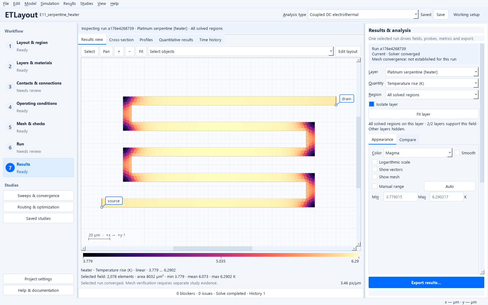
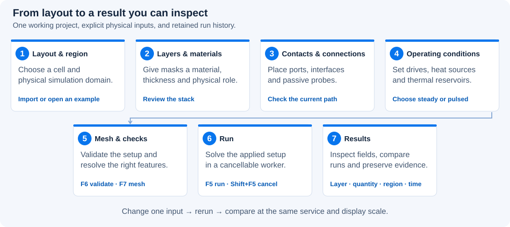
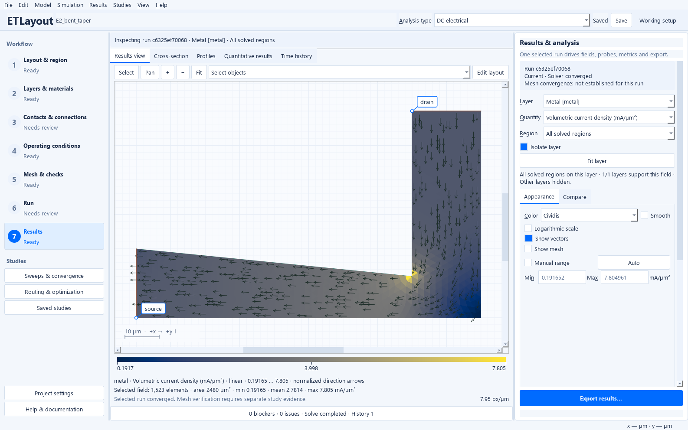
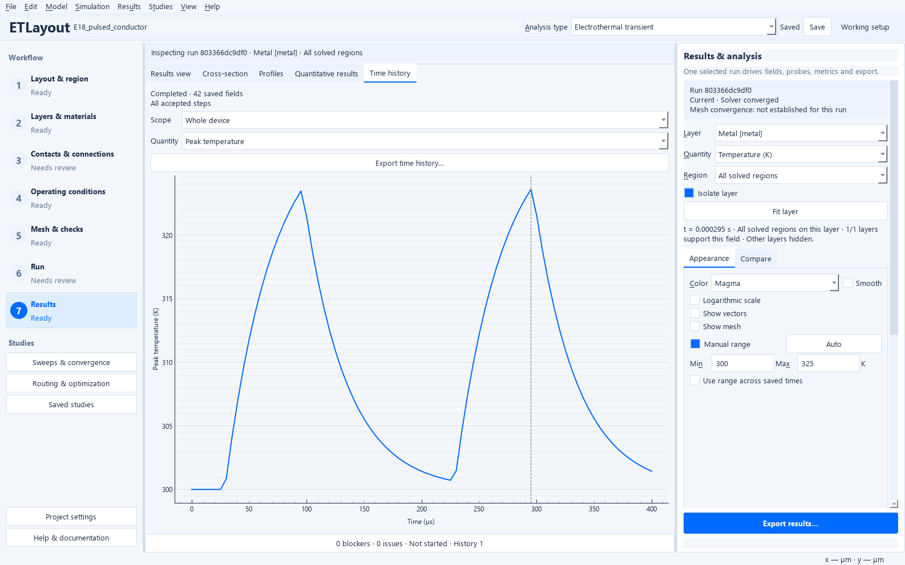

# Electrothermal Layout Studio

[](https://github.com/mmensing/electrothermal-layout-studio/actions/workflows/ci.yml)

**Explore where current flows, where power is lost, and how heat moves through your layout.**

Electrothermal Layout Studio turns a GDSII or OASIS layout into an interactive
experiment. Build a physical layer stack, connect electrical feeds and thermal
reservoirs, and follow the result from individual contacts to the complete device.
Use it to investigate a crowded bend, unequal via loading, heat spreading between
banks, or the temperature rise during a pulse—all in one Windows desktop workspace.

The large layout canvas stays beside a contextual inspector and a numbered
workflow. Start with a ready-to-run example, inspect its assumptions, change one
input, and compare saved runs. You can use the complete desktop workflow without
writing Python or editing JSON.



*E11 in the actual desktop: heater temperature rise above the configured 300 K
backside reservoir, with 20 mA drive and its documented 2 mW prescribed heat load.
This run is solver-converged; mesh verification is separate. The examples are
synthetic engineering demonstrations, not device ratings.*

**[Explore the feature catalog](docs/features.md) · [Choose a guided example](docs/examples.md) · [Follow the desktop guide](docs/desktop-workflow.md)**

## From layout to an engineering question



Choose **Analysis type** in the header, then work through the seven stages. The
**Issues** drawer explains missing prerequisites and offers **Locate** or **Fix**
where available. **Jobs** shows progress and cancellation; **History** keeps runs
attached to the configuration that produced them.

At **Results**, choose the layer, quantity, region and time before interpreting a
map. Change colormaps and ranges to answer a display question, then use physical
averages, conservation and mesh studies to assess the calculation. Display changes
do not change your physical setup.

## What can you investigate?

| Capability | In the desktop | A useful first experiment |
| --- | --- | --- |
| **Layout and stack** | Browse hierarchy; define separate simulation, view and measurement regions; map masks to materials, thicknesses and interfaces. | [Trace heat through a multilayer stack](docs/examples.md#e10). |
| **Safe layout editing** | Drag polygon or hole vertices, enter coordinates, insert/delete points and undo changes in a project-owned copy. | [Edit a layout without overwriting its source](docs/layout-editor.md). |
| **DC and electrothermal analysis** | Run isothermal electrical, steady thermal or coupled calculations with finite contacts, feeds and thermal paths. | [Find current crowding at a bend](docs/examples.md#e2). |
| **Pulses and thermal memory** | Set pulse/PWL drives, initialization and saved-state continuation; inspect time-dependent maps and histories. | [Follow heating and cooldown](docs/examples.md#e17). |
| **Results you can interrogate** | Select layers/regions, probe fields, draw profiles, integrate branch current and synchronize comparison maps. | [Read a map and check its support](docs/handbook/results-and-validation.md). |
| **Power-interconnect analysis** | Inspect device groups, via/port loading, contact loss, source-potential spread and passive multiport exports. | [Explore GaN and SiC feeds](docs/power-examples.md). |
| **Studies and constrained routing** | Run parameter sweeps, mesh/time studies and bounded routing experiments; check equal service and mesh-verified finalists. | [Compare alternatives fairly](docs/POWER_ROUTING.md). |
| **Portable work and reporting** | Choose PNG/PDF/SVG figures or standalone reports, selected CSV/NPZ/VTU data, or a complete ETL experiment with embedded layout and retained runs. | [Save a result you can reopen](docs/handbook/first-calculation.md). |
| **On-demand run history** | Opt in to schema-3 metadata-first opening, inspect exact saved frames in background workers, and manage a bounded array cache while complete saves retain unloaded runs. | [Choose archive and history settings](docs/user-guide.md#on-demand-history-for-schema-3-projects). |

[The full feature catalog](docs/features.md) explains where to find each tool,
what it produces and what its result does—and does not—establish.

<table>
<tr>
<td width="50%"><a href="docs/images/showcase/current-crowding.png"></a></td>
<td width="50%"><a href="docs/images/showcase/pulsed-operation.png"></a></td>
</tr>
<tr>
<td><strong>Follow the electrical path.</strong> E2 shows corner crowding at 0.1 A. Inspect local loading and distinguish sheet current from volumetric current density.</td>
<td><strong>Watch the pulse response.</strong> E18 shows peak temperature during heating and cooldown. Inspect the accepted times and refine the time step before comparing peaks.</td>
</tr>
</table>

Open either image at full size to read its controls and scale. The [example
walkthroughs](docs/examples.md) explain how to reach and interpret these views.

## Your first GUI calculation

After installation, launch the application and choose **File → Ready-to-run
examples → Fundamentals → E1 · Straight conductor**. Its configuration is already complete.

1. Select **DC electrical** in the header. Visit **Layers & Materials** and
   **Contacts & Connections** to see the copper strip and its two terminals.
2. At **Mesh & Checks**, press **F6** to validate, then **F7** to generate the mesh.
   Read the Issues drawer before continuing.
3. Open **Run** and press **F5**. At **Results**, choose layer **metal** and
   **Potential**; expect a linear rise along the strip. Switch to **Volumetric
   current density** to see its uniform loading.
4. Compare the reported resistance with **0.084 Ω**, current with **0.238095 A**,
   and Joule loss with **4.76190 mW** at the configured 20 mV and 300 K.
5. Use **File → Save project as…** to keep your own project and result. Then try
   [a bend, a via ladder or a pulsed heater](docs/examples.md).

The [first-calculation guide](docs/handbook/first-calculation.md) explains the
independent analytical check. For a larger device, the [power-example guide](docs/power-examples.md)
introduces millimeter RDL, long-finger/multi-bank GaN and SiC on-state source
collection. All **40 reference projects** open through the categorized example menu;
opening an example does not automatically start a calculation. Large cases are
labeled before execution. The [extended GUI walkthroughs](docs/extended-examples.md)
add E25–E40: analytical coupons, contacts and networks, thermal experiments,
pulsed constrictions, independently driven GaN banks, SiC active islands and
a package interposer.

## Start from source on Windows

**0.4.0 source edition · research prototype · MPL-2.0 original project source.**
Windows 11 x64 / Python 3.12 is the validated desktop platform. Check the
[Releases page](https://github.com/mmensing/electrothermal-layout-studio/releases)
for publication status. Local Windows candidates require the
[binary compliance checks](docs/licensing.md) before redistribution.
To run from source, install once in a clean environment using PowerShell:

```powershell
git clone https://github.com/mmensing/electrothermal-layout-studio.git
cd electrothermal-layout-studio
py -3.12 -m venv .venv
.\.venv\Scripts\python.exe -m pip install --require-hashes --only-binary=:all: -r requirements-windows-py312.lock
.\.venv\Scripts\python.exe -m pip install --no-build-isolation --no-deps -e .
.\.venv\Scripts\python.exe -m etlayout gui
```

Dependency installation needs Internet access; normal calculations run offline.
The lock includes runtime, development and build tools. See [Windows setup](docs/windows.md)
for troubleshooting and [licensing](docs/licensing.md) before redistribution.
The Python namespace and CLI remain `etlayout`; existing project formats are
preserved. [CLI/Python automation](docs/handbook/automation-and-troubleshooting.md)
is available for repeatable batch work after the GUI introduction.

## Know what the model can tell you

The solver uses thickness-averaged **2.5D finite elements** and explicitly
configured interlayer interfaces. It models resistive electrical conduction,
thermal conduction and thermal storage. Coupled transient operation uses
quasi-static electrical states as temperature evolves.

It does not establish full 3D spreading, drift diffusion, high-field velocity
saturation, breakdown, trapping, electrical capacitance/inductance or switching
overshoot. GaN examples use a local-gate-bias sheet law; SiC examples are
**fixed-on-state interconnect models** with area-specific resistance. Synthetic
materials and examples require calibration before use as process predictions.

Corner peaks can depend on the mesh. **Generated**, **converged** and
**mesh-verified** are different states; compare physical averages, conservation
and delivered service before ranking designs. See [physics](docs/handbook/model-and-physics.md)
and [scientific acceptance](docs/scientific-acceptance.md).

Calculations run in cancellable background processes. **Edit → Execution
settings…** defaults to at most four available logical CPUs, shared by eligible
assembly and study work. Some geometry operations and sparse direct factorization
remain serial; there is no GPU backend. Display units use engineering scales,
including **mA/µm²** for volumetric current density. Stored numerical inputs and raw numerical exports
remain SI.

## Keep exploring

- [Feature catalog](docs/features.md) and [guided desktop workflow](docs/desktop-workflow.md).
- [Use-case gallery](docs/examples.md), [power devices](docs/power-examples.md),
  [pulsed operation](docs/handbook/transient.md) and the [physics handbook](docs/handbook/README.md).
- [Developer guide](docs/developer-guide.md), [validation](docs/validation.md),
  [architecture](docs/architecture.md) and [change history](CHANGELOG.md).
- [Contributing](CONTRIBUTING.md), [security reporting](SECURITY.md) and
  [maintainer procedure](docs/maintainer-guide.md).

Original project material uses the unmodified [MPL-2.0](LICENSE). Third-party
components retain their licenses and exceptions; see [THIRD_PARTY_NOTICES.md](THIRD_PARTY_NOTICES.md)
and [licensing](docs/licensing.md). A combined frozen application is not MPL-only;
public binary publication requires separate corresponding-source and
redistribution clearance.
