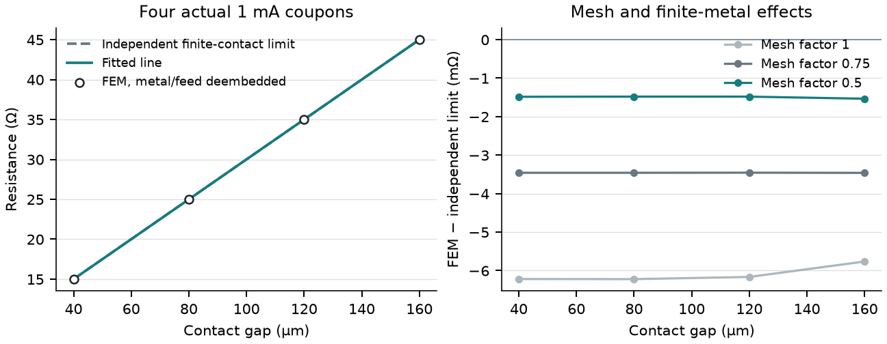

# Extracting finite-contact parameters with E27

E27 is a synthetic, fixed-temperature transfer-length-method (TLM) coupon. Its
reference remains the original 120 micrometre gap, 40 micrometre width and
1 mA drive. The expanded study generates separate editable coupons at 40, 80,
120 and 160 micrometre gaps. Each is an ordinary FEM calculation with actual
finite copper electrodes, distributed finite feeds and a uniform effective
10 ohm/square TaN sheet. No prescribed internal current sharing is substituted.

## GUI use and interpretation

Open E27 from the example browser. The two floating cross-section probes measure
the central film; Results also retains external terminal power, metal loss,
interface loss and finite-feed loss. Use the **Finite-contact TLM study** action
in Studies to choose an empty output directory and run all four coupons in a background
job. Inspect fitted parameters, residuals and individual observations. Reopen a
generated ETL through File > Open to inspect or edit a particular spacing.

The study fits the **two-terminal** resistance after subtracting the actual metal
and external-feed energy contributions divided by delivered current squared.
A configured feed resistance is a distributed footprint parameter: nonuniform
normal current means its actual power can exceed the uniform R times I-squared
lower bound. The extraction therefore uses measured ledger integrals.

The fitted per-contact Rc contains interface resistance **and film spreading
beneath the contact**. Interface-only power divided by current squared is a
different quantity. The Kelvin resistance between the two central probes is
another independent check; its probe spacing changes proportionally with the
contact gap. It is not the resistance used for the TLM fit.

## Independent model and uncertainty

For uniform sheet resistance Rs, width W, contact length Lc and gap d:

- R(d) = Rs d/W + 2 Rc
- Rc = Rs LT/W coth(Lc/LT)
- LT = sqrt(rho_c/Rs)

The fit solves the finite-length coth relation, including short contacts; it does
not silently use the long-contact approximation. This example explicitly assumes
the same sheet resistance beneath and between contacts. Real semiconductor
contacts may violate that assumption and need additional contact-end/process
data. See [Hajlasz, chapter 3, equations 3.10-3.11](https://research.utwente.nl/files/30602652/thesis_M_Hajlasz.pdf)
for the finite-contact model and the distinction between sheet resistances.

The report includes regression residuals, covariance and propagated standard errors
for Rs, Rc, LT and rho_c. These describe numerical residual scatter only. They
exclude spatial discretization bias, finite-metal model differences, process
variation and experimental uncertainty. A tiny fit standard error is not evidence
of physical calibration. This implements linear TLM, not circular TLM (CTLM).

## Measured source verification

Twelve actual fixed-temperature solves cover mesh factors 1, 0.75 and 0.5; every
coupon delivers 1 mA and retains the configured contact/feed model. The finest
extracted values are approximately Rs=10 ohm/square, Rc=2.4993 ohm, LT=9.9971
micrometres and rho_c=9.9942e-10 ohm m2, compared with declared
10 ohm/square, 2.50003 ohm, 10 micrometres and 1e-9 ohm m2.
Both successive fit changes are below 0.13%; the fit passes a 1% mesh-sensitivity
criterion. This does not certify individual raw current peaks.

The [measured CSV](example-science/tlm/tlm-mesh.csv) retains per-point resistance,
losses, actual element counts and phase timings. Total four-coupon study wall
times were 7.76, 12.56 and 25.63 seconds on the shared Windows 11 / CPython 3.12.14
verification host, four requested CPUs and one study worker. Fine-level counts
range from 37,742 to 60,424 triangles. Process high-water memory is cumulative,
not isolated per case. These observations establish neither a speedup nor a
clean-machine/frozen-build result.

An additional factor-0.25 attempt generated 149,828 triangles at the first gap
and exceeded the unchanged 120,000-element budget. The report retains it as
resource-limited and unverified; no smaller geometry or relaxed physics was
substituted. Generated GDS/OASIS masks agree and solved projects reopen with
their physical, connection and measurement identities intact.

## Reproduction

~~~powershell
python scripts/verify_contact_study.py --output .artifacts/tlm --attempt-quarter
python scripts/render_contact_study.py .artifacts/tlm/verification.json --output .artifacts/tlm/figures
python -m pytest tests/test_contact_studies.py
~~~

The standard CLI exposes the same study; individual coupons can be generated
with an explicit TLM spacing. Source tests cover short/long-contact inversion,
negative fits, exact reference identity, actual multi-gap conservation,
deembedding, format equality and solved-project reopening. Large fields and
performance logs belong in generated artifacts, not maintained source.
