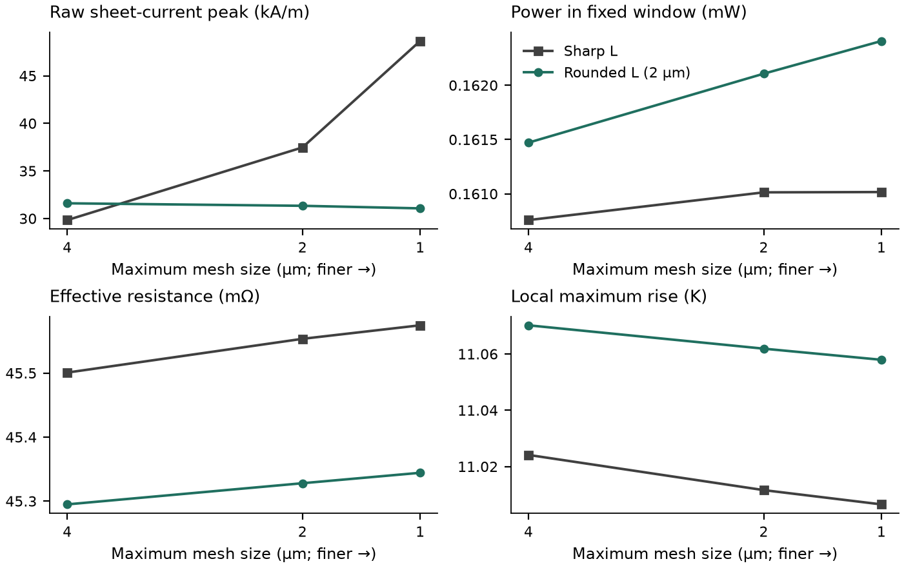
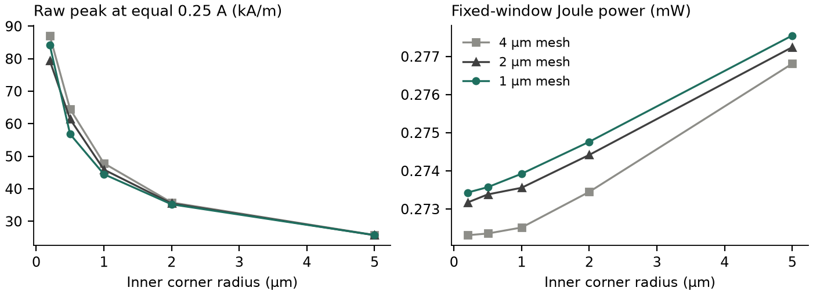

# Current crowding and conservative Joule heating

The electrical model solves div(Gs grad V)=0 on independent layer/component
spaces. Gs is a diagonal anisotropic sheet conductance in siemens. Each P1
triangle has E=-grad V [V/m], K=Gs E [A/m], and q=E dot K [W/m²]. Its power is
q times its exact area. For a homogeneous bulk layer J=K/t [A/m²] and q/t is
volumetric heating [W/m³]. For anisotropic material, heating uses the tensor
contraction, not a scalar resistivity times an unqualified vector magnitude.

A 2DEG has a physical sheet-current interpretation. Dividing by an illustrative
channel thickness does not establish a calibrated bulk current density. New
crowding reports omit bulk J for sheet/HEMT laws; legacy field arrays remain
compatible. Display scaling does not change SI fields or exports.

## What the audit established

The existing field contraction, area integration, component-local potential,
thermal feedback and conservative interface-loss transfer passed the independent
checks without a PDE correction or relaxed solver tolerance. The uniform-strip
reference also verifies electrical anisotropy and exact partial-area heat.
Contact/via/feed losses remain separate from sheet Joule loss in the existing
loss ledger. External feed loss is not automatically internal device heating.

Interface heat defaults to the existing equal split between adjacent sheets.
That is a symmetric unresolved deposition assumption, not a universal statement
about where semiconductor dissipation occurs. It is reasonable for symmetric
adjacent thermal supports and needs a calibrated deposition model for a strongly
asymmetric device stack. Do not add the full interface loss again to both sheets.
Electrical-to-thermal fields are indexed on the same immutable mesh; a different
mesh requires an explicit conservative remapping.

## Peaks and physical support

A sharp 270° reentrant corner admits a Laplace solution proportional to r^(2/3),
so its gradient can grow as r^(-1/3). A finite mesh peak is therefore not a finite
material property. Rounded geometry bounds the ideal continuum field, but a GDS
polygon only supplies facets. The diagnostic reports a locally inferred radius
and keeps physical-radius qualification false until independently established.

`local_crowding` reports raw maximum, area-weighted 95th percentile, fixed-support
mean K, local Joule integral, electric-field maximum, authoritative P1 temperature
maximum/mean, and optional K/reference-K crowding factor. Reference K must be
explicit and positive. Polygon intersections account for partial triangles;
temperature averages integrate the affine field over each clipped part. Point-only
component contacts retain their distinct temperatures and potentials.

The completed run contains `analysis.current_crowding` per electrical layer.
It identifies nearby sharp convex/reentrant corners, inferred circular facets,
terminal edges and interface/layer boundaries. A nearby boundary is a geometric
warning, not proof of a conductivity discontinuity or its cause. A single solve
is always mesh unverified. No display smoothing enters these calculations.

`verify_mesh_sequence` requires at least three converged solutions of the same
physical configuration, decreasing sizes and increasing element counts. Both
final refinement intervals must pass the stated per-metric budgets: 2% current/
Joule power and 5% fixed-area current/power/temperature rise. These are benchmark
criteria, not changed solver tolerances or certified universal limits. Temperature
changes use rise over the named reservoir rather than absolute Kelvin. Sharp
reentrant peaks remain unverified even when an incidental numerical change is small.

## Independent reference calculations

Ten generated cases cover a strip, abrupt neck, sharp/rounded L, dogbone, taper,
slot, finite contact, nonuniform via landing, and runner joining a pad. They use
synthetic constant rho=2e-8 Ω m, metal thickness 2 µm, k=200 W/(m K), a named
300 K reservoir and declared effective backside area resistance 1e-5 m²K/W.
Those choices are a verification problem, not a calibrated package or device rating.

The reference solver is an independently assembled cell-centred five-point
finite-volume resistor network. It does not call ETLayout FEM assembly or Gmsh.
It has a staircase boundary error, measured at 1 and 0.5 µm; this is numerical
verification rather than experimental or analytical validation of all shapes.
Additional exact references cover R=rho L/(Wt), a finite-length TLM contact,
and an annular bend with V proportional to angle, R=angle/(Gs log(ro/ri)) and
|K|=Gs ΔV/(angle r). The annular test checks local fields as well as resistance
and Joule power. It uses its own structured polar mesh.

The TLM limit is R=Rs (L-Lc)/W + sqrt(Rs rho_c) coth(Lc/Lt)/W,
Lt=sqrt(rho_c/Rs), for an ideal equipotential injection metal. The actual lower
sheet and finite interface are solved; a terminal shorts only the declared upper
footprint. This is not a general extraction formula for arbitrary resistive contacts.

The geometric current-crowding discussion is consistent with the conformal-map
analysis in [Clem and Berggren (2011)](https://doi.org/10.1103/PhysRevB.84.174510);
its superconducting critical-current physics is outside this application. The
finite-contact TLM expression is also documented in the independent
[Hajlasz thesis](https://ris.utwente.nl/ws/files/30602652/thesis_M_Hajlasz.pdf).
No experimental calibration is implied.

## Reproduce and inspect

```powershell
python -m pytest tests/test_crowding_physics.py
python scripts/verify_crowding.py --output .artifacts/crowding.json
python scripts/render_crowding.py .artifacts/crowding.json --output .artifacts/crowding
```

Generation performs actual calculations on three Gmsh levels (4, 2, 1 µm).
The separate radius study uses 0.2, 0.5, 1, 2 and 5 µm, identical 0.25 A service,
material and thermal conditions. All raw peaks and failures are retained. A finer
maximum size alone does not establish radius/contact-transfer resolution.



Different L geometries use the same 10 mV boundary drive. Resistance, fixed-window
Joule heat and local temperature rise stabilize while the sharp raw peak grows.
No comparison of these voltage-driven geometries is an equal-service ranking.
The window is x/y=16–26 µm, intersected with the physical conductor.



The radius plot uses a fixed x/y=16–30 µm window and identical delivered current.
A larger radius reduces the local raw peak in this problem; power in this fixed
window also changes with the conducting area. This is not a claim that all
routing metrics improve simultaneously. Very small radii may still require
refinement; consult the per-metric receipt rather than just the plotted curve.

The maintained [mesh CSV](validation/crowding/crowding-mesh.csv) and
[radius CSV](validation/crowding/corner-radius.csv) contain actual measured values.
Detailed fields and logs belong in generated artifacts. Performance columns are
measured Windows source-process wall times on a shared host, four requested CPUs,
with Gmsh and SciPy SuperLU; they do not establish a speedup. Peak working set is
the cumulative process high-water mark, not isolated per-case allocation. Separate
assembly timing was not available in this baseline. Native GUI, frozen-package
and clean-machine verification are distinct checks.

## Measured verification scope (Windows source, 2026-10-19)

The ten finest FEM resistances differ from the independent 0.5 µm Cartesian
references by at most 0.688%; reference-grid error is retained separately.
Across all thirty mesh solves, maximum relative electrical power imbalance was
2.54e-12 and thermal imbalance 7.34e-12. The ten three-level runs took 53.45 s
including requested local postprocessing on a shared Windows 11 host (16 logical
CPUs, four requested simulation CPUs). These timings are not isolated benchmarks.
The 0.2/0.5 µm radius raw peaks still require refinement; 1/2/5 µm raw peaks pass
the stated numerical change budget, with physical qualification remaining false.

Before this change, the representative unchanged numerical command passed
110 tests in 23.10 s; after the change, the identical command passed 110 in 7.89 s.
Its whole-package coverage was 5,102/27,492 statements (18.56%) and
1,635/10,072 branches (16.23%) before, versus 5,176/27,779 (18.63%) and
1,664/10,202 (16.31%) after. These are deliberately partial-suite measurements,
not the historical full-suite 87.01%/76.57%. Cold imports, native caches and shared
host activity preclude a speedup claim. Fourteen additional focused tests passed
in 9.23 s, including the refined annular local-field benchmark. No source module
was excluded and no acceptance or solver tolerance was relaxed.
