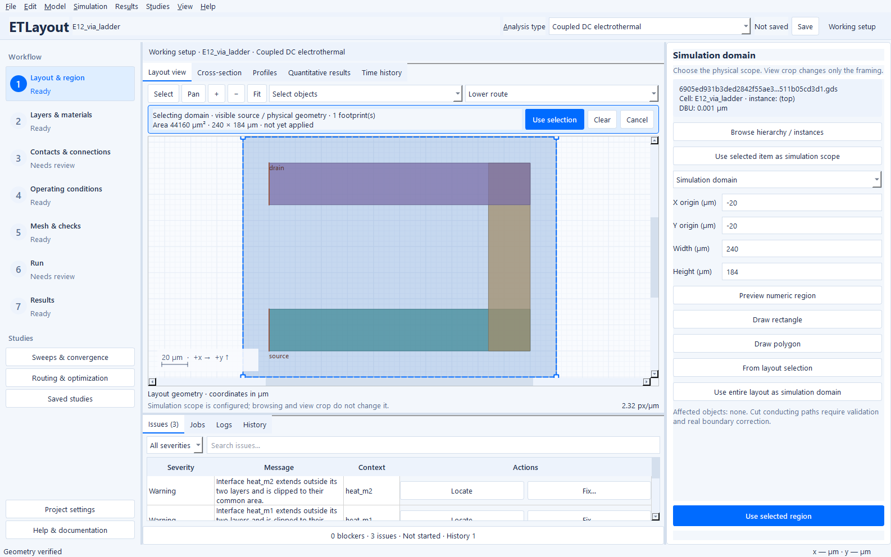
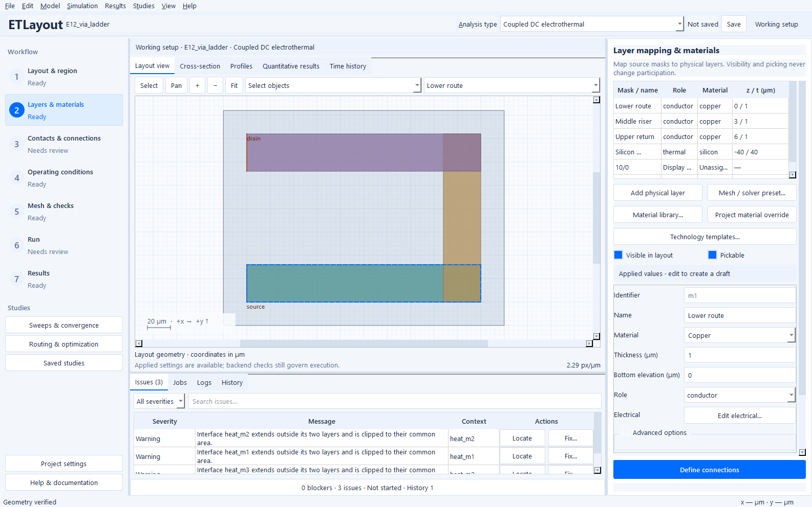
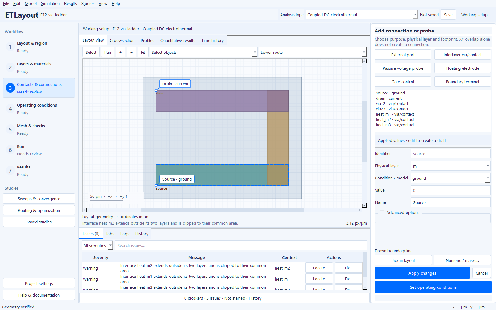
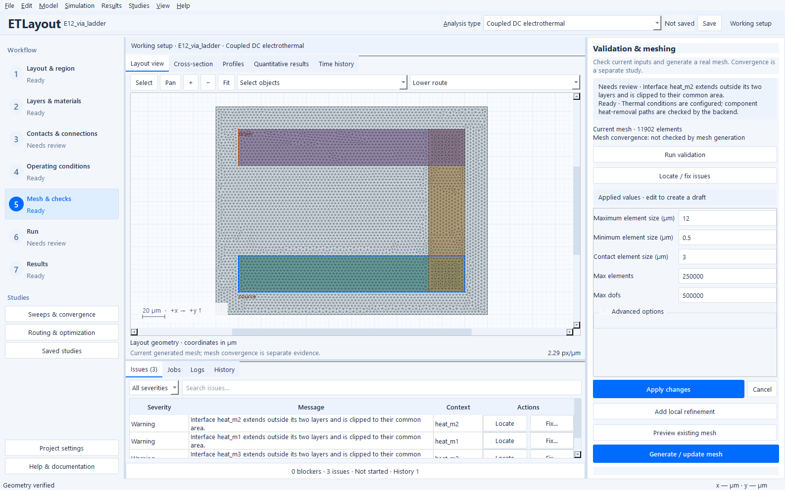
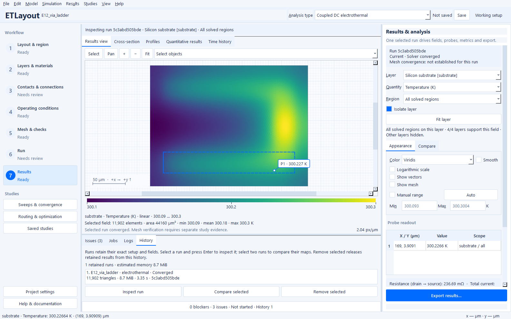
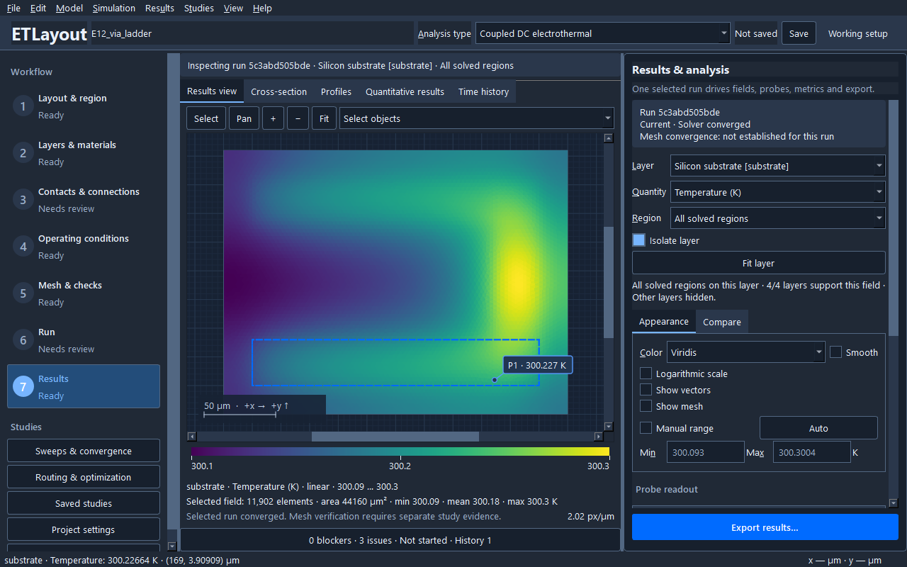

# Guided desktop workflow

This guide describes the **0.4.0.dev0 public source edition**, retaining the
guided Windows desktop and 0.3.1 project compatibility.
Version 0.2.0 uses the older four-part ribbon described in
[its historical quick start](user-guide.md). Launch the extracted
`ElectrothermalLayoutStudio.exe`, or use `python -m etlayout gui` after installing
the locked Windows dependencies. See [validation](validation.md) for current check commands and the
[historical engineering notes](releases/0.3.1.md) for compatibility context.

The project, save state, analysis type and working/historical setup remain visible
above a seven-step navigator. The canvas stays in the center, editing belongs in
the right inspector, and Issues, Jobs, Logs and History share a collapsible drawer.
Use **Ctrl+1–7** to change steps and **Ctrl+J** to toggle the drawer. Splitters let
the canvas and inspector share available space; resizing is preferable to reducing
font size. The light theme uses blue interaction controls; dark mode is
under View.

## Choose analysis first

The header offers DC electrical, steady thermal, coupled DC electrothermal,
thermal transient and coupled electrothermal transient. Switching updates the
applicable prerequisites and preserves dormant ports, thermal boundaries,
waveforms and numerical settings. It does not solve automatically. Electrical
analysis has no electrical-storage transient option. Transient electrothermal
analysis solves quasi-static electrical states with thermal energy storage.

Thermal analysis can optionally include electrical heating without temperature
feedback. Coupled analysis includes feedback. A pure prescribed-heat model needs
no electrical port; DC electrical analysis needs no thermal sink. A steady thermal
model needs a supported heat-removal path. An adiabatic transient can store heat,
unless its chosen steady initialization itself requires a sink.

## Import to a real result

1. **Layout & Region:** import GDSII or OASIS and choose a cell. New imports leave
   masks as display-only until explicitly mapped. Browse hierarchy without
   changing simulation scope; use the explicit scope action when the intended
   cell or instance should become the physical model. A simulation domain changes
   the calculation; a view crop changes only framing. Review the pending selection
   and choose **Use selection** before applying it.
2. **Layers & Materials:** map the required masks to physical sheets; assign
   role, project material, thickness and bottom elevation. Ignore annotation and
   fabrication masks deliberately. A via mask usually describes a contact between
   sheets. Projected overlap of different elevations does not create a contact.
   The cross-section uses the real stack; it is not a 3D field solver.
   **Technology templates…** saves or loads an optional portable physical mapping;
   review its layers, mask assignments and provenance before applying.
3. **Contacts & Connections:** choose the purpose before the landing geometry.
   An external port can own several local footprints. A passive voltage probe
   only samples; a floating electrode enforces an equipotential and may change
   current flow. Interlayer contacts, gate controls and boundary terminals remain
   distinct model objects. Pick a visible layer/instance, check any overlapping
   candidates, and commit the selected footprint explicitly.
4. **Operating Conditions:** edit electrical inputs, physical-port drives,
   thermal boundaries, heat sources and initial/numerical conditions in their
   relevant group. Use supported engineering units. Open Time and load settings
   for transient timing, initialization and waveforms. Gate controls use the
   existing supported HEMT model; RF ports and switching parasitics are not modeled.
5. **Mesh & Checks:** use **F6** for real geometric/connectivity validation and
   **F7** for mesh generation. Issues retain severity, object and location when
   supplied by the backend. **Locate** frames the evidence; **Fix** opens its
   editing destination. Fixes do not acknowledge invalid physics away. Warnings
   need interpretation; only actual blocking requirements prevent Run.
   **Suggest local refinement** opens a review of contact/channel/hotspot sizing,
   resource screens and bounded local studies; see [local refinement](local-refinement.md).
6. **Run:** review analysis, applied setup and CPU budget, then **F5**. A worker
   operates on an immutable input snapshot. **Shift+F5** cancels. Failed or
   cancelled jobs do not replace earlier successful history. CPU preferences are
   under **Edit → Execution settings** and default to four available logical CPUs
   at most; this is a thread/process budget, not guaranteed fourfold acceleration.
7. **Results:** choose the retained run, layer, field, physical support and time.
   Colormaps and manual ranges affect display only. Probe and profile actions use
   the authoritative component-local fields. The selected-result identity is
   distinct from whether the working setup has subsequently changed. Convergence
   is distinct from mesh verification and engineering limits.

The [example gallery](examples.md) gives learning goals and actual calculated
fields. E1 is a metal-only DC starting point; E7/E16 demonstrate supported gates;
E12 demonstrates interlayer routing; E17–E19 cover pulses and thermal delay.

## Selection, drafts and historical results

**Edit layout** above the canvas, **Edit → Edit layout polygon vertices**, or
**Ctrl+Shift+E** opens the [layout vertex editor](layout-editor.md). Select an
original shape and drag exterior/hole handles; Apply creates a verified copy
without overwriting the imported file. This physical edit uses the shared draft
policy and Undo/Redo, and saving embeds the edited layout in the project.

Rectangle, polygon and existing-object selections share a pending session. The
selection banner states the purpose; candidate labels identify masks, physical
layers and instance paths. **Ctrl+click** adds or removes a picked footprint.
Visibility and pickability are view controls. Pan/zoom can be used while selecting;
Escape cancels the pending selection instead of applying geometry.

Common object fields appear in the inspector; advanced fields remain available.
Use **Apply** or **Cancel**. Leaving a dirty editor offers Apply, Discard or Stay.
Edits use the same project document and undo history whether made from the guided
inspector, complete model tables or the embedded power/studies workbench.

Physical edits make affected results out of date, but retained runs remain
inspectable. Historical inspection clearly identifies its source configuration
and disables model editing. **Results → Return to working setup** restores the
editable project. Save retains the project, embedded layout and allowed result
history; reopening does not turn an old run into a solution of a newer setup.

Measurement/support/reporting edits can use **Studies → Routing & optimization →
Analysis → Reanalyze retained fields**. This validates compatibility and computes
a new report from a copy of the retained result without a new field solve. A
report records both the original field configuration hash and current reporting
configuration hash. Per-measurement temperature reference takes precedence over
the current project reference; clearing an override requires an unambiguous
physical reservoir or an explicit new reference. Original solver metrics and
history stay attached to their original configuration.

## Result display units

Maps, probes, profiles, comparison panels and power-analysis tables use fixed
layout-scale conventions. Manual color ranges use the unit printed beside their
inputs; changing layers or time does not change that unit.

| Quantity | Display unit | Conversion from the stored SI value |
| --- | --- | --- |
| Volumetric or contact-normal current density | mA/µm² | A/m² × 10⁻⁹ |
| Sheet current per width | mA/µm | A/m × 10⁻³ |
| Electric field | V/µm | V/m × 10⁻⁶ |
| Applied/Joule/contact heat per area | W/mm² | W/m² × 10⁻⁶ |
| Temperature gradient | K/µm | K/m × 10⁻⁶ |
| Length and area | µm and µm² | m × 10⁶ and m² × 10¹² |
| Dimensionless error fractions | % | fraction × 100 |

For example, **10¹⁰ A/m² = 10 mA/µm² = 10,000 A/mm²**. Sheet current and
volumetric/normal current density remain distinct quantities. Absolute
temperature stays in K, temperature rise in K and thermal resistance in K/W;
these already have readable magnitudes and avoid confusing absolute values with
differences. Scalar voltage, current, power, energy and time summaries retain
engineering prefixes such as mV, mA, mW, µJ and µs where appropriate.

Saved solver fields, configuration inputs, thresholds, CSV/JSON/VTU numerical
exports and API/CLI range arguments remain SI. Figures and human-readable HTML
tables use display units. Figure metadata records both SI and displayed limits.
Older saved manual ranges without a unit are interpreted as SI and converted;
invalid old ranges remain visibly invalid rather than silently changing meaning.

## Studies and exports

Studies are optional for a single calculation. The Studies menu exposes parameter
sweeps, mesh/time convergence, project comparison, routing and optimization, and
saved results. The embedded power workspace works on the same project: configure
baseline, allowed changes, scenarios and goals/limits, preview/check, evaluate,
then compare/verify. Typed controls cover supported recipes and scenarios;
advanced parameter overrides remain available. Generated candidates still pass
the backend protection, connectivity, equal-service and export/reimport checks.
Do not interpret coarse feasibility as a verified improvement.

**Results → Export task** offers map, displayed field/support, original numerical
result, report and selected-run project archive routes. Check the visible run/time/support
before exporting. The selected-run archive contains that run's original physical
configuration and fields. **File → Save project** saves the working setup and its
retained history instead. Original-result export preserves all original layers;
displayed field export records the chosen support and time. Candidate-layout and passive
multiport exports remain in their owning study/analysis task.

## Existing projects and migration

Technology templates use separate `.etltech.json` files. Save current mapping
records physical sheets, their electrical/material models and declared contacts.
It does not copy project terminal drives, heat sources, thermal boundaries or
transient waveforms. Project-specific gate-terminal associations are explicitly
omitted and listed in the preview; review gate/model settings after applying.
Loading presents checkable layers and explicit target-mask choices. Preview shows
the source project/version, template SHA-256, material provenance, added IDs,
omitted dependent contacts and masks untouched by the proposal. Existing objects
remain intact; conflicting layer/contact IDs get new IDs and different material
snapshots get their own project IDs. Apply asks for confirmation and creates one
undoable transaction. The project's notes retain template provenance. A technology
mapping is separate from a mesh/solver preset and does not establish readiness.

This workflow round introduces no new project schema. The existing loader still
accepts schema 1 and 2 archives and writes schema 2 using its established migration
and identity handling. Previously assigned layers, sources, ports, interfaces,
waveforms and stored results remain model data; the safer display-only default
applies to new imports and does not remap an existing project's physical sheets.
The analysis selector uses the existing solver mode and transient-enabled fields.
Viewing a different page, changing visibility or adjusting display range does not
change the physical project. Application theme/workspace and CPU preferences stay
separate from scientific configuration. Use View's workspace reset if older saved
panel placement is unhelpful in the new shell.

Optimization resume caches include the Python source fingerprint. After an
application update, use a new experiment output directory when the existing
identity check rejects an older cache. Stored run archives remain available for
inspection; this update does not rewrite their source configuration or version.

See the [command ownership map](workflow-commands.md), [design guidelines](design-guidelines.md),
[scientific acceptance contracts](scientific-acceptance.md), [physics handbook](handbook/README.md)
and [power-routing guide](POWER_ROUTING.md). Test and build evidence accompanies CI/release artifacts.

## Application views

These are actual native application screenshots. Field values belong to their
depicted runs and are illustrations, not acceptance limits for another project.

