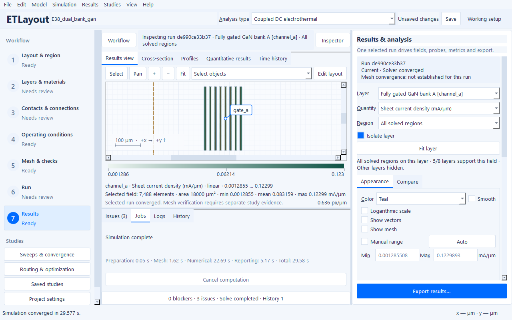
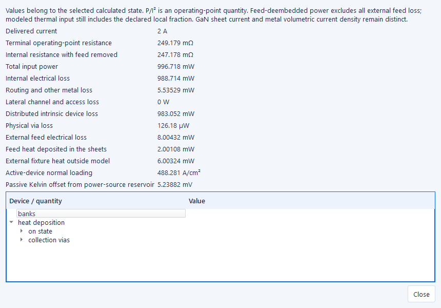

# Device engineering studies in the GUI

These scenarios answer specific contact, current-sharing and fixture questions
with the existing 2.5D models. The [semiconductor learning path](example-paths.md#semiconductor-interconnects)
connects the small coupons to larger families. All forty original references are
retained. No
example establishes a transistor rating, full 3D accuracy or experimental
calibration. The [combined E1–E40 observation index](example-science/device-observations.json)
joins original, thermal and device observations; the [readable tables](example-science/device-observations.md)
show the calculated configurations and sensitivity checks.

## Choose and run a stored experiment

1. Choose **File → Browse example library…** and search E37, E38 or E39.
2. Review **Operating scenario** and choose a case below. E37 recommends
   **Voltage-controlled GaN coupon**; E39 recommends **Lower-current SiC reference
   (2 A)**. **Original reference** remains available, including E39's original
   10 A stress setup. The direct **Ready-to-run examples** shortcuts retain those
   original inputs. For an already opened example, use **File → Choose example
   operating scenario…**. Opening prepares an editable project without running it.
3. Review **Analysis type**, layers, contacts and operating conditions. Validate,
   generate the mesh and run through the numbered workflow.
4. At **Results**, select a layer and physical quantity, then **Fit layer**.
   GaN 2DEG loading is sheet current; its nominal sheet thickness does not
   establish a bulk-metal volumetric current density.
5. Open **Results → Device and fixture observations…** for separate lateral
   channel/access, metal, conventional contact, intrinsic device, via and feed
   losses, local bank quantities and operating-point deembedding.
6. Choose **Studies → Run configured study…** to run a named study using its
   stored values and analysis mode. The ordinary study table/plot retains each
   actual result. Double-click a row to inspect its field map. The project does
   not accumulate duplicate study specifications when rerunning a stored study.

## E37: separate the gate, contact and thermal effects

Select **Voltage-controlled GaN coupon**. A localized finite drain reservoir
sets 0.2 V, the source reservoir is 0 V and the gate is 3 V. Drain current emerges
from the finite contacts and the existing analytical local-gate-bias law. All
source-to-drain paths cross the 1 µm gate; the conducting gate width is 250 µm.

The configured studies address three questions:

| Study | Stored values | Interpretation |
| --- | --- | --- |
| Low-field output | Drain 0.05 / 0.1 / 0.2 / 0.3 V | At fixed 3 V gate, delivered current is 6.244 / 12.471 / 24.859 / 37.139 mA. This is the low-field sheet law, not saturation. |
| Voltage-biased transfer | Gate −2 / −1 / 0 / 1 / 3 V | At fixed 0.2 V drain, current rises from 9.533 to 24.859 mA. These choices avoid the model's deep-off conductance floor. |
| Source-contact sensitivity | 3e-11 / 1e-10 / 3e-10 Ω·m² | Increasing only source contact resistivity reduces current from 25.813 to 23.328 mA; inspect local source potential and contact loss. |

The actual 0.2 V coupled run reaches 300.34474 K. At fixed 300 K electrical
operation it delivers 24.89337 mA, compared with 24.85938 mA when coupled.
This small feedback is appropriate to its small dissipation; no cooling or
mobility was altered to make a dramatic curve. The field-limit measurements
passed at every stored point, under the declared 300 kV/m screening assumption.

The model does not establish high-field saturation, trapping, breakdown,
switching or leakage. A numerical minimum sheet conductance is not predicted
off-state leakage. Mobility, charge coupling and contact parameters remain
synthetic, uncalibrated assumptions.

## E38: let parallel bank currents emerge

The original **0.25 A per bank** experiment stays available unchanged. It asks
how much voltage each prescribed bank current requires.

Select **Parallel GaN banks** to ask a different question. The existing physical
ports explicitly alias one shared 0.25 V external drain node; both banks also
share the source metal/reservoir and thermal substrate. Finite landings and
local sheet/contact conductance determine each branch current. The separate
port records retain their physical branch currents and common-node identity.

At the nominal shared voltage, banks A/B carry **0.243797 / 0.244228 A**. The
small difference follows their finite source routing; it is not numerically
forced away. Each bank has eight 250 µm conducting paths, 2 mm active gate width.
The Devices records retain individual finger current per active width, local
source potential, effective gate bias and temperature.

| Additional choice | What changes | Calculated total current |
| --- | --- | ---: |
| Unequal contact | Bank B source contact resistivity ×5 | 0.462185 A |
| Gate mismatch | Bank B gate 1 V; bank A 3 V | 0.457516 A |
| Asymmetric source feed | Move only the finite source footprint toward bank A | 0.484370 A |

The shared-voltage reference delivers 0.488025 A. These are **unequal-service
responses**, not claims that lower loss means improved routing. The stored
bank-gate, contact and common-backside studies preserve the physical bank
geometry and expose thermal coupling and source-potential imbalance. For an
improvement ranking, first match delivered current and the thermal environment.



## E39: separate a lower-current reference from the stress case

Select **Lower-current SiC reference (2 A)**. The original **10 A stress
reference** remains available. Both use four 320 × 320 µm active macrocells,
0.4096 mm² total active area, finite source collection and a passive Kelvin
location. They are explicitly **SiC MOSFET on-state interconnect models**.

The existing distributed law is `j_z = (V_d − V_s) / Ron,sp(T)`, with
`Ron,sp(300 K) = 1e-7 Ω·m² = 1 mΩ·cm²`. Each cell's uniform reference
resistance is `Ron,sp / A_cell`; the total uniform 300 K device-only reference
is **244.140625 mΩ**. Local current sharing emerges from the coupled sheet/load
solution. The fixed on-state gate assumption is independent of the insulated
gate drawing. Intrinsic channel/drift/contact terms included in Ron,sp are not
added again as a substrate electrical resistor.

At 2 A, active-area loading is **488.28125 A/cm²**, compared with
2441.40625 A/cm² at 10 A. Lower current alone does not establish a continuous
rating. The model has no body diode, avalanche, switching, or predictive
planar/trench distinction.

**SiC: heat in semiconductor (2 A)** deposits all distributed device loss in the
fully supported SiC thermal sheet. It keeps current, active geometry, device law
and thermal boundaries fixed. The original reference's legacy 50/50 source/drain
metal partition remains selectable. Device electrical loss is still integrated
once; heat placement changes the thermal solution and consequently temperature
feedback, rather than inventing a second heat source.

| 2 A configuration | Input | Intrinsic device loss | Peak |
| --- | ---: | ---: | ---: |
| Legacy endpoint split | 0.997126 W | 0.983457 W | 302.72392 K |
| Heat in semiconductor | 0.996718 W | 0.983052 W | 302.58304 K |

The named-semiconductor **10 A stress** reaches 376.709 K with 29.6181 W input;
the original endpoint-partition stress reaches 381.857 K. Neither is a calibrated
rating or verified optimization winner. The chosen 423.15 K engineering limit
is separate from numerical convergence and the declared model ranges. The
[thermal-stack guide](thermal-stacks.md) explains supported deposition geometry.



E23/E24 retain their existing area-normalized distributed loads and current-sharing
benchmarks. Their stripe/tile arrangement is a macrocell homogenization, not a
resolved microscopic MOSFET. [Power-example assumptions](power-examples.md)
state active area, Ron,sp, gate assumption, material seeds and package boundaries.
E9 remains a doped SiC resistor; it is not a MOSFET example.

## E40: remove the external fixture before quoting package resistance

Open the original 5 A interposer and run it. **Results → Device and fixture
observations…** reports both terminal and internal operating-point values:

- Total electrical input: **159.337 mW**, including **50.111 mW** external feed loss.
- Internal interposer loss: **109.226 mW**, including **3.831 mW** physical via loss.
- Terminal `P/I²`: **6.37346 mΩ**; feed-deembedded internal `P_internal/I²`: **4.36904 mΩ**.
- Feed heat deposited locally: **12.528 mW**; the remaining **37.583 mW** stays outside the modeled package.

Subtract the entire feed electrical loss when deembedding. The configured 25%
local thermal fraction still belongs in the heat balance; it does not make that
feed resistance an internal conductor. In a nonlinear/self-heated device,
`P/I²` is an operating-point quantity, not a material constant or differential
resistance. Multiport systems require a stated service definition.

This geometry uses **20 µm thick copper on a 1.8 × 1.6 mm alumina interposer**:
power-package assumptions, not thin microelectronics BEOL. At fixed 300 K,
independent 2.5/5 A calculations preserve resistance and quadruple Joule power.
That linear scaling is not imposed on nonlinear GaN or self-heated cases.

## Extract contacts with E27

Open E27 and choose **Studies → Finite-contact TLM study (E27)…**. Select a parent
folder; a new empty child folder receives four real coupons, solved projects
and the fit. The working project/result stays intact while the background job
runs. The fit dialog shows Rs, Rc, rho_c and LT, together with residuals,
covariance, individual observations and the independent finite-contact
reference. This is linear TLM, not CTLM. See the [contact extraction guide](contact-extraction.md)
for the finite-length coth correction, retained resource-limited attempt and
actual three-mesh measurements.

## What was verified

Nine exact coupled configurations passed conservation and their declared model
ranges, exported/reimported GDSII/OASIS and schema-2/schema-3 solved-project
reopening. Four representative cases have three spatial levels; final-two
current/power differences are below 0.08%, and regularized hotspot-rise changes
below 0.13%. Every configured device sweep was actually run through the ordinary
study engine. These are selected-metric sensitivity observations, independent of
raw singular maxima and physical calibration.

The [machine-readable index](example-science/device-observations.json) retains
loss components, support/averaging definitions, source/configuration hashes,
field ranges, bank metrics and measured phase times. Bulky fields and raw logs
remain generated artifacts. Native Windows source GUI scenarios, background
jobs and readable result/fit dialogs were exercised; no new frozen-package or
clean-machine test is claimed.

Reproduce without editing Python or project JSON:

```text
etlayout examples examples-local --name E38 --scenario parallel_voltage
etlayout contact-study artifacts/tlm --cpu-threads 4 --study-workers 1
etlayout examples examples-local --name E27 --tlm-spacing-um 80
```

Maintainer opt-in validation stores bulky results outside tracked source:

```text
python scripts/verify_device_examples.py --output artifacts/device-nominals
python scripts/verify_device_examples.py --cases E37:voltage_controlled E38:parallel_voltage E39:semiconductor_heat E40:reference --mesh-factors 1 .8 .65 --output artifacts/device-mesh
python scripts/verify_device_studies.py --output artifacts/device-studies
```
