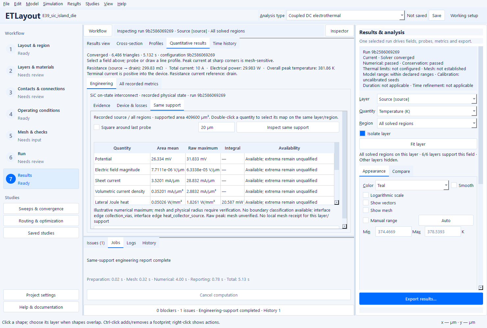
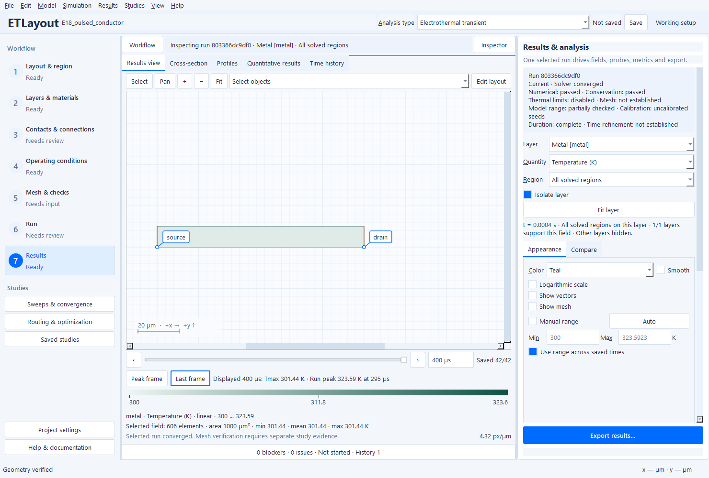

# Interpret a result before accepting a design

Open **Results → Metrics & loss budget** (also available in the Results inspector).
The **Engineering** tab groups evidence, device losses and a linked physical-support
readout. **All recorded metrics** retains the original scalar and terminal tables.
The result's original configuration and fields remain the numerical source.

Actual native Windows source application inspecting the 10 A E39 explicit-gap
thermal-stack calculation. This single mesh is explicitly unverified.

## Read the evidence axes

A converged PDE solution can exceed a temperature limit, lie outside a material
range or have an unresolved hotspot. The evidence table keeps these questions
separate:

| Evidence | Meaning |
| --- | --- |
| Numerical solve | Recorded convergence for the displayed physical state |
| Conservation | Current, electrical-power and thermal residuals against the recorded solver tolerances |
| Temperature limits | Existing hard-limit compliance over accepted states; a failed run remains inspectable |
| Material/model range | Authoritative displayed temperatures against checked layer thermal-k/bulk-ρ/sheet-Rs ranges; omitted laws explicitly not established |
| Mesh confidence | A recorded local refinement receipt, scoped to its selected metrics; otherwise not established |
| Time confidence | Recorded time-refinement changes; an individual time step does not establish accuracy |
| Requested duration | Complete, stopped early or unavailable; separate from numerical convergence |
| Calibration | Reference/synthetic material seeds and the need to calibrate material/interface/backside data |

Ambiguous legacy point-touch temperatures cannot establish a property-range pass.
The axis is partially checked when transient heat-capacity, semiconductor transport
or used via/gap/through-plane law envelopes remain unestablished; checked laws and
omissions are listed separately.

A property-range check does not validate HEMT high-field transport, fabricated
corner radius, breakdown, switching or full 3D heat spreading. User-supplied data
does not establish calibration. Reducing a solver tolerance does not supply any
of those missing physical checks. The Results inspector repeats the independent
states while viewing a map. Failure/range/early-stop concerns remain visible above
the detailed tables.

## Follow one hotspot through its electrical and thermal causes

1. Choose the physical **Layer** and a **Region**, such as a connected island,
   contact or via footprint. Inspect the original physical result; a difference
   map is not a separate solved state.
2. Use **Place result probe** on a corner, bend or contact. Open **Engineering →
   Same support** and enable **Square around last probe**. Enter a physical side,
   for example `20 µm`; plain numbers in this control mean micrometres.
3. Select **Inspect same support**. Preparation and integration run in the normal
   cancellable background process. The shown area is the square intersected with
   the selected solved layer/region, including holes and partial elements.
4. Read area means, raw maxima and local power integrals for potential, electric
   field, sheet current, volumetric metal current where physically defined,
   lateral Joule heat, allocated interface heat, total applied layer heat,
   absolute temperature and rise above the named recorded reservoir.
5. Double-click a quantity to select its original map on the same layer/region.
   The physical support is outlined; the surrounding map remains visible for
   context. The table integrates only the outlined support. **Locate
   selected-support peak** marks its numerical current maximum.

Without the square option, the complete selected layer/region is used. Changing
a run or displayed time invalidates the linked report, including a new run with
identical settings. A probe from another run/frame must be placed again.
Historical inspection remains read-only; returning to the working setup restores
its original configuration. Pending drafts still require Apply, Discard or Stay.
These readouts do not change physical configuration, mesh or result identity.
A report completed after its displayed frame was superseded is rejected.

Sheet current K is a thickness-integrated current in A/m; bulk-metal J is in A/m².
Automatic color ranges suppress ULP-only roundoff spans without changing raw
fields/statistics or manual limits; meaningful small variations remain visible.
The GUI uses the existing human-scaled units (mA/µm and mA/µm²). A bulk K readout
is reporting-only and does not replace volumetric metal stress criteria. Bulk-semiconductor readouts use the declared physical thickness and remain
reporting-only; they do not introduce a semiconductor stress model. A 2DEG
has no invented bulk thickness. Unavailable fields/references are explained rather
than displayed as zero. Interface **generated** loss and its **allocated** sheet
heat are distinct; selecting an interface region also exposes its generated
power integral before deposition.

The peak diagnosis lists nearby reentrant/convex/faceted boundaries and
terminal/interface edges when recorded geometry is available. Faceted-radius
estimates are explicitly uncalibrated. A raw maximum remains illustrative.
A local mesh receipt applies to this readout only when layer and physical support
match; each metric retains its own convergence state and no receipt establishes
physical qualification. A different probe square does not inherit that status.
Select **Local mesh evidence…** in the Evidence tab to open the existing
refinement-confidence dialog with its actual levels, sizes and per-metric states.

## Use the device and loss dashboard

The heading identifies the configured model family. The dashboard reuses device
groups, contact-island loading and the disjoint loss ledger: GaN current per
active width and local gate/source conditions; SiC current per active area and
intrinsic-load versus collection losses; metal crowding and heat; contact
transfer-length estimates from the existing guidance calculation; and individual
via loading in multilayer packages. External-feed losses stay separate from
internal thermal deposition/excluded loss. Device groups can overlap and must
not be added again to the disjoint power total. Transfer length is an estimate
from the recorded constitutive state, not a 3D contact simulation.

## Distinguish a cooled frame from the run peak

The time navigation shows displayed time/Tmax separately from the accepted-run
maximum and its time. **Peak frame** opens the retained peak spatial snapshot;
**Last frame** returns to the last accepted saved state. If the peak spatial
field was not retained, the button says **Nearest to peak** and the summary
states that limitation. No field or intermediate time is manufactured.

For resumed calculations the peak is labeled for the resumed segment. A run
stopped at a hard limit retains accepted fields and labels its requested duration
as incomplete even when the last PDE solution converged. Use time-step and mesh
studies before interpreting a pulse peak as resolved. On-demand archives keep
metadata and the currently loaded frame distinct until the requested frame loads.

Actual nominal E18 calculation: 323.59 K at 295 µs, versus 301.44 K at the
400 µs final frame. Both maps use the same across-time color range. These are
source-app captures, not packaged-build or clean-machine validation.

On compact windows, tables scroll and the Same support page scrolls vertically;
use the existing Workflow/Inspector and drawer toggles to recover map space.
The new controls support keyboard focus, Enter for time/physical input and normal
button activation. Units and numerical source arrays are unchanged by inspection.
