# Explore the examples

See current crowd around a bend, follow heat into a substrate, or watch a device cool between pulses. The library contains 40 runnable reference examples. Each project supplies configured geometry, materials, connections and operating conditions. These walkthroughs use the desktop controls.

## Open your first example

1. In **File → Ready-to-run examples**, open the appropriate group and choose an example by its stable ID below. Opening prepares the project; it does not start a simulation.
2. Use **Save project as…** to keep your own project. Review the visible **Analysis type**; the gallery's analysis column states the mode used for its recorded picture.
3. Follow **Layout & region → Layers & materials → Contacts & connections → Operating conditions**. The example already supplies these inputs; inspect them before changing anything.
4. In **Mesh & checks**, select **Run validation**, inspect the Issues drawer, then **Generate / update mesh**. **Run → Run analysis** starts the background calculation. F6, F7 and F5 provide the corresponding shortcuts.
5. In **Results**, select **Layer** and **Quantity**, then **Fit layer**. Use **Appearance** for colors and range, **Metrics & loss budget** for numbers, and **History** for earlier runs.
6. Try the follow-up question for your example. **Sweeps & convergence** opens parameter, mesh and time-step studies; **Compare saved runs…** helps inspect alternatives.

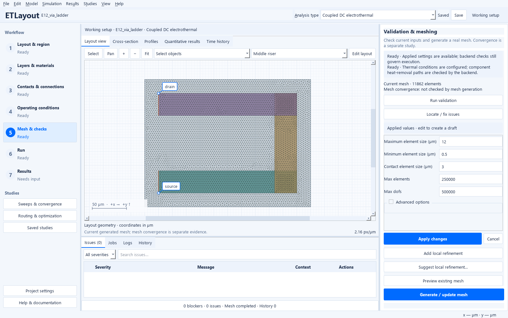

*A real E12 workflow view. The large canvas, contextual inspector and Issues/Jobs/History drawer stay together while you move through the numbered stages.*

## Choose a question

| What do you want to understand? | Start here | Then explore |
| --- | --- | --- |
| How do geometry and current paths set resistance? | [E1: straight strip](#e1) | [E2: bend and taper](#e2), [E3: parallel paths](#e3) |
| Where do multilayer routes become bottlenecks? | [E4: two metals](#e4) | [E5: via array](#e5), [E12: via ladder](#e12), [E13: perforated spreader](#e13) |
| What does the voltage probe actually measure? | [E6: Kelvin sensing](#e6) | [E14: resistive bridge](#e14) |
| How does a gate change the conducting channel? | [E7: illustrative HEMT](#e7) | [E8: routing resistance](#e8), [E16: fully gated stripes](#e16) |
| How far does heat spread? | [E10: layered thermal path](#e10) | [E11: meander heater](#e11), [E15: thermal crosstalk](#e15) |
| What happens between pulses? | [E17: heating and cooling](#e17) | [E18: pulsed conductor](#e18), [E19: delayed receiver heating](#e19) |
| How do larger power structures share current? | [E20–E24: power guide](power-examples.md) | [GaN fingers and banks](power-examples.md#e21), [SiC source collection](power-examples.md#e24) |
| What should I explore after the foundations? | [E25–E40: extended walkthroughs](extended-examples.md) | [Contact coupons](extended-examples.md#e27), [thermal paths](extended-examples.md#e35), [device sharing](extended-examples.md#e39) |

## Choose an operating scenario

After opening a reference, use **File → Choose example operating scenario…**.
Keep **Original reference** for its recorded analytical/nominal calculation;
choose a named Joule-only, thermal, pulse/limit or device study to explore a
specific physical change. Scenario selection does not start a run or rewrite the
original example. Review the new current/voltage, heat sources, reservoir and
limits in **Operating conditions** before validation and meshing.

Follow [thermal demonstrations](thermal-example-scenarios.md) for heating and
cooldown, [device engineering](device-engineering-examples.md) for GaN/SiC/package
questions, and [contact extraction](contact-extraction.md) for E27 TLM. Use
[the scientific audit](example-science.md) to distinguish a converged calculation
from selected mesh/time evidence, material validity and physical calibration.

## All examples

| Example | Focus | Level | Gallery analysis |
| --- | --- | --- | --- |
| [E1 · Straight conductor](#e1) | Fundamentals | Starter | DC electrical |
| [E2 · Bent and tapered conductor](#e2) | Fundamentals | Starter | DC electrical |
| [E3 · Unequal parallel routes](#e3) | Fundamentals | Starter | DC electrical |
| [E4 · Two-metal transfer](#e4) | Interconnects | Intermediate | DC electrical |
| [E5 · Hierarchical via array](#e5) | Interconnects | Intermediate | DC electrical |
| [E6 · Kelvin sheet and contact test](#e6) | Measurements | Intermediate | DC electrical |
| [E7 · Interdigitated HEMT](#e7) | Devices | Intermediate | DC electrical |
| [E8 · HEMT with resistive routing](#e8) | Devices | Intermediate | DC electrical |
| [E9 · Conducting SiC sheet](#e9) | Devices | Intermediate | DC electrical |
| [E10 · Metal–oxide–silicon stack](#e10) | Thermal | Intermediate | Coupled DC electrothermal |
| [E11 · Serpentine thin-film heater](#e11) | Thermal | Advanced | Coupled DC electrothermal |
| [E12 · Three-level via ladder](#e12) | Interconnects | Advanced | Coupled DC electrothermal |
| [E13 · Perforated current spreader](#e13) | Interconnects | Advanced | Coupled DC electrothermal |
| [E14 · Four-arm resistive bridge](#e14) | Measurements | Advanced | Coupled DC electrothermal |
| [E15 · Dual-heater thermal crosstalk](#e15) | Thermal | Advanced | Coupled DC electrothermal |
| [E16 · Full-width gated HEMT array](#e16) | Devices | Advanced | Coupled DC electrothermal |
| [E17 · Pulsed heating and cooling](#e17) | Transient | Starter | Thermal transient |
| [E18 · Pulsed electrothermal conductor](#e18) | Transient | Intermediate | Electrothermal transient |
| [E19 · Multilayer pulse and thermal crosstalk](#e19) | Transient | Advanced | Thermal transient |
| [E20 · High-current multilayer RDL](power-examples.md#e20) | Power benchmarks | Engineering | Coupled DC electrothermal |
| [E21 · Long-finger GaN HEMT array](power-examples.md#e21) | Power benchmarks | Engineering | Coupled DC electrothermal |
| [E22 · Multi-bank GaN power die](power-examples.md#e22) | Power benchmarks | Engineering | Coupled DC electrothermal |
| [E23 · SiC MOSFET on-state interconnect · stripes](power-examples.md#e23) | Power benchmarks | Engineering | Coupled DC electrothermal |
| [E24 · SiC MOSFET on-state interconnect · macrocells](power-examples.md#e24) | Power benchmarks | Engineering | Coupled DC electrothermal |
| [E25 · Stepped-width series reference](extended-examples.md#e25) | Analytical coupons | Starter | See configured walkthrough |
| [E26 · Dog-bone current-crowding coupon](extended-examples.md#e26) | Analytical coupons | Intermediate | See configured walkthrough |
| [E27 · Finite-contact transfer-length coupon](extended-examples.md#e27) | Contacts and measurements | Intermediate | See configured walkthrough |
| [E28 · Three-terminal T-junction splitter](extended-examples.md#e28) | Routed networks | Starter | See configured walkthrough |
| [E29 · Annular current-spreading bus](extended-examples.md#e29) | Routed networks | Intermediate | See configured walkthrough |
| [E30 · Multilevel via daisy chain](extended-examples.md#e30) | Routed networks | Advanced | See configured walkthrough |
| [E31 · Tapped resistive ladder](extended-examples.md#e31) | Contacts and measurements | Starter | See configured walkthrough |
| [E32 · Parallel resistor array with resistive buses](extended-examples.md#e32) | Routed networks | Advanced | See configured walkthrough |
| [E33 · Thermal bridge heater](extended-examples.md#e33) | Thermal experiments | Intermediate | See configured walkthrough |
| [E34 · Interleaved heater and sensor](extended-examples.md#e34) | Thermal experiments | Advanced | See configured walkthrough |
| [E35 · Localized backside die attachment](extended-examples.md#e35) | Thermal experiments | Advanced | See configured walkthrough |
| [E36 · Pulsed constriction and cooling](extended-examples.md#e36) | Pulsed operation | Advanced | See configured walkthrough |
| [E37 · Fully gated HEMT contact coupon](extended-examples.md#e37) | Device studies | Intermediate | See configured walkthrough |
| [E38 · Independently driven GaN banks](extended-examples.md#e38) | Device studies | Advanced | See configured walkthrough |
| [E39 · SiC on-state die with active islands](extended-examples.md#e39) | Device studies | Engineering | See configured walkthrough |
| [E40 · Three-level package interposer](extended-examples.md#e40) | Package interconnects | Engineering | See configured walkthrough |

## Read the pictures, then run your own project

Each scientific preview pairs actual prepared geometry with a recorded computed field. All devices are synthetic teaching configurations; deterministic calculations do not supply experimental uncertainty or process calibration. A converged solve still needs a mesh study before comparing sensitive peaks. Field scales and panel extents differ between pictures.

The recorded preview details below retain their original operating points, diagnostics and numerical provenance. Some were calculated with earlier solver versions; the manifest records those identities. They are illustrations, not fresh validation of a newly opened project. Current application screenshots are labeled separately.

ETL projects retain the physical setup and saved sweeps. GDSII/OASIS downloads contain geometry only. SVG previews retain vector geometry, axes and text; only the finite-element field is rasterized at twice the intended display resolution.

<a id="e1"></a>
## E1 · Straight conductor

**Starter · Fundamentals.** Compare the solved resistance with the uniform-strip analytical limit.

[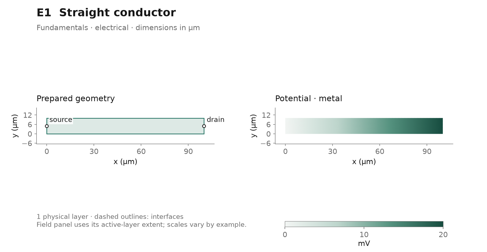](example-gallery/E1_straight.svg)

**In the GUI:** choose **DC electrical**, then in Results select layer `metal` and **Potential (V)**. Open Metrics & loss budget and compare the resistance with the uniform-strip value in the reference details.

**Look for:** A smooth voltage drop along the straight strip; the fixed-temperature resistance follows its length, width and thickness.

**Try next:** Use Parameter sweep… to vary the drain voltage in DC electrical mode. Does the resistance stay constant while Joule power rises?

[Project (.etl)](../examples/E1_straight.etl) · [GDSII](../examples/E1_straight.gds) · [OASIS](../examples/E1_straight.oas) · [Vector preview](example-gallery/E1_straight.svg)

<details>
<summary>Recorded inputs, model limits and numerical details</summary>

**Recorded operating point:** source 0 V (ground); drain 0.02 V (voltage). Preview mode: **electrical**.

**Physical layers:** `metal` (copper, 2 µm).

**Saved sweep:** `terminals.drain.value` = `[0.01, 0.02, 0.04]` (SI values, electrothermal)

The saved sweep is a separate experiment; review the selected parameter, values and analysis in **Parameter sweep…** before starting it.

**Physical scope:** Uniform thickness copper sheet; the analytical comparison applies at fixed 300 K. Analytical R = rho L/(w t) = 0.084 ohm at 300 K; L=100 µm, w=10 µm, t=2 µm.

**Recorded computed preview:** 0.084 Ω effective resistance; 0.004762 W electrical power. 360 nodes / 608 triangles; converged. [Full metrics and hashes](example-gallery/manifest.json).

Optional command-line run of the current project:

```powershell
.\.venv\Scripts\python.exe -m etlayout solve examples/E1_straight.etl --mode electrical --output results/E1
```

</details>

<a id="e2"></a>
## E2 · Bent and tapered conductor

**Starter · Fundamentals.** See how a taper and a reentrant corner redistribute current.

[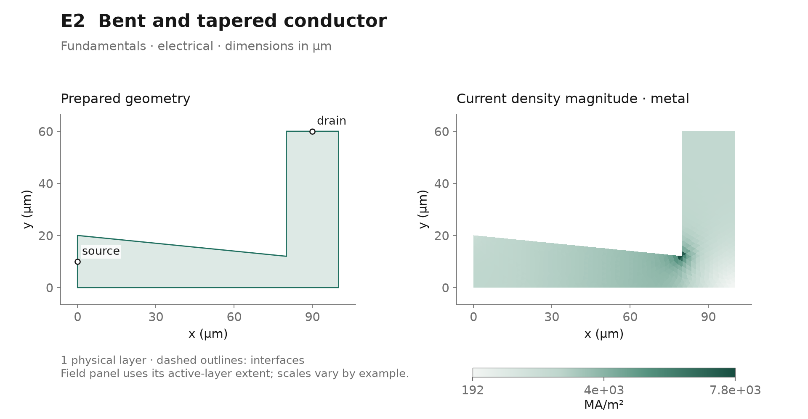](example-gallery/E2_bent_taper.svg)

**In the GUI:** choose **DC electrical**, then in Results select layer `metal` and **Volumetric current density (mA/µm²)**. Zoom into the inside bend, then enable Show vectors in Appearance to follow current around it.

**Look for:** Current bunches at the reentrant corner and redistributes through the taper.

**Try next:** Save a copy and use Edit layout to widen the neck. Does an averaged loading measure improve when the mesh is refined?

[Project (.etl)](../examples/E2_bent_taper.etl) · [GDSII](../examples/E2_bent_taper.gds) · [OASIS](../examples/E2_bent_taper.oas) · [Vector preview](example-gallery/E2_bent_taper.svg)

<details>
<summary>Recorded inputs, model limits and numerical details</summary>

**Recorded operating point:** source 0 V (ground); drain 0.1 A (current). Preview mode: **electrical**.

**Physical layers:** `metal` (copper, 2 µm).

**Saved sweep:** `terminals.drain.value` = `[0.01, 0.02, 0.04]` (SI values, electrothermal)

The saved sweep is a separate experiment; review the selected parameter, values and analysis in **Parameter sweep…** before starting it.

**Physical scope:** Ideal sharp corners have mesh-sensitive peak current density; refine before comparing peaks. Bent, tapered conductor; current crowding near the reentrant corner is mesh-sensitive.

**Recorded computed preview:** 0.06804 Ω effective resistance; 0.0006804 W electrical power. 845 nodes / 1,523 triangles; converged. [Full metrics and hashes](example-gallery/manifest.json).

**Recorded diagnostics:** Thermal boundary sink_metal extends outside its layer and is clipped.

Review current Issues after validation; a recorded warning is not permission to ignore a current blocker.

Optional command-line run of the current project:

```powershell
.\.venv\Scripts\python.exe -m etlayout solve examples/E2_bent_taper.etl --mode electrical --output results/E2
```

</details>

<a id="e3"></a>
## E3 · Unequal parallel routes

**Starter · Fundamentals.** Compare current sharing through unequal-width branches and common access buses.

[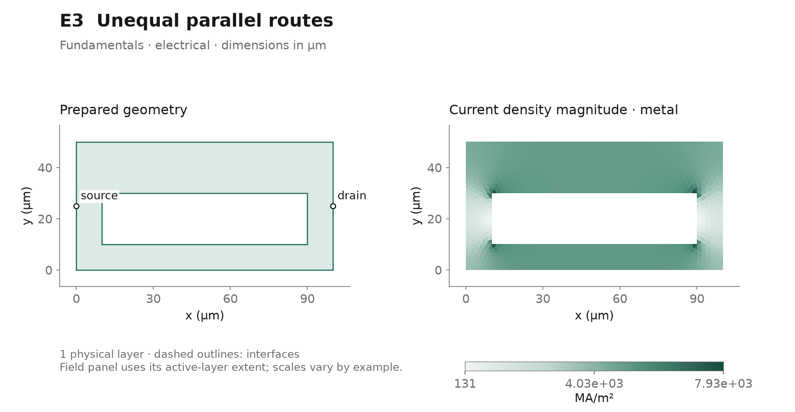](example-gallery/E3_parallel.svg)

**In the GUI:** choose **DC electrical**, then in Results select layer `metal` and **Volumetric current density (mA/µm²)**. Compare both branch widths and their common access buses before inspecting the current map.

**Look for:** The wider route carries more current, but shared access resistance also affects the division.

**Try next:** Change one branch in a project-owned layout copy. How much does current sharing change without changing total delivered current?

[Project (.etl)](../examples/E3_parallel.etl) · [GDSII](../examples/E3_parallel.gds) · [OASIS](../examples/E3_parallel.oas) · [Vector preview](example-gallery/E3_parallel.svg)

<details>
<summary>Recorded inputs, model limits and numerical details</summary>

**Recorded operating point:** source 0 V (ground); drain 0.3 A (current). Preview mode: **electrical**.

**Physical layers:** `metal` (copper, 2 µm).

**Saved sweep:** `terminals.drain.value` = `[0.01, 0.02, 0.04]` (SI values, electrothermal)

The saved sweep is a separate experiment; review the selected parameter, values and analysis in **Parameter sweep…** before starting it.

**Physical scope:** Distributed access resistance is included, so branch sharing is not a simple width-only ratio. Two parallel routes with 10 and 20 µm widths, including distributed access resistance.

**Recorded computed preview:** 0.02689 Ω effective resistance; 0.00242 W electrical power. 1,152 nodes / 2,054 triangles; converged. [Full metrics and hashes](example-gallery/manifest.json).

**Recorded diagnostics:** Thermal boundary sink_metal extends outside its layer and is clipped.

Review current Issues after validation; a recorded warning is not permission to ignore a current blocker.

Optional command-line run of the current project:

```powershell
.\.venv\Scripts\python.exe -m etlayout solve examples/E3_parallel.etl --mode electrical --output results/E3
```

</details>

<a id="e4"></a>
## E4 · Two-metal transfer

**Intermediate · Interconnects.** Follow lateral transport through a nonrectangular second layer and a finite via.

[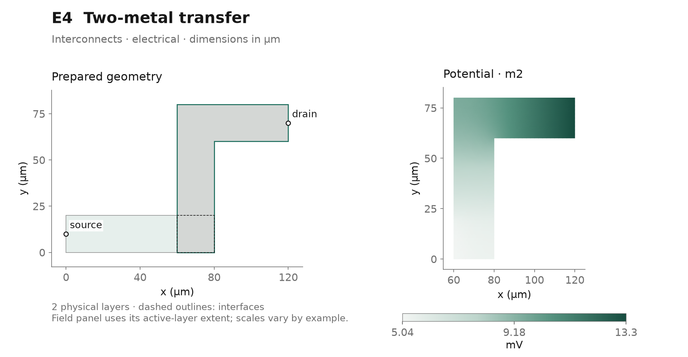](example-gallery/E4_multilayer.svg)

**In the GUI:** choose **DC electrical**, then in Results select layer `m2` and **Potential (V)**. Switch Layer between m1 and m2; use Fit layer after each switch to follow the finite interlayer transfer.

**Look for:** Each sheet has its own potential distribution, joined through the declared via footprint.

**Try next:** Change contact refinement in Mesh & checks. Which voltage drops remain stable as that region is resolved?

[Project (.etl)](../examples/E4_multilayer.etl) · [GDSII](../examples/E4_multilayer.gds) · [OASIS](../examples/E4_multilayer.oas) · [Vector preview](example-gallery/E4_multilayer.svg)

<details>
<summary>Recorded inputs, model limits and numerical details</summary>

**Recorded operating point:** source 0 V (ground); drain 0.2 A (current). Preview mode: **electrical**.

**Physical layers:** `m1` (copper, 2 µm); `m2` (copper, 2 µm).

**Saved sweep:** `terminals.drain.value` = `[0.01, 0.02, 0.04]` (SI values, electrothermal)

The saved sweep is a separate experiment; review the selected parameter, values and analysis in **Parameter sweep…** before starting it.

**Physical scope:** Separate sheet potentials couple through a finite copper via; this is a 2.5D representation. Nonrectangular two-metal structure, finite copper via and separate layer potentials.

**Recorded computed preview:** 0.06658 Ω effective resistance; 0.002663 W electrical power. 910 nodes / 1,643 triangles; converged. [Full metrics and hashes](example-gallery/manifest.json).

**Recorded diagnostics:** Thermal boundary sink_m1 extends outside its layer and is clipped. Thermal boundary sink_m2 extends outside its layer and is clipped.

Review current Issues after validation; a recorded warning is not permission to ignore a current blocker.

Optional command-line run of the current project:

```powershell
.\.venv\Scripts\python.exe -m etlayout solve examples/E4_multilayer.etl --mode electrical --output results/E4
```

</details>

<a id="e5"></a>
## E5 · Hierarchical via array

**Intermediate · Interconnects.** Inspect repeated layout instances and unequal transfer through a 4 × 5 via array.

[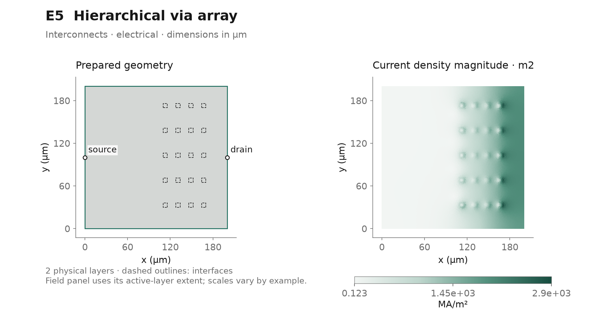](example-gallery/E5_via_array.svg)

**In the GUI:** choose **DC electrical**, then in Results select layer `m2` and **Volumetric current density (mA/µm²)**. Zoom into the repeated via footprints and compare the two sheet layers at the same operating point.

**Look for:** Transfer is distributed across the array; distance from the feed can make individual vias load unequally.

**Try next:** Would moving the physical feed change loading more than adding another row of vias? Keep planar metal density distinct from normal via current density.

[Project (.etl)](../examples/E5_via_array.etl) · [GDSII](../examples/E5_via_array.gds) · [OASIS](../examples/E5_via_array.oas) · [Vector preview](example-gallery/E5_via_array.svg)

<details>
<summary>Recorded inputs, model limits and numerical details</summary>

**Recorded operating point:** source 0 V (ground); drain 2 A (current). Preview mode: **electrical**.

**Physical layers:** `m1` (copper, 5 µm); `m2` (copper, 5 µm).

**Saved sweep:** `terminals.drain.value` = `[0.01, 0.02, 0.04]` (SI values, electrothermal)

The saved sweep is a separate experiment; review the selected parameter, values and analysis in **Parameter sweep…** before starting it.

**Physical scope:** Individual via footprints are resolved; through-thickness current is represented by interface links. Hierarchical 4 × 5 array of finite vias; nonuniform transfer current across a 200 µm pad.

**Recorded computed preview:** 0.003132 Ω effective resistance; 0.01253 W electrical power. 12,160 nodes / 23,918 triangles; converged. [Full metrics and hashes](example-gallery/manifest.json).

Optional command-line run of the current project:

```powershell
.\.venv\Scripts\python.exe -m etlayout solve examples/E5_via_array.etl --mode electrical --output results/E5
```

</details>

<a id="e6"></a>
## E6 · Kelvin sheet and contact test

**Intermediate · Measurements.** Separate voltage sensing from current injection using zero-current floating electrodes.

[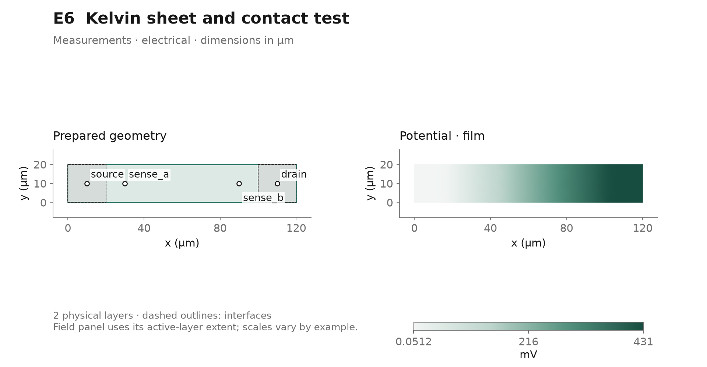](example-gallery/E6_kelvin.svg)

**In the GUI:** choose **DC electrical**, then in Results select layer `film` and **Potential (V)**. Inspect the sense_a and sense_b terminal values in Quantitative results as well as the sheet potential.

**Look for:** The floating sense electrodes have zero net current, while their equipotential footprints can locally perturb the film.

**Try next:** How does the sensed voltage differ from a two-terminal voltage that also includes the current contacts?

[Project (.etl)](../examples/E6_kelvin.etl) · [GDSII](../examples/E6_kelvin.gds) · [OASIS](../examples/E6_kelvin.oas) · [Vector preview](example-gallery/E6_kelvin.svg)

<details>
<summary>Recorded inputs, model limits and numerical details</summary>

**Recorded operating point:** source 0 V (ground); drain 0.001 A (current); sense_a 0 (floating); sense_b 0 (floating). Preview mode: **electrical**.

**Physical layers:** `film` (silicon, 1 µm); `pads` (copper, 2 µm).

**Saved sweep:** `terminals.drain.value` = `[0.01, 0.02, 0.04]` (SI values, electrothermal)

The saved sweep is a separate experiment; review the selected parameter, values and analysis in **Parameter sweep…** before starting it.

**Physical scope:** Floating sense electrodes are equipotential constraints and can perturb the sheet locally. Four-terminal sheet/contact test; floating sense terminals draw exactly zero net current.

**Recorded computed preview:** 431.3 Ω effective resistance; 0.0004313 W electrical power. 411 nodes / 726 triangles; converged. [Full metrics and hashes](example-gallery/manifest.json).

**Recorded diagnostics:** Layer Pads contains 2 disconnected polygon islands; inspect connectivity. Thermal boundary sink_pads extends outside its layer and is clipped.

Review current Issues after validation; a recorded warning is not permission to ignore a current blocker.

Optional command-line run of the current project:

```powershell
.\.venv\Scripts\python.exe -m etlayout solve examples/E6_kelvin.etl --mode electrical --output results/E6
```

</details>

<a id="e7"></a>
## E7 · Interdigitated HEMT

**Intermediate · Devices.** Explore local gate control, finite source/drain contacts, and thermal coupling.

[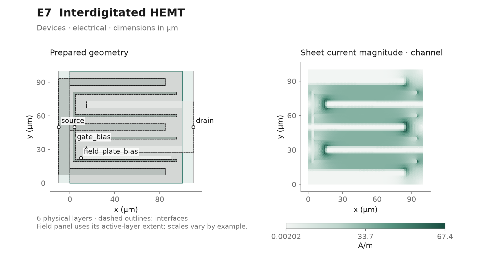](example-gallery/E7_hemt.svg)

**In the GUI:** choose **DC electrical**, then in Results select layer `channel` and **Sheet current density (mA/µm)**. In Operating conditions, choose Electrical inputs / gate controls and inspect gate_control. Run a second gate bias and use History to compare.

**Look for:** The gated region changes conductance, while the documented ungated edges still provide a bypass path.

**Try next:** Compare the response with E16. Does every source-to-drain path cross a gate-controlled region?

[Project (.etl)](../examples/E7_hemt.etl) · [GDSII](../examples/E7_hemt.gds) · [OASIS](../examples/E7_hemt.oas) · [Vector preview](example-gallery/E7_hemt.svg)

<details>
<summary>Recorded inputs, model limits and numerical details</summary>

**Recorded operating point:** source 0 V (ground); drain 0.2 V (voltage); gate_bias 0 V (voltage); field_plate_bias 0 V (voltage); gate_control 0 V (gate). Preview mode: **electrical**.

**Physical layers:** `channel` (2deg, 0.01 µm); `source_metal` (copper, 2 µm); `drain_metal` (copper, 2 µm); `gate_metal` (copper, 0.15 µm); `field_plate` (copper, 0.3 µm); `substrate` (sic, 100 µm).

**Saved sweep:** `terminals.gate_control.value` = `[-5.0, -3.0, -1.0, 1.0]` (SI values, electrothermal)

The saved sweep is a separate experiment; review the selected parameter, values and analysis in **Parameter sweep…** before starting it.

**Physical scope:** Illustrative resistive 2DEG law, with ungated edge bypass; the insulated field plate has no electrostatic effect. Illustrative depletion-mode interdigitated HEMT. Local gate control only under gate mask; access channel uses the configured ungated carrier-density cap. Field plate is insulated and has no electrostatic effect. Ungated channel edges permit bypass current. Metal/channel to substrate thermal links use an effective 2e-7 m²K/W for omitted buffer/dielectric paths; these parallel heat paths require process calibration. Not a calibrated transistor model.

**Recorded computed preview:** 15.89 Ω effective resistance; 0.002517 W electrical power. 7,053 nodes / 13,807 triangles; converged. [Full metrics and hashes](example-gallery/manifest.json).

**Recorded diagnostics:** Physical volumes of Source Metal and Gate Metal overlap in z and x–y. Verify stack positions and material assignment; electrical potentials remain independent. Interface heat_channel extends outside its two layers and is clipped to their common area. Interface heat_source_metal extends outside its two layers and is clipped to their common area. Interface heat_drain_metal extends outside its two layers and is clipped to their common area. Interface heat_gate_metal extends outside its two layers and is clipped to their common area. Interface heat_field_plate extends outside its two layers and is clipped to their common area.

Review current Issues after validation; a recorded warning is not permission to ignore a current blocker.

Optional command-line run of the current project:

```powershell
.\.venv\Scripts\python.exe -m etlayout solve examples/E7_hemt.etl --mode electrical --output results/E7
```

</details>

<a id="e8"></a>
## E8 · HEMT with resistive routing

**Intermediate · Devices.** Compare thin access buses with the thicker routing in E7.

[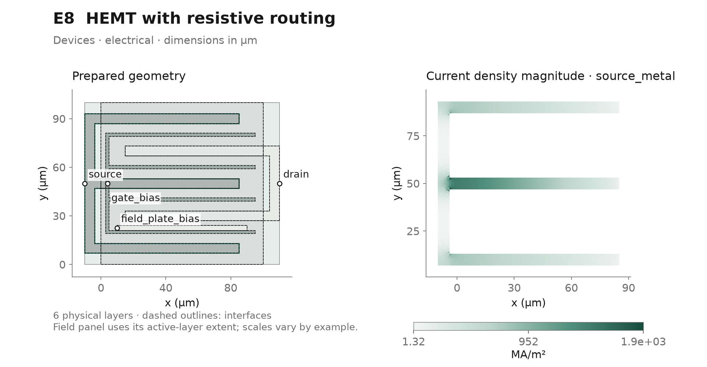](example-gallery/E8_hemt_routing.svg)

**In the GUI:** choose **DC electrical**, then in Results select layer `source_metal` and **Volumetric current density (mA/µm²)**. Inspect the source_metal current map, then compare the layer thicknesses with E7 in Layers & materials.

**Look for:** The thinner access metal changes routing resistance and current crowding while retaining the same illustrative channel law.

**Try next:** Which part of the voltage drop comes from routing, and which from the channel? Compare at equal delivered current before calling a layout better.

[Project (.etl)](../examples/E8_hemt_routing.etl) · [GDSII](../examples/E8_hemt_routing.gds) · [OASIS](../examples/E8_hemt_routing.oas) · [Vector preview](example-gallery/E8_hemt_routing.svg)

<details>
<summary>Recorded inputs, model limits and numerical details</summary>

**Recorded operating point:** source 0 V (ground); drain 0.2 V (voltage); gate_bias 0 V (voltage); field_plate_bias 0 V (voltage); gate_control 0 V (gate). Preview mode: **electrical**.

**Physical layers:** `channel` (2deg, 0.01 µm); `source_metal` (copper, 0.7 µm); `drain_metal` (copper, 0.7 µm); `gate_metal` (copper, 0.15 µm); `field_plate` (copper, 0.3 µm); `substrate` (sic, 100 µm).

**Saved sweep:** `terminals.gate_control.value` = `[-5.0, -3.0, -1.0, 1.0]` (SI values, electrothermal)

The saved sweep is a separate experiment; review the selected parameter, values and analysis in **Parameter sweep…** before starting it.

**Physical scope:** Same effective channel law as E7; metal thickness changes routing resistance, not transistor electrostatics. Illustrative depletion-mode interdigitated HEMT. Local gate control only under gate mask; access channel uses the configured ungated carrier-density cap. Field plate is insulated and has no electrostatic effect. Ungated channel edges permit bypass current. Metal/channel to substrate thermal links use an effective 2e-7 m²K/W for omitted buffer/dielectric paths; these parallel heat paths require process calibration. Not a calibrated transistor model.

**Recorded computed preview:** 15.99 Ω effective resistance; 0.002501 W electrical power. 7,095 nodes / 13,891 triangles; converged. [Full metrics and hashes](example-gallery/manifest.json).

**Recorded diagnostics:** Physical volumes of Source Metal and Gate Metal overlap in z and x–y. Verify stack positions and material assignment; electrical potentials remain independent. Interface heat_channel extends outside its two layers and is clipped to their common area. Interface heat_source_metal extends outside its two layers and is clipped to their common area. Interface heat_drain_metal extends outside its two layers and is clipped to their common area. Interface heat_gate_metal extends outside its two layers and is clipped to their common area. Interface heat_field_plate extends outside its two layers and is clipped to their common area.

Review current Issues after validation; a recorded warning is not permission to ignore a current blocker.

Optional command-line run of the current project:

```powershell
.\.venv\Scripts\python.exe -m etlayout solve examples/E8_hemt_routing.etl --mode electrical --output results/E8
```

</details>

<a id="e9"></a>
## E9 · Conducting SiC sheet

**Intermediate · Devices.** Connect carrier density and mobility to sheet conduction and contact loss.

[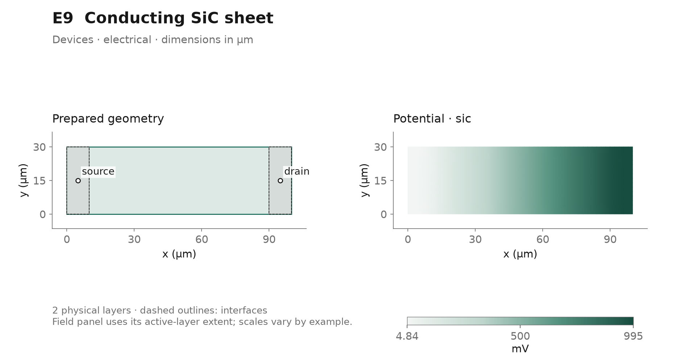](example-gallery/E9_sic.svg)

**In the GUI:** choose **DC electrical**, then in Results select layer `sic` and **Potential (V)**. Inspect the sic layer's electrical model in Layers & materials, then run its fixed-temperature electrical calculation.

**Look for:** An effective doped-SiC resistive sheet with finite contacts; this example has no transistor gate or junction model.

**Try next:** How does changing mobility affect sheet resistance? For a distributed MOSFET on-state load, continue with E23 or E24.

[Project (.etl)](../examples/E9_sic.etl) · [GDSII](../examples/E9_sic.gds) · [OASIS](../examples/E9_sic.oas) · [Vector preview](example-gallery/E9_sic.svg)

<details>
<summary>Recorded inputs, model limits and numerical details</summary>

**Recorded operating point:** source 0 V (ground); drain 1 V (voltage). Preview mode: **electrical**.

**Physical layers:** `sic` (sic, 2 µm); `pads` (copper, 2 µm).

**Saved sweep:** `terminals.drain.value` = `[0.01, 0.02, 0.04]` (SI values, electrothermal)

The saved sweep is a separate experiment; review the selected parameter, values and analysis in **Parameter sweep…** before starting it.

**Physical scope:** Effective doped semiconductor resistor; no junction, depletion, or breakdown physics. Effective n=10^18 cm^-3, mobility=400 cm²/Vs at 300 K; resistive sheet, no junction physics.

**Recorded computed preview:** 226.6 Ω effective resistance; 0.004412 W electrical power. 960 nodes / 1,788 triangles; converged. [Full metrics and hashes](example-gallery/manifest.json).

**Recorded diagnostics:** Layer Pads contains 2 disconnected polygon islands; inspect connectivity. Thermal boundary sink_pads extends outside its layer and is clipped.

Review current Issues after validation; a recorded warning is not permission to ignore a current blocker.

Optional command-line run of the current project:

```powershell
.\.venv\Scripts\python.exe -m etlayout solve examples/E9_sic.etl --mode electrical --output results/E9
```

</details>

<a id="e10"></a>
## E10 · Metal–oxide–silicon stack

**Intermediate · Thermal.** Resolve lateral heat spreading and the resistance of a layered thermal path.

[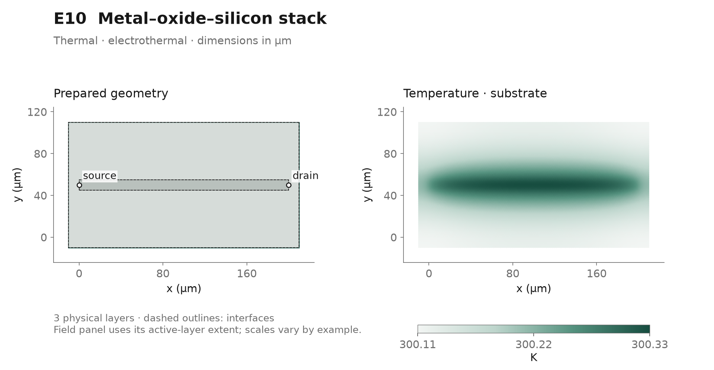](example-gallery/E10_thermal_stack.svg)

**In the GUI:** choose **Coupled DC electrothermal**, then in Results select layer `substrate` and **Temperature (K)**. Switch Layer between the metal and substrate, then compare Temperature with Temperature rise when a reservoir reference is available.

**Look for:** Heat spreads laterally in the substrate while the configured stack and backside boundary set the thermal path.

**Try next:** Change the backside condition in Operating conditions. Which layer changes most, and why is it misleading to inspect only the metal?

[Project (.etl)](../examples/E10_thermal_stack.etl) · [GDSII](../examples/E10_thermal_stack.gds) · [OASIS](../examples/E10_thermal_stack.oas) · [Vector preview](example-gallery/E10_thermal_stack.svg)

<details>
<summary>Recorded inputs, model limits and numerical details</summary>

**Recorded operating point:** source 0 V (ground); drain 0.4 A (current). Preview mode: **electrothermal**.

**Physical layers:** `metal` (copper, 2 µm); `oxide` (sio2, 1 µm); `substrate` (silicon, 50 µm).

**Saved sweep:** `terminals.drain.value` = `[0.01, 0.02, 0.04]` (SI values, electrothermal)

The saved sweep is a separate experiment; review the selected parameter, values and analysis in **Parameter sweep…** before starting it.

**Physical scope:** Thickness-averaged layers; the bottom boundary includes half of the substrate thickness. Thickness-averaged metal/oxide/silicon model. Bottom boundary includes half substrate thickness.

**Recorded computed preview:** 0.176 Ω effective resistance; 0.02816 W electrical power; 312.2 K overall maximum temperature. 7,899 nodes / 15,456 triangles; converged. [Full metrics and hashes](example-gallery/manifest.json).

**Recorded diagnostics:** Interface metal_oxide extends outside its two layers and is clipped to their common area. Thermal boundary top_air extends outside its layer and is clipped.

Review current Issues after validation; a recorded warning is not permission to ignore a current blocker.

Optional command-line run of the current project:

```powershell
.\.venv\Scripts\python.exe -m etlayout solve examples/E10_thermal_stack.etl --mode electrothermal --output results/E10
```

</details>

<a id="e11"></a>
## E11 · Serpentine thin-film heater

**Advanced · Thermal.** Inspect corner crowding, temperature feedback, and heat spreading beyond a five-pass trace.

[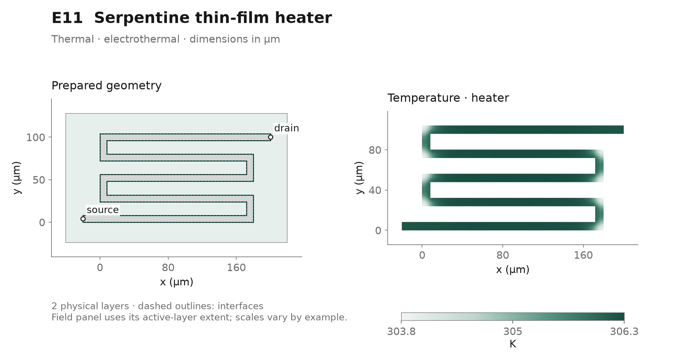](example-gallery/E11_serpentine_heater.svg)

**In the GUI:** choose **Coupled DC electrothermal**, then in Results select layer `heater` and **Temperature (K)**. Inspect the heater temperature, then switch to the substrate and look beyond the meander footprint.

**Look for:** Bends concentrate electrical loading, while the effective interface and substrate spread the deposited heat.

**Try next:** Vary current with Parameter sweep… and compare temperature and resistance. Keep the configured prescribed heat input when reproducing the nominal project.

[Project (.etl)](../examples/E11_serpentine_heater.etl) · [GDSII](../examples/E11_serpentine_heater.gds) · [OASIS](../examples/E11_serpentine_heater.oas) · [Vector preview](example-gallery/E11_serpentine_heater.svg)

<details>
<summary>Recorded inputs, model limits and numerical details</summary>

**Recorded operating point:** source 0 V (ground); drain 0.02 A (current); prescribed heat: background_heating 0.002 W. Preview mode: **electrothermal**.

**Physical layers:** `heater` (platinum, 0.25 µm); `substrate` (silicon, 50 µm).

**Saved sweep:** `terminals.drain.value` = `[0.01, 0.02, 0.03]` (SI values, electrothermal); `interfaces.heater_substrate.thermal_value` = `[1e-06, 2e-06, 4e-06]` (SI values, electrothermal)

The saved sweep is a separate experiment; review the selected parameter, values and analysis in **Parameter sweep…** before starting it.

**Physical scope:** Illustrative platinum film on silicon, with an effective thermal interface; sharp-corner peaks need mesh refinement. Five-pass 8 µm wide, 0.25 µm thick platinum serpentine, driven at 20 mA. Square turns demonstrate current crowding; corner peaks require a mesh study. The explicit 260 × 152 µm silicon substrate extends beyond the imported conductor. A 2e-6 m²K/W effective dielectric link and a 2e6 W/m²K backside sink are illustrative; the omitted dielectric has no resolved lateral heat flow. An independent 2 mW heater load also makes thermal-only mode meaningful. Steady-state thickness-averaged model; no transient heat capacity, radiation or calibrated thin-film transport.

**Recorded computed preview:** 52.74 Ω effective resistance; 0.0211 W electrical power; 306.3 K overall maximum temperature. 5,567 nodes / 10,856 triangles; converged. [Full metrics and hashes](example-gallery/manifest.json).

**Recorded diagnostics:** Interface heater_substrate extends outside its two layers and is clipped to their common area. Heat source background_heating extends outside its layer and is clipped.

Review current Issues after validation; a recorded warning is not permission to ignore a current blocker.

Optional command-line run of the current project:

```powershell
.\.venv\Scripts\python.exe -m etlayout solve examples/E11_serpentine_heater.etl --mode electrothermal --output results/E11
```

</details>

<a id="e12"></a>
## E12 · Three-level via ladder

**Advanced · Interconnects.** Follow sequential vertical transfer through two hierarchical 3 × 3 via banks.

[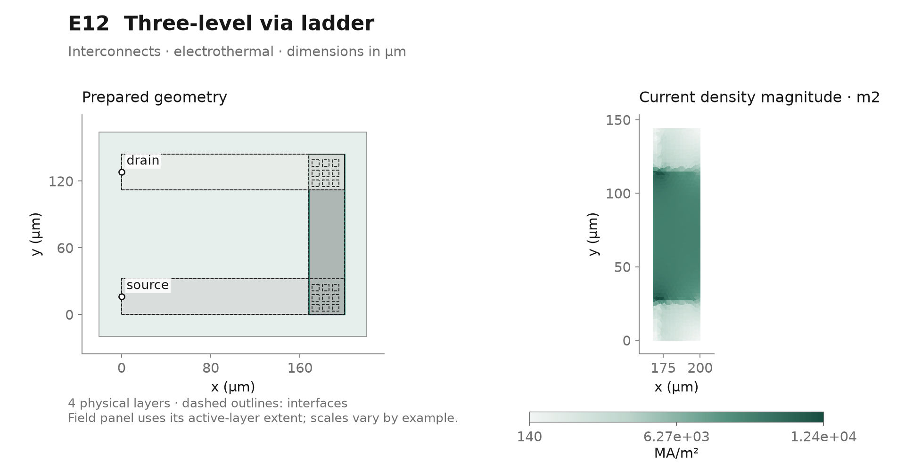](example-gallery/E12_via_ladder.svg)

**In the GUI:** choose **Coupled DC electrothermal**, then in Results select layer `m2` and **Volumetric current density (mA/µm²)**. Switch Layer among m1, m2 and m3, using Fit layer to follow the two via banks and the middle riser.

**Look for:** Current transfers vertically twice; a map of one metal level does not describe loading in the others.

**Try next:** Draw a profile through a transfer region and compare it with a finer mesh. Can you separate a persistent bottleneck from a corner peak?

[Project (.etl)](../examples/E12_via_ladder.etl) · [GDSII](../examples/E12_via_ladder.gds) · [OASIS](../examples/E12_via_ladder.oas) · [Vector preview](example-gallery/E12_via_ladder.svg)

<details>
<summary>Recorded inputs, model limits and numerical details</summary>

**Recorded operating point:** source 0 V (ground); drain 0.3 A (current); prescribed heat: riser_heating 0.003 W. Preview mode: **electrothermal**.

**Physical layers:** `m1` (copper, 1 µm); `m2` (copper, 1 µm); `m3` (copper, 1 µm); `substrate` (silicon, 40 µm).

**Saved sweep:** `terminals.drain.value` = `[0.1, 0.3, 0.5]` (SI values, electrothermal); `interfaces.via12.height` = `[1e-06, 2e-06, 4e-06]` (SI values, electrical)

The saved sweep is a separate experiment; review the selected parameter, values and analysis in **Parameter sweep…** before starting it.

**Physical scope:** Three independent sheet potentials linked by finite copper vias; no full 3D via-sidewall field solution. Three 1 µm copper levels form a U-shaped series route with two hierarchical 3 × 3 banks of 6 × 6 µm finite copper vias, 2 µm high. A 0.3 A terminal current must cross both banks; individual vias can carry different currents. Each metal has a separate potential and temperature. Effective 1e-6 m²K/W links to a larger silicon substrate approximate omitted dielectric paths; they are parallel thermal paths requiring process calibration. An independent 3 mW load is applied to the middle riser. Vias are distributed interlayer conductances, not resolved 3D solids. The via-height sweep changes electrical resistance only; thermal via conductance is independently fixed.

**Recorded computed preview:** 0.2367 Ω effective resistance; 0.0213 W electrical power; 303 K overall maximum temperature. 6,100 nodes / 11,914 triangles; converged. [Full metrics and hashes](example-gallery/manifest.json).

**Recorded diagnostics:** Interface heat_m1 extends outside its two layers and is clipped to their common area. Interface heat_m2 extends outside its two layers and is clipped to their common area. Interface heat_m3 extends outside its two layers and is clipped to their common area.

Review current Issues after validation; a recorded warning is not permission to ignore a current blocker.

Optional command-line run of the current project:

```powershell
.\.venv\Scripts\python.exe -m etlayout solve examples/E12_via_ladder.etl --mode electrothermal --output results/E12
```

</details>

<a id="e13"></a>
## E13 · Perforated current spreader

**Advanced · Interconnects.** See current diversion around staggered slots and diamond holes in a conducting sheet.

[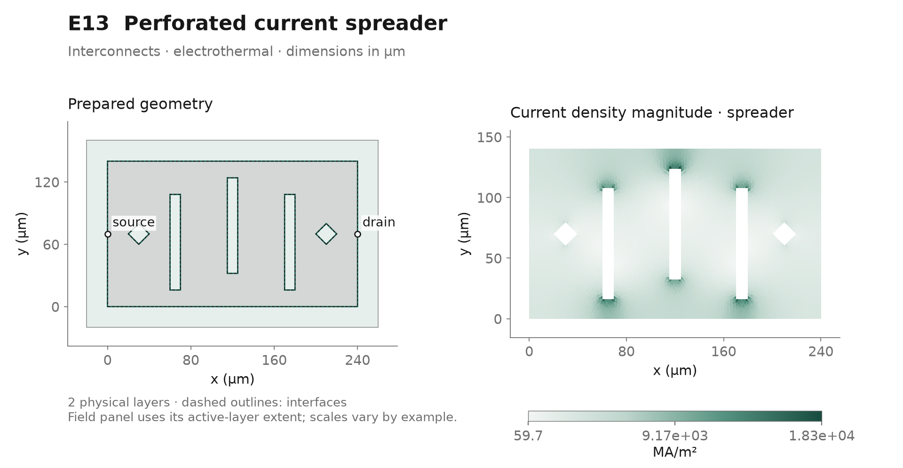](example-gallery/E13_perforated_spreader.svg)

**In the GUI:** choose **Coupled DC electrothermal**, then in Results select layer `spreader` and **Volumetric current density (mA/µm²)**. Inspect the narrow ligaments around slots and diamond holes; preview the mesh to check that voids stay empty.

**Look for:** Current detours around genuine holes, concentrating in the remaining conducting paths.

**Try next:** Compare a physically averaged hotspot with the largest element value while refining near a hole. Which conclusion is stable?

[Project (.etl)](../examples/E13_perforated_spreader.etl) · [GDSII](../examples/E13_perforated_spreader.gds) · [OASIS](../examples/E13_perforated_spreader.oas) · [Vector preview](example-gallery/E13_perforated_spreader.svg)

<details>
<summary>Recorded inputs, model limits and numerical details</summary>

**Recorded operating point:** source 0 V (ground); drain 0.75 A (current); prescribed heat: local_load 0.006 W. Preview mode: **electrothermal**.

**Physical layers:** `spreader` (copper, 2 µm); `substrate` (sic, 40 µm).

**Saved sweep:** `terminals.drain.value` = `[0.25, 0.5, 0.75]` (SI values, electrothermal); `heat_sources.local_load.value` = `[0.002, 0.006, 0.012]` (SI values, thermal)

The saved sweep is a separate experiment; review the selected parameter, values and analysis in **Parameter sweep…** before starting it.

**Physical scope:** True void topology is preserved in the mesh; ideal hole corners produce mesh-sensitive current peaks. A 240 × 140 µm, 2 µm thick copper sheet contains three staggered 10 × 92 µm slots and two diamond cutouts. These are actual holes in the conductor, not decorative masks. A 0.75 A edge drive diverts current around slot ends; a separate 6 mW localized load exercises thermal-only mode. The continuous, larger SiC substrate remains beneath the copper holes. Its effective interface resistance is 5e-7 m²K/W and backside sink is 2e6 W/m²K. Sharp-corner current peaks are mesh-dependent; use spatial averages or a refinement study. This steady-state sheet approximation omits 3D sidewall spreading and mechanical stress.

**Recorded computed preview:** 0.02849 Ω effective resistance; 0.01602 W electrical power; 301.9 K overall maximum temperature. 7,257 nodes / 14,204 triangles; converged. [Full metrics and hashes](example-gallery/manifest.json).

**Recorded diagnostics:** KLayout normalized a nonsimple polygon/cutline on mask 1/0: Ring Self-intersection[0.00021 8e-05]. Inspect the resulting geometry; cutlines encoding holes are expected in GDS. Interface sheet_substrate extends outside its two layers and is clipped to their common area.

Review current Issues after validation; a recorded warning is not permission to ignore a current blocker.

Optional command-line run of the current project:

```powershell
.\.venv\Scripts\python.exe -m etlayout solve examples/E13_perforated_spreader.etl --mode electrothermal --output results/E13
```

</details>

<a id="e14"></a>
## E14 · Four-arm resistive bridge

**Advanced · Measurements.** Read a differential bridge imbalance with separate current drive and floating midpoint probes.

[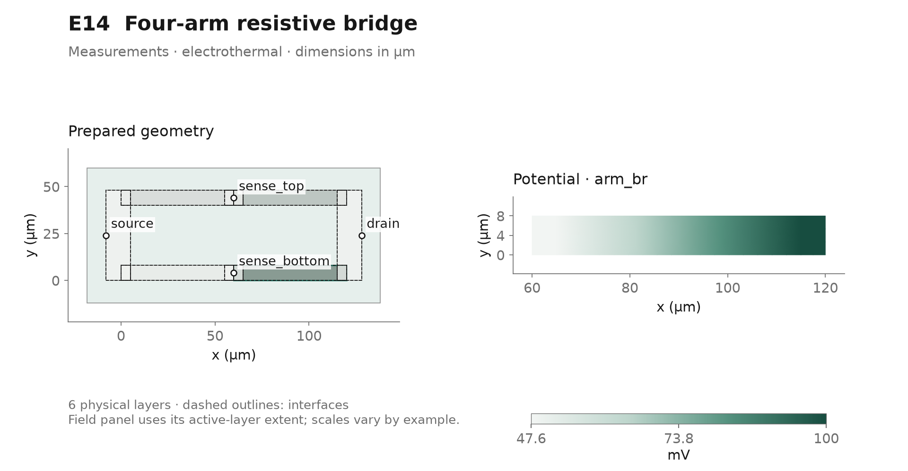](example-gallery/E14_bridge_sensor.svg)

**In the GUI:** choose **Coupled DC electrothermal**, then in Results select layer `arm_br` and **Potential (V)**. Inspect arm_br and the floating midpoint terminal values in Quantitative results.

**Look for:** A differential bridge signal caused by unequal effective sheet resistances, with no mechanical strain calculation.

**Try next:** Change one arm's thickness in a copied setup. How do bridge imbalance and total power respond?

[Project (.etl)](../examples/E14_bridge_sensor.etl) · [GDSII](../examples/E14_bridge_sensor.gds) · [OASIS](../examples/E14_bridge_sensor.oas) · [Vector preview](example-gallery/E14_bridge_sensor.svg)

<details>
<summary>Recorded inputs, model limits and numerical details</summary>

**Recorded operating point:** source 0 V (ground); drain 0.1 V (voltage); sense_top 0 (floating); sense_bottom 0 (floating); prescribed heat: sensor_load 0.0002 W. Preview mode: **electrothermal**.

**Physical layers:** `arm_tl` (tan, 0.2 µm); `arm_tr` (tan, 0.2 µm); `arm_bl` (tan, 0.2 µm); `arm_br` (tan, 0.2 µm); `pads` (copper, 2 µm); `substrate` (silicon, 30 µm).

**Saved sweep:** `layers.arm_br.electrical.sheet_resistance.value` = `[80.0, 100.0, 120.0]` (SI values, electrical)

The saved sweep is a separate experiment; review the selected parameter, values and analysis in **Parameter sweep…** before starting it.

**Physical scope:** Four effective sheet resistors and metal pads; resistor mismatch represents a sensor response without a mechanical model. Four-arm Wheatstone bridge: three 100 Ω/□ TaN sheets and one 110 Ω/□ sensing arm. The 0.1 V drive uses finite-conductivity metal buses and ideal arm/pad interfaces. Floating midpoint electrodes draw zero net current. Read V(sense_top) − V(sense_bottom); effective resistance instead reports the source/drain drive resistance. Sweep the lower-right sheet resistance through 100 Ω/□ to reverse the differential output. A separate 0.2 mW prescribed sensor load also makes thermal-only operation meaningful; fixed sheet resistance does not model thermoresistive transduction. Synthetic 2.5D demonstration, not a calibrated sensor.

**Recorded computed preview:** 640.3 Ω effective resistance; 1.562e-05 W electrical power; 300.4 K overall maximum temperature. 1,717 nodes / 3,280 triangles; converged. [Full metrics and hashes](example-gallery/manifest.json).

**Recorded diagnostics:** Layer Bridge electrodes contains 4 disconnected polygon islands; inspect connectivity. Interface contact_arm_tl extends outside its two layers and is clipped to their common area. Interface heat_arm_tl extends outside its two layers and is clipped to their common area. Interface contact_arm_tr extends outside its two layers and is clipped to their common area. Interface heat_arm_tr extends outside its two layers and is clipped to their common area. Interface contact_arm_bl extends outside its two layers and is clipped to their common area. Interface heat_arm_bl extends outside its two layers and is clipped to their common area. Interface contact_arm_br extends outside its two layers and is clipped to their common area. Interface heat_arm_br extends outside its two layers and is clipped to their common area. Interface heat_pads extends outside its two layers and is clipped to their common area. Heat source sensor_load extends outside its layer and is clipped.

Review current Issues after validation; a recorded warning is not permission to ignore a current blocker.

Optional command-line run of the current project:

```powershell
.\.venv\Scripts\python.exe -m etlayout solve examples/E14_bridge_sensor.etl --mode electrothermal --output results/E14
```

</details>

<a id="e15"></a>
## E15 · Dual-heater thermal crosstalk

**Advanced · Thermal.** Inspect overlapping temperature fields from independently driven meanders on a shared substrate.

[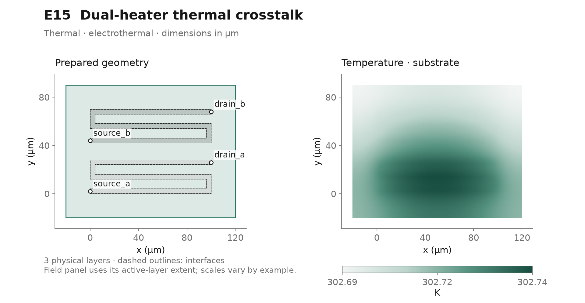](example-gallery/E15_thermal_crosstalk.svg)

**In the GUI:** choose **Coupled DC electrothermal**, then in Results select layer `substrate` and **Temperature (K)**. Choose the shared substrate layer and inspect both heat-source neighborhoods on one temperature scale.

**Look for:** Overlapping heat-spreading fields and warming outside the driven meanders; narrow temperature ranges need distinct tick labels.

**Try next:** Change one configured heat input and compare saved runs at a common manual range. Does the unpowered neighborhood still warm?

[Project (.etl)](../examples/E15_thermal_crosstalk.etl) · [GDSII](../examples/E15_thermal_crosstalk.gds) · [OASIS](../examples/E15_thermal_crosstalk.oas) · [Vector preview](example-gallery/E15_thermal_crosstalk.svg)

<details>
<summary>Recorded inputs, model limits and numerical details</summary>

**Recorded operating point:** source_a 0 V (ground); drain_a 0.4 V (voltage); source_b 0 V (ground); drain_b 0.25 V (voltage); prescribed heat: load_a 0.0005 W, load_b 0.00015 W. Preview mode: **electrothermal**.

**Physical layers:** `heater_a` (tin, 0.5 µm); `heater_b` (tin, 0.5 µm); `substrate` (silicon, 30 µm).

**Saved sweep:** `heat_sources.load_a.value` = `[0.0, 0.0005, 0.002]` (SI values, thermal); `terminals.drain_a.value` = `[0.2, 0.4, 0.6]` (SI values, electrothermal)

The saved sweep is a separate experiment; review the selected parameter, values and analysis in **Parameter sweep…** before starting it.

**Physical scope:** Effective sheet-to-substrate heat transfer; prescribed sources also permit a meaningful independent thermal solve. Two electrically independent three-pass TiN heaters share a larger silicon thermal layer. A and B are biased at 0.4 V and 0.25 V; prescribed loads add 0.5 mW and 0.15 mW respectively. Electrical mode computes each powered net; reported resistance uses A only. Thermal-only mode uses prescribed loads without Joule heating, whereas electrothermal mode adds both Joule loads. Sweep load_a with B held fixed and inspect the rise of B temperature to observe thermal crosstalk. Effective 2e-6 m²K/W interfaces represent omitted isolation stacks; the 5e4 W/m²K backside sink and representative film properties need calibration. Synthetic steady-state 2.5D example.

**Recorded computed preview:** 154.4 Ω effective resistance; 0.001441 W electrical power; 305.2 K overall maximum temperature. 4,688 nodes / 9,124 triangles; converged. [Full metrics and hashes](example-gallery/manifest.json).

**Recorded diagnostics:** Interface heat_a extends outside its two layers and is clipped to their common area. Interface heat_b extends outside its two layers and is clipped to their common area. Heat source load_a extends outside its layer and is clipped. Heat source load_b extends outside its layer and is clipped.

Review current Issues after validation; a recorded warning is not permission to ignore a current blocker.

Optional command-line run of the current project:

```powershell
.\.venv\Scripts\python.exe -m etlayout solve examples/E15_thermal_crosstalk.etl --mode electrothermal --output results/E15
```

</details>

<a id="e16"></a>
## E16 · Full-width gated HEMT array

**Advanced · Devices.** Contrast E7's edge bypass with gate control that spans every channel in a four-channel array.

[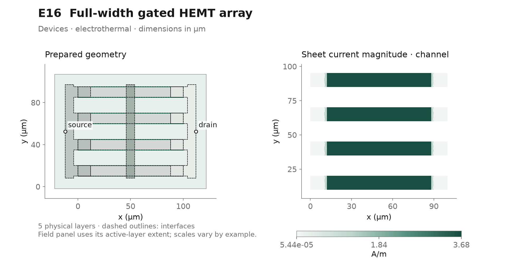](example-gallery/E16_full_gate_hemt_array.svg)

**In the GUI:** choose **Coupled DC electrothermal**, then in Results select layer `channel` and **Sheet current density (mA/µm)**. Inspect the four channel stripes, then vary gate_control through Operating conditions and compare the channel maps.

**Look for:** Every intended conducting path crosses a gate-controlled region, avoiding E7/E8's edge bypass.

**Try next:** Compare gate-bias response with E7, then move to E21 for long fingers. The numerical conductance floor is not an off-state leakage prediction.

[Project (.etl)](../examples/E16_full_gate_hemt_array.etl) · [GDSII](../examples/E16_full_gate_hemt_array.gds) · [OASIS](../examples/E16_full_gate_hemt_array.oas) · [Vector preview](example-gallery/E16_full_gate_hemt_array.svg)

<details>
<summary>Recorded inputs, model limits and numerical details</summary>

**Recorded operating point:** source 0 V (ground); drain 0.1 V (voltage); gate_control 0 V (gate); prescribed heat: channel_load 0.0002 W. Preview mode: **electrothermal**.

**Physical layers:** `channel` (2deg, 0.01 µm); `source_metal` (copper, 1 µm); `drain_metal` (copper, 1 µm); `gate_metal` (gold, 0.2 µm); `substrate` (sic, 75 µm).

**Saved sweep:** `terminals.gate_control.value` = `[-5.0, -3.0, -1.0, 1.0]` (SI values, electrothermal)

The saved sweep is a separate experiment; review the selected parameter, values and analysis in **Parameter sweep…** before starting it.

**Physical scope:** Resistive 2DEG approximation with finite contacts; no velocity saturation, gate leakage, trapping, or electrostatic field-plate model. Four separated parallel GaN 2DEG stripes join shared source/drain metal buses through finite 1e-10 Ωm² contacts, with 0.1 V drain bias. One gate bar spans each complete channel width, so every source-to-drain channel path crosses a controlled region; there is no ungated edge bypass. The gold gate is electrically insulated and modeled as a thermal-only layer; its voltage enters the local analytical charge-control model through gate_control. No gate leakage, capacitance, electrostatic field solution, velocity saturation or calibrated transistor prediction is provided. A 1e-7 S sheet-conductance floor limits deep-off current and maintains numerical conditioning; the off-state current is not a leakage prediction. A 0.2 mW prescribed channel load supports thermal-only operation and adds to Joule heating in coupled mode. Effective thermal interfaces represent omitted buffer/dielectric paths.

**Recorded computed preview:** 687.5 Ω effective resistance; 1.455e-05 W electrical power; 300 K overall maximum temperature. 5,027 nodes / 9,798 triangles; converged. [Full metrics and hashes](example-gallery/manifest.json).

**Recorded diagnostics:** Layer Four GaN 2DEG channels contains 4 disconnected polygon islands; inspect connectivity. Interface heat_channel extends outside its two layers and is clipped to their common area. Interface heat_source_metal extends outside its two layers and is clipped to their common area. Interface heat_drain_metal extends outside its two layers and is clipped to their common area. Interface heat_gate_metal extends outside its two layers and is clipped to their common area. Terminal gate_control extends outside its layer and is clipped. Heat source channel_load extends outside its layer and is clipped.

Review current Issues after validation; a recorded warning is not permission to ignore a current blocker.

Optional command-line run of the current project:

```powershell
.\.venv\Scripts\python.exe -m etlayout solve examples/E16_full_gate_hemt_array.etl --mode electrothermal --output results/E16
```

</details>

<a id="e17"></a>
## E17 · Pulsed heating and cooling

**Starter · Transient.** Compare pulse heating and cooling with the uniform lumped thermal RC limit, then refine the time step.

[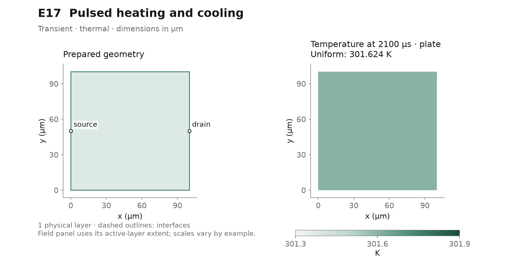](example-gallery/E17_pulsed_thermal.svg)

**In the GUI:** choose **Thermal transient**, then in Results select layer `plate` and **Temperature (K)**. Open Time, waveform & initial-state settings… in Operating conditions, inspect Timing and Waveforms, then run and open Time history.

**Look for:** Uniform prescribed heating and cooling with thermal storage; the field can be nearly uniform even while the time history changes strongly.

**Try next:** Use Time-step convergence… to compare peak temperature and pulse energy. Does a shorter integration step resolve the pulse edges?

[Project (.etl)](../examples/E17_pulsed_thermal.etl) · [GDSII](../examples/E17_pulsed_thermal.gds) · [OASIS](../examples/E17_pulsed_thermal.oas) · [Vector preview](example-gallery/E17_pulsed_thermal.svg)

<details>
<summary>Recorded inputs, model limits and numerical details</summary>

**Recorded operating point:** source 0 V (ground); drain 0 V (voltage); prescribed heat: heater 1e+06 W/m². Preview mode: **transient thermal**.

**Physical layers:** `plate` (copper, 10 µm).

**Saved sweep:** `transient.drives.0.waveform.high` = `[250000.0, 500000.0, 1000000.0]` (SI values, thermal)

The saved sweep is a separate experiment; review the selected parameter, values and analysis in **Parameter sweep…** before starting it.

**Physical scope:** Prescribed heat drives uniform copper thermal storage; electrical Joule heating is excluded. Pulse width means high plateau. Uniform prescribed heat pulses in a 100 × 100 × 10 µm copper plate, with h=1e5 W/(m² K). Thermal-only operation excludes Joule heating. The spatially uniform limit has tau=rho*cp*t/h and high-level steady rise=10 K, so the transient can be checked against a lumped RC. Pulse width is the 200 µs plateau, period 700 µs, and delay 100 µs. Reduce dt to check time accuracy.

**Transient setup:** stop 0.0021 s; maximum step 2.5e-05 s; saved output interval 5e-05 s. `heat_sources.heater.value`: 0 → 1e+06, delay 0.0001 s, rise 0 s, plateau 0.0002 s, fall 0 s, period 0.0007 s (target SI units). The field preview shows the final accepted time; use Time history to inspect the full run.

**Recorded computed preview:** 301.6 K maximum temperature at final time; 305 K peak over all time steps; 6e-06 J integrated input heat. 302 nodes / 542 triangles; converged. [Full metrics and hashes](example-gallery/manifest.json).

Optional command-line run of the current project:

```powershell
.\.venv\Scripts\python.exe -m etlayout solve examples/E17_pulsed_thermal.etl --mode thermal --output results/E17
```

</details>

<a id="e18"></a>
## E18 · Pulsed electrothermal conductor

**Intermediate · Transient.** Follow current pulses, Joule energy, delayed temperature peaks and cooling with temperature feedback.

[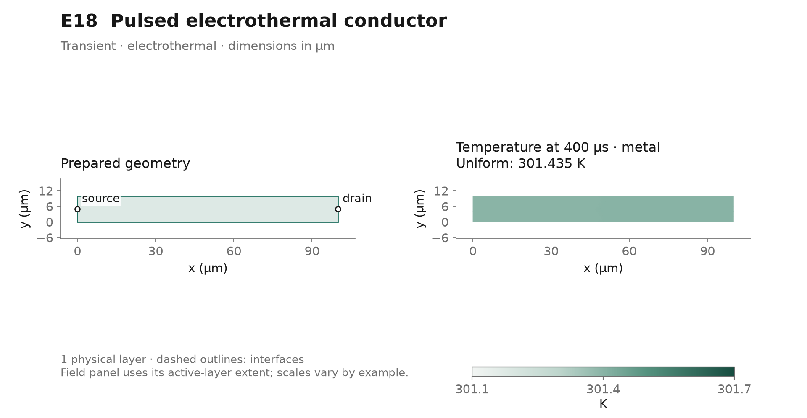](example-gallery/E18_pulsed_conductor.svg)

**In the GUI:** choose **Electrothermal transient**, then in Results select layer `metal` and **Temperature (K)**. Inspect the current waveform, run, then select retained times and use Time history to view temperature and Stored energy.

**Look for:** Joule heating during current pulses, thermal delay and cooling between pulses, with temperature-dependent electrical feedback.

**Try next:** Change the pulse plateau or cooling interval in Waveforms, then refine time. This models thermal dynamics, not electromagnetic switching losses.

[Project (.etl)](../examples/E18_pulsed_conductor.etl) · [GDSII](../examples/E18_pulsed_conductor.gds) · [OASIS](../examples/E18_pulsed_conductor.oas) · [Vector preview](example-gallery/E18_pulsed_conductor.svg)

<details>
<summary>Recorded inputs, model limits and numerical details</summary>

**Recorded operating point:** source 0 V (ground); drain 0.25 A (current). Preview mode: **transient electrothermal**.

**Physical layers:** `metal` (copper, 2 µm).

**Saved sweep:** `transient.drives.0.waveform.high` = `[0.05, 0.15, 0.25]` (SI values, electrothermal)

The saved sweep is a separate experiment; review the selected parameter, values and analysis in **Parameter sweep…** before starting it.

**Physical scope:** Backward Euler thermal storage with quasi-static electrical feedback; no electrical capacitance, inductance or switching losses. Pulsed 100 × 10 × 2 µm copper conductor with quasi-static current and temperature-dependent resistivity. The 0.25 A pulse has 10 µs rise, 60 µs high plateau and 10 µs fall, repeated every 200 µs after a 25 µs delay. Finite edge times need time-step refinement. Heat capacity and cooling produce delayed thermal response; electrical capacitance and inductance are not included.

**Transient setup:** stop 0.0004 s; maximum step 5e-06 s; saved output interval 1e-05 s. `terminals.drain.value`: 0 → 0.25, delay 2.5e-05 s, rise 1e-05 s, plateau 6e-05 s, fall 1e-05 s, period 0.0002 s (target SI units). The field preview shows the final accepted time; use Time history to inspect the full run.

**Recorded computed preview:** 0 W electrical power; 301.4 K maximum temperature at final time; 323.6 K peak over all time steps; 7.529e-07 J integrated input heat. 360 nodes / 608 triangles; converged. [Full metrics and hashes](example-gallery/manifest.json).

Optional command-line run of the current project:

```powershell
.\.venv\Scripts\python.exe -m etlayout solve examples/E18_pulsed_conductor.etl --mode electrothermal --output results/E18
```

</details>

<a id="e19"></a>
## E19 · Multilayer pulse and thermal crosstalk

**Advanced · Transient.** Compare heater, substrate and unpowered receiver histories to locate the delayed crosstalk peak.

[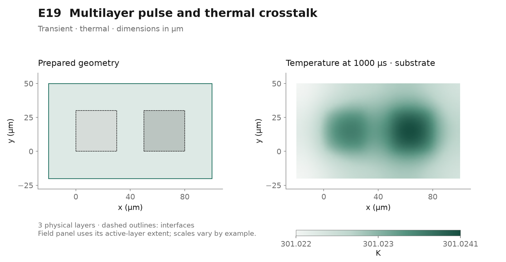](example-gallery/E19_pulsed_multilayer.svg)

**In the GUI:** choose **Thermal transient**, then in Results select layer `substrate` and **Temperature (K)**. Compare heater, substrate and unpowered receiver layers, then inspect their Time history scopes.

**Look for:** A delayed receiver temperature peak after a prescribed heat pulse transfers through the shared structure.

**Try next:** Change an interface thermal parameter and compare the receiver's peak time as well as its maximum temperature.

[Project (.etl)](../examples/E19_pulsed_multilayer.etl) · [GDSII](../examples/E19_pulsed_multilayer.gds) · [OASIS](../examples/E19_pulsed_multilayer.oas) · [Vector preview](example-gallery/E19_pulsed_multilayer.svg)

<details>
<summary>Recorded inputs, model limits and numerical details</summary>

**Recorded operating point:** ; prescribed heat: pulse_heat 0.01 W. Preview mode: **transient thermal**.

**Physical layers:** `heater` (copper, 5 µm); `receiver` (copper, 10 µm); `substrate` (silicon, 20 µm).

**Saved sweep:** `transient.drives.0.waveform.high` = `[0.0025, 0.005, 0.01]` (SI values, thermal)

The saved sweep is a separate experiment; review the selected parameter, values and analysis in **Parameter sweep…** before starting it.

**Physical scope:** A prescribed single heat pulse transfers through finite interfaces and a shared silicon sheet; no electrical drive or through-thickness diffusion. A 10 mW, 100 µs single pulse heats a 30 × 30 × 5 µm copper island. An unpowered 30 × 30 × 10 µm copper receiver sits 20 µm away on the same 20 µm silicon substrate. Finite interface conductances create separate layer temperatures; receiver heating and its delayed peak arise entirely from thermal crosstalk. Inspect heater, substrate and receiver histories. Prescribed heat only; no electrical solve. Input energy is 1 µJ. Thickness-averaged sheets and representative materials require process calibration.

**Transient setup:** stop 0.001 s; maximum step 1e-05 s; saved output interval 1e-05 s. `heat_sources.pulse_heat.value`: 0 → 0.01, delay 5e-05 s, rise 0 s, plateau 0.0001 s, fall 0 s, period 0 s (target SI units). The field preview shows the final accepted time; use Time history to inspect the full run.

**Recorded computed preview:** 301.4 K maximum temperature at final time; 337.7 K peak over all time steps; 1e-06 J integrated input heat. 977 nodes / 1,838 triangles; converged. [Full metrics and hashes](example-gallery/manifest.json).

**Recorded diagnostics:** Interface heater_substrate extends outside its two layers and is clipped to their common area. Interface receiver_substrate extends outside its two layers and is clipped to their common area. Heat source pulse_heat extends outside its layer and is clipped.

Review current Issues after validation; a recorded warning is not permission to ignore a current blocker.

Optional command-line run of the current project:

```powershell
.\.venv\Scripts\python.exe -m etlayout solve examples/E19_pulsed_multilayer.etl --mode thermal --output results/E19
```

</details>

## Maintaining the gallery

<details>
<summary>Advanced: deterministic generation and reproduction</summary>

The desktop walkthroughs above work with the existing projects. Maintainers can regenerate the scientific previews separately:

```powershell
.\.venv\Scripts\python.exe scripts/build_example_gallery.py --use-cache
.\.venv\Scripts\python.exe scripts/build_example_gallery.py --examples E11 E16 --output .artifacts/gallery-preview --markdown .artifacts/gallery-preview.md
```

The generator reads existing projects from `examples/` and creates missing ones. Its cache is reused only when the physics hash, solver version and source-code fingerprint match. Use `--no-solve` for explicitly labeled geometry-only previews. The manifest records plotted range, units, mesh, convergence, diagnostics, operating point and configuration hashes.

</details>


See the [scientific evidence audit](example-science.md) for applicability levels, exact nominal measurements, model limits and reproduction commands.

## Compare electrical operating scenarios

[Meaningful Joule thermal demonstrations](thermal-example-scenarios.md) add
optional editable scenarios through **File → Choose example operating scenario…**.
They keep the E1–E40 reference inputs available and distinguish failed engineering
limits from numerical convergence. The guide includes actual maps, losses,
pulse peaks and mesh/time sensitivity observations.
