# From analytical coupons to power devices

See current crowd around a bend, follow heat into a substrate, or watch a device cool between pulses. This gallery covers 16 of the library's 40 runnable reference examples. Each project supplies configured geometry, materials, connections and operating conditions. These walkthroughs use the desktop controls.

## Open your first example

1. In **File → Ready-to-run examples**, open the appropriate group and choose an example by its stable ID below. Opening prepares the project; it does not start a simulation.
2. Use **Save project as…** to keep your own project. Review the visible **Analysis type**; the gallery's analysis column states the mode used for its recorded picture.
3. Follow **Layout & region → Layers & materials → Contacts & connections → Operating conditions**. The example already supplies these inputs; inspect them before changing anything.
4. In **Mesh & checks**, select **Run validation**, inspect the Issues drawer, then **Generate / update mesh**. **Run → Run analysis** starts the background calculation. F6, F7 and F5 provide the corresponding shortcuts.
5. In **Results**, select **Layer** and **Quantity**, then **Fit layer**. Use **Appearance** for colors and range, **Metrics & loss budget** for numbers, and **History** for earlier runs.
6. Try the follow-up question for your example. **Sweeps & convergence** opens parameter, mesh and time-step studies; **Compare saved runs…** helps inspect alternatives.

[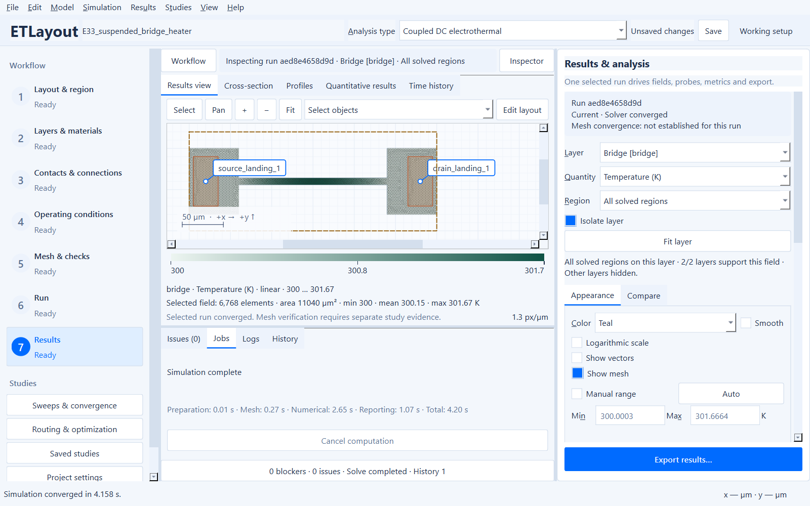](images/extended-bridge-results.png)

*Actual 0.4.0 source GUI on native Windows at 125% Qt scale, in a compact 1280 × 800 logical-pixel window. The selected bridge temperature map uses the project's 300 K backside reservoir. The solver converged; mesh verification is not established for this run. Open the image for full-size controls.*

## Choose the question, then inspect the physics

Start with a compact coupon before moving to a device or package. Keep the supplied nominal inputs for the first calculation; the saved sweeps are follow-up experiments, not validation substitutes. Opening never starts a solve.

| Question | Start here | Continue with |
| --- | --- | --- |
| Does the numerical result agree with a circuit limit? | [E25: series strip](#e25) | [E28: signed port currents](#e28), [E31: divider taps](#e31) |
| How do contacts and routing change local loading? | [E27: Kelvin/contact transfer](#e27) | [E26: neck loading](#e26), [E29: annular paths](#e29), [E30: via banks](#e30), [E32: resistive access](#e32) |
| Which thermal path controls the hotspot? | [E33: finite anchors](#e33) | [E34: thermal sensing](#e34), [E35: partial attachment](#e35), [E36: pulse cooling](#e36) |
| How do device and package regions share current? | [E37: one gated channel](#e37) | [E38: separately driven banks](#e38), [E39: SiC active islands](#e39), [E40: package interposer](#e40) |

**Read loading in its physical units.** Channel/film sheet current uses mA/µm; bulk-metal volumetric current density uses mA/µm². Via normal density is a separate interface quantity. A converged field is not automatically mesh verified, and a point corner maximum is not a physically averaged hotspot. Compare delivered service and the loss ledger alongside temperature.

## Examples in this walkthrough

| Example | Focus | Level | Gallery analysis |
| --- | --- | --- | --- |
| [E25 · Stepped-width series reference](#e25) | Analytical coupons | Starter | DC electrical |
| [E26 · Dog-bone current-crowding coupon](#e26) | Analytical coupons | Intermediate | Coupled DC electrothermal |
| [E27 · Finite-contact transfer-length coupon](#e27) | Contacts and measurements | Intermediate | DC electrical |
| [E28 · Three-terminal T-junction splitter](#e28) | Routed networks | Starter | DC electrical |
| [E29 · Annular current-spreading bus](#e29) | Routed networks | Intermediate | Coupled DC electrothermal |
| [E30 · Multilevel via daisy chain](#e30) | Routed networks | Advanced | Coupled DC electrothermal |
| [E31 · Tapped resistive ladder](#e31) | Contacts and measurements | Starter | DC electrical |
| [E32 · Parallel resistor array with resistive buses](#e32) | Routed networks | Advanced | Coupled DC electrothermal |
| [E33 · Thermal bridge heater](#e33) | Thermal experiments | Intermediate | Coupled DC electrothermal |
| [E34 · Interleaved heater and sensor](#e34) | Thermal experiments | Advanced | Coupled DC electrothermal |
| [E35 · Localized backside die attachment](#e35) | Thermal experiments | Advanced | Coupled DC electrothermal |
| [E36 · Pulsed constriction and cooling](#e36) | Pulsed operation | Advanced | Electrothermal transient |
| [E37 · Fully gated HEMT contact coupon](#e37) | Device studies | Intermediate | Coupled DC electrothermal |
| [E38 · Independently driven GaN banks](#e38) | Device studies | Advanced | Coupled DC electrothermal |
| [E39 · SiC on-state die with active islands](#e39) | Device studies | Engineering | Coupled DC electrothermal |
| [E40 · Three-level package interposer](#e40) | Package interconnects | Engineering | Coupled DC electrothermal |

## Read the pictures, then run your own project

Each scientific preview pairs actual prepared geometry with a recorded computed field. All devices are synthetic teaching configurations; deterministic calculations do not supply experimental uncertainty or process calibration. A converged solve still needs a mesh study before comparing sensitive peaks. Field scales and panel extents differ between pictures.

These previews were computed with solver 0.4.0 from the supplied configured projects. The manifest records each result's exact configuration, source hashes and diagnostics. They demonstrate numerical behavior under the declared assumptions, not experimental validation. Current application screenshots are labeled separately.

ETL projects retain the physical setup and saved sweeps. GDSII/OASIS downloads contain geometry only. SVG previews retain vector geometry, axes and text; only the finite-element field is rasterized at twice the intended display resolution.

<a id="e25"></a>
## E25 · Stepped-width series reference

**Starter · Analytical coupons.** Compare series resistance with access spreading at width changes.

[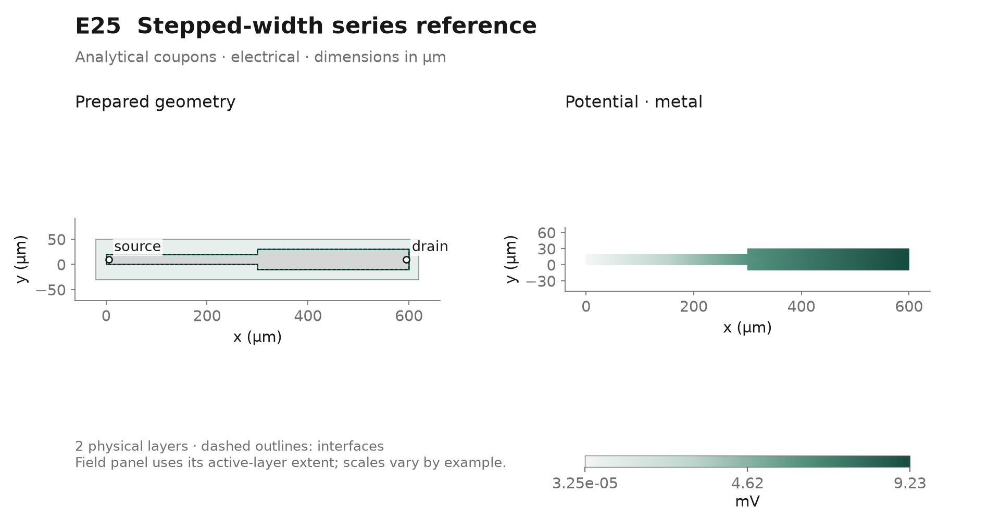](example-gallery/extended/E25_stepped_width_series.svg)

**In the GUI:** choose **DC electrical**, then in Results select layer `metal` and **Potential (V)**. Inspect Metrics & loss budget, then compare the two strip widths in Layout & region.

**Look for:** The width step adds spreading resistance above the one-dimensional series reference; the finite end feeds also dissipate power.

**Try next:** Run the saved fixed-temperature current sweep. Does doubling current keep resistance constant and quadruple Joule power?

[Project (.etl)](../examples/E25_stepped_width_series.etl) · [GDSII](../examples/E25_stepped_width_series.gds) · [OASIS](../examples/E25_stepped_width_series.oas) · [Vector preview](example-gallery/extended/E25_stepped_width_series.svg)

<details>
<summary>Recorded inputs, model limits and numerical details</summary>

**Recorded operating point:** source 0 V (ground port; feeds source_landing: 0.1 mΩ); drain 0.05 A (current port; feeds drain_landing: 0.1 mΩ). Preview mode: **electrical**.

**Physical layers:** `metal` (copper, 2 µm); `substrate` (silicon, 100 µm).

**Saved sweep:** `power.ports.drain.value` = `[0.025, 0.05, 0.1]` (SI values, electrical)

The saved sweep is a separate experiment; review the selected parameter, values and analysis in **Parameter sweep…** before starting it.

**Physical scope:** Synthetic copper coupon at fixed reference temperature; abrupt width transitions add spreading resistance. Two 300 µm series segments have widths 20 and 40 µm and copper thickness 2 µm. Ten-micrometre full-width end electrodes leave 290 µm per segment outside the electrodes. The 1D lower limit at 300 K is 0.1827 Ω inside the strip, plus two 0.1 mΩ feeds; the width step adds spreading resistance. Localized finite feeds leave the entire route resistive, including the metal beneath their footprints. Nominal setup: 50 mA DC electrical reference. Layout support 640 × 80 µm including margins. Synthetic 300 K engineering assumptions, not process calibration or device ratings. Nearest-sheet SiO₂-equivalent gaps connect to a 100 µm silicon support; finite physical contacts/vias replace gap areas. One backside 300 K reservoir includes 2e-6 m²K/W die attachment plus half-substrate conduction. These thickness-averaged paths omit depth-resolved gradients. No prescribed heating is added: coupled mode uses conductor, contact and finite-feed losses only; 25% of external-feed loss enters the local landing and 75% remains external. Constant TaN sheet values, where present, are synthetic effective values without electrical temperature feedback; bulk copper retains its reference temperature dependence. Review 250–500 K material validity and mesh refinement before interpreting peaks. No electromigration, damage, reactive circuit or mechanical model is implied.

**Recorded computed preview:** 0.1847 Ω effective resistance; 0.0004617 W electrical power. 7,310 nodes / 14,136 triangles; converged. [Full metrics and hashes](example-gallery/extended/manifest.json).

Optional command-line run of the current project:

```powershell
.\.venv\Scripts\python.exe -m etlayout solve examples/E25_stepped_width_series.etl --mode electrical --output results/E25
```

</details>

<a id="e26"></a>
## E26 · Dog-bone current-crowding coupon

**Intermediate · Analytical coupons.** Separate a physically averaged neck loading from a mesh-sensitive corner maximum.

[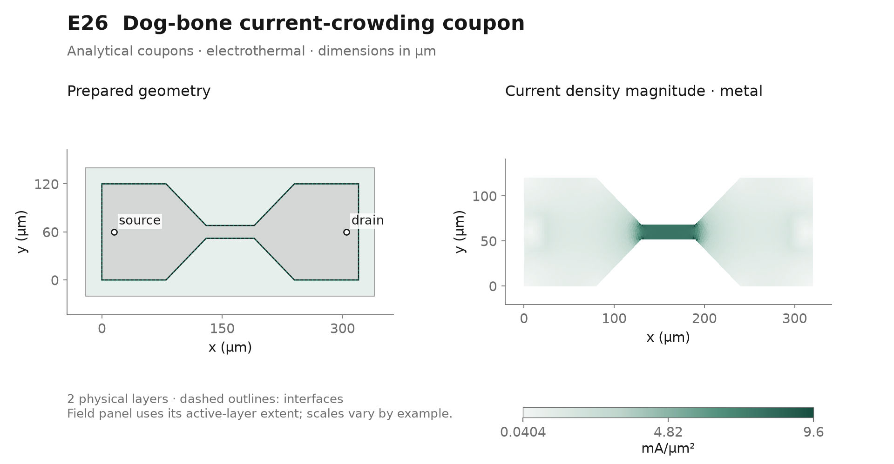](example-gallery/extended/E26_dogbone_coupon.svg)

**In the GUI:** choose **Coupled DC electrothermal**, then in Results select layer `metal` and **Volumetric current density (mA/µm²)**. Zoom into the neck, then open Routing & optimization → Analysis → Measurements and locate neck_loading.

**Look for:** The fixed physical neck window measures loading independently of the mesh-sensitive point maximum at a taper corner.

**Try next:** Refine the neck locally and compare averaged loading and terminal resistance before interpreting the largest element value.

[Project (.etl)](../examples/E26_dogbone_coupon.etl) · [GDSII](../examples/E26_dogbone_coupon.gds) · [OASIS](../examples/E26_dogbone_coupon.oas) · [Vector preview](example-gallery/extended/E26_dogbone_coupon.svg)

<details>
<summary>Recorded inputs, model limits and numerical details</summary>

**Recorded operating point:** source 0 V (ground port; feeds source_landing: 2 mΩ); drain 0.5 A (current port; feeds drain_landing: 2 mΩ). Preview mode: **electrothermal**.

**Physical layers:** `metal` (copper, 4 µm); `substrate` (silicon, 100 µm).

**Saved sweep:** `power.ports.drain.value` = `[0.25, 0.5, 0.75]` (SI values, electrothermal)

The saved sweep is a separate experiment; review the selected parameter, values and analysis in **Parameter sweep…** before starting it.

**Physical scope:** Joule-heated resistive metal; current crowding does not predict melting, electromigration lifetime or fracture. A 320 × 120 µm dog-bone coupon narrows through two 50 µm tapers into a 60 × 16 µm neck. Localized 20 × 40 µm feed footprints and 2 mΩ feeds retain pad spreading. The neck_loading measurement averages a fixed 40 × 16 µm physical window; sharp taper-end point maxima remain mesh-sensitive. This is a crowding coupon, not a fuse model. Nominal setup: 0.5 A coupled DC. Layout support 360 × 160 µm including margins. Synthetic 300 K engineering assumptions, not process calibration or device ratings. Nearest-sheet SiO₂-equivalent gaps connect to a 100 µm silicon support; finite physical contacts/vias replace gap areas. One backside 300 K reservoir includes 2e-6 m²K/W die attachment plus half-substrate conduction. These thickness-averaged paths omit depth-resolved gradients. No prescribed heating is added: coupled mode uses conductor, contact and finite-feed losses only; 25% of external-feed loss enters the local landing and 75% remains external. Constant TaN sheet values, where present, are synthetic effective values without electrical temperature feedback; bulk copper retains its reference temperature dependence. Review 250–500 K material validity and mesh refinement before interpreting peaks. No electromigration, damage, reactive circuit or mechanical model is implied.

**Recorded computed preview:** 0.03535 Ω effective resistance; 0.008837 W electrical power; 302.3 K overall maximum temperature. 8,109 nodes / 15,868 triangles; converged. [Full metrics and hashes](example-gallery/extended/manifest.json).

Optional command-line run of the current project:

```powershell
.\.venv\Scripts\python.exe -m etlayout solve examples/E26_dogbone_coupon.etl --mode electrothermal --output results/E26
```

</details>

<a id="e27"></a>
## E27 · Finite-contact transfer-length coupon

**Intermediate · Contacts and measurements.** Compare contact drop and passive Kelvin voltage with the contact transfer length.

[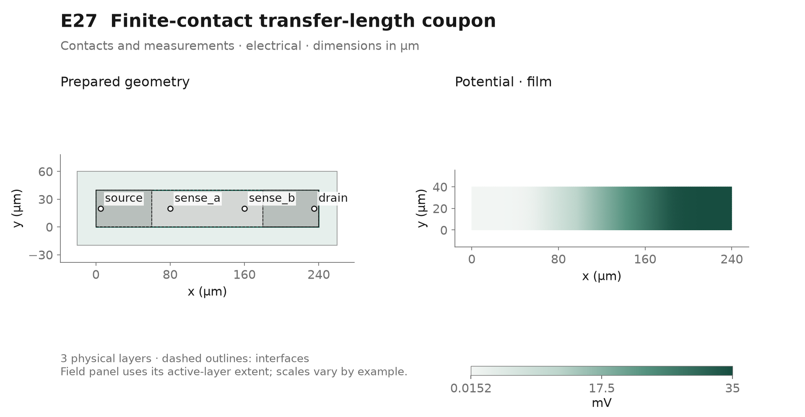](example-gallery/extended/E27_transfer_length_coupon.svg)

**In the GUI:** choose **DC electrical**, then in Results select layer `film` and **Potential (V)**. Compare the film potential with sense_a and sense_b in Quantitative results and the Analysis Contacts table.

**Look for:** The passive Kelvin drop excludes the current contacts; current transfers over a finite length beneath the copper electrodes.

**Try next:** Run the specific-contact-resistivity sweep. Which voltage drop changes, and is contact refinement still small compared with the transfer length?

[Project (.etl)](../examples/E27_transfer_length_coupon.etl) · [GDSII](../examples/E27_transfer_length_coupon.gds) · [OASIS](../examples/E27_transfer_length_coupon.oas) · [Vector preview](example-gallery/extended/E27_transfer_length_coupon.svg)

<details>
<summary>Recorded inputs, model limits and numerical details</summary>

**Recorded operating point:** source 0 V (ground port; feeds source_landing: 2 mΩ); drain 0.001 A (current port; feeds drain_landing: 2 mΩ); sense_a zero net current (floating); sense_b zero net current (floating). Preview mode: **electrical**.

**Physical layers:** `film` (tan, 0.2 µm); `pads` (copper, 2 µm); `substrate` (silicon, 100 µm).

**Saved sweep:** `interfaces.film_contacts.electrical_value` = `[2.5e-10, 1e-09, 4e-09]` (SI values, electrical)

The saved sweep is a separate experiment; review the selected parameter, values and analysis in **Parameter sweep…** before starting it.

**Physical scope:** Finite area-specific ohmic contacts to a resistive sheet; no Schottky, tunneling or calibrated contact chemistry. A 240 × 40 µm, 10 Ω/□ effective TaN strip has two 60 µm long copper contacts with specific contact resistivity 1e-9 Ω m². The nominal contact transfer length is sqrt(rho_c/R_sheet) = 10 µm, resolved with 2 µm contact sizing. Zero-current floating cross-section probes at x=80 and 160 µm are equipotential and can perturb nonuniform fields; here the intervening uniform strip gives a 20 Ω Kelvin reference. Terminal two-terminal resistance additionally includes finite contact, pad and external-feed losses. Nominal setup: 1 mA DC electrical Kelvin reference. Layout support 280 × 80 µm including margins. Synthetic 300 K engineering assumptions, not process calibration or device ratings. Nearest-sheet SiO₂-equivalent gaps connect to a 100 µm silicon support; finite physical contacts/vias replace gap areas. One backside 300 K reservoir includes 2e-6 m²K/W die attachment plus half-substrate conduction. These thickness-averaged paths omit depth-resolved gradients. No prescribed heating is added: coupled mode uses conductor, contact and finite-feed losses only; 25% of external-feed loss enters the local landing and 75% remains external. Constant TaN sheet values, where present, are synthetic effective values without electrical temperature feedback; bulk copper retains its reference temperature dependence. Review 250–500 K material validity and mesh refinement before interpreting peaks. No electromigration, damage, reactive circuit or mechanical model is implied.

**Recorded computed preview:** 20 Ω effective resistance; 3.501e-05 W electrical power. 6,844 nodes / 13,326 triangles; converged. [Full metrics and hashes](example-gallery/extended/manifest.json).

**Recorded diagnostics:** Layer Copper contact electrodes contains 2 disconnected polygon islands; inspect connectivity.

Review current Issues after validation; a recorded warning is not permission to ignore a current blocker.

Optional command-line run of the current project:

```powershell
.\.venv\Scripts\python.exe -m etlayout solve examples/E27_transfer_length_coupon.etl --mode electrical --output results/E27
```

</details>

<a id="e28"></a>
## E28 · Three-terminal T-junction splitter

**Starter · Routed networks.** Track signed terminal currents through a branched route with two return landings.

[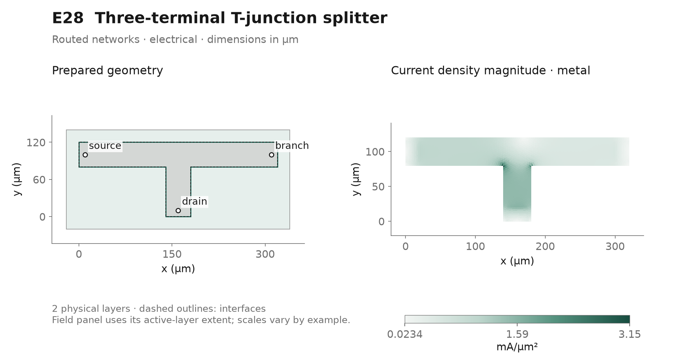](example-gallery/extended/E28_t_junction_splitter.svg)

**In the GUI:** choose **DC electrical**, then in Results select layer `metal` and **Volumetric current density (mA/µm²)**. In Operating conditions inspect External port drives, including the signed branch withdrawal, then open the Analysis Ports table.

**Look for:** The input supplies both returns: positive current enters the domain and the negative branch current leaves it.

**Try next:** Vary the branch withdrawal with the saved sweep while keeping the input fixed. Does the reference return close the current balance?

[Project (.etl)](../examples/E28_t_junction_splitter.etl) · [GDSII](../examples/E28_t_junction_splitter.gds) · [OASIS](../examples/E28_t_junction_splitter.oas) · [Vector preview](example-gallery/extended/E28_t_junction_splitter.svg)

<details>
<summary>Recorded inputs, model limits and numerical details</summary>

**Recorded operating point:** source 0 V (ground port; feeds source_landing: 2 mΩ); drain 0.3 A (current port; feeds drain_landing: 2 mΩ); branch -0.1 A (current port; feeds branch_landing: 2 mΩ). Preview mode: **electrical**.

**Physical layers:** `metal` (copper, 5 µm); `substrate` (silicon, 100 µm).

**Saved sweep:** `power.ports.branch.value` = `[-0.05, -0.1, -0.15]` (SI values, electrical)

The saved sweep is a separate experiment; review the selected parameter, values and analysis in **Parameter sweep…** before starting it.

**Physical scope:** Prescribed branch withdrawal and a balancing reference return; no passive-divider ratio, microwave S-parameters, inductance or capacitance. A 320 µm copper T-bus with 40 µm arms receives 0.3 A through its bottom landing. A separate right port withdraws 0.1 A; the left ground/reference port must return 0.2 A. Negative port current explicitly leaves the model. The external currents are controlled; the local junction fields and required port voltages emerge from the sheet solution. Every localized landing has 2 mΩ feed resistance. The effective resistance metric uses the bottom input against the left reference and is not a two-terminal network reduction. Nominal setup: 0.3 A input and 0.1 A right withdrawal. Layout support 360 × 160 µm including margins. Synthetic 300 K engineering assumptions, not process calibration or device ratings. Nearest-sheet SiO₂-equivalent gaps connect to a 100 µm silicon support; finite physical contacts/vias replace gap areas. One backside 300 K reservoir includes 2e-6 m²K/W die attachment plus half-substrate conduction. These thickness-averaged paths omit depth-resolved gradients. No prescribed heating is added: coupled mode uses conductor, contact and finite-feed losses only; 25% of external-feed loss enters the local landing and 75% remains external. Constant TaN sheet values, where present, are synthetic effective values without electrical temperature feedback; bulk copper retains its reference temperature dependence. Review 250–500 K material validity and mesh refinement before interpreting peaks. No electromigration, damage, reactive circuit or mechanical model is implied.

**Recorded computed preview:** 0.01731 Ω effective resistance; 0.001418 W electrical power. 7,961 nodes / 15,572 triangles; converged. [Full metrics and hashes](example-gallery/extended/manifest.json).

Optional command-line run of the current project:

```powershell
.\.venv\Scripts\python.exe -m etlayout solve examples/E28_t_junction_splitter.etl --mode electrical --output results/E28
```

</details>

<a id="e29"></a>
## E29 · Annular current-spreading bus

**Intermediate · Routed networks.** Follow current around a protected central opening and compare the two annular paths.

[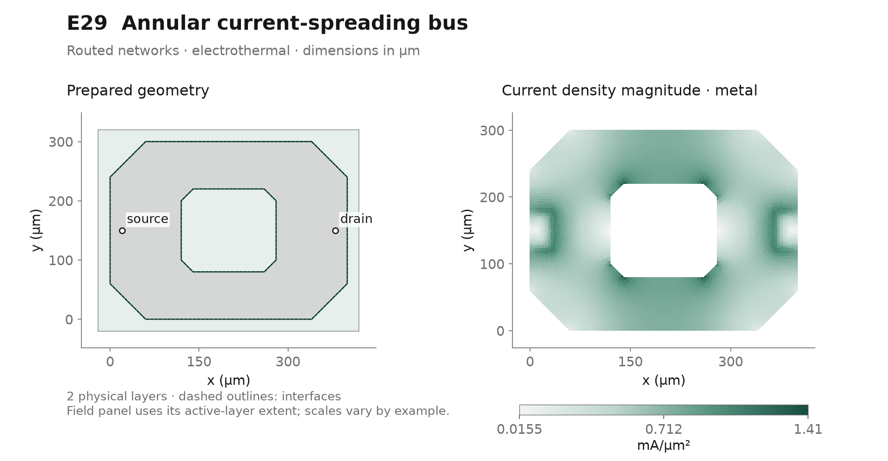](example-gallery/extended/E29_annular_bus.svg)

**In the GUI:** choose **Coupled DC electrothermal**, then in Results select layer `metal` and **Volumetric current density (mA/µm²)**. Preview the mesh around the central opening and compare the upper_loss and lower_loss measurements.

**Look for:** Current splits symmetrically around a genuine void in the copper, while the continuous substrate remains beneath it.

**Try next:** Save a layout copy and move only one landing. How much symmetry is lost at the same delivered current?

[Project (.etl)](../examples/E29_annular_bus.etl) · [GDSII](../examples/E29_annular_bus.gds) · [OASIS](../examples/E29_annular_bus.oas) · [Vector preview](example-gallery/extended/E29_annular_bus.svg)

<details>
<summary>Recorded inputs, model limits and numerical details</summary>

**Recorded operating point:** source 0 V (ground port; feeds source_landing: 0.5 mΩ); drain 1 A (current port; feeds drain_landing: 0.5 mΩ). Preview mode: **electrothermal**.

**Physical layers:** `metal` (copper, 8 µm); `substrate` (silicon, 100 µm).

**Saved sweep:** `power.ports.drain.value` = `[0.5, 1.0, 1.5]` (SI values, electrothermal)

The saved sweep is a separate experiment; review the selected parameter, values and analysis in **Parameter sweep…** before starting it.

**Physical scope:** Polygonal approximation to a curved copper bus; compare integral or averaged quantities through mesh refinement. A 400 × 300 µm octagonal 8 µm copper bus surrounds a genuine octagonal 160 × 140 µm opening. The larger continuous substrate remains below the opening. Opposed centered 30 × 60 µm landings and 0.5 mΩ feeds preserve top/bottom symmetry: each arm should carry half the delivered current. Upper/lower loss measurements use matching physical support windows. No conductor exists in the protected opening; corner point peaks need refinement. Nominal setup: 1 A coupled DC. Layout support 440 × 340 µm including margins. Synthetic 300 K engineering assumptions, not process calibration or device ratings. Nearest-sheet SiO₂-equivalent gaps connect to a 100 µm silicon support; finite physical contacts/vias replace gap areas. One backside 300 K reservoir includes 2e-6 m²K/W die attachment plus half-substrate conduction. These thickness-averaged paths omit depth-resolved gradients. No prescribed heating is added: coupled mode uses conductor, contact and finite-feed losses only; 25% of external-feed loss enters the local landing and 75% remains external. Constant TaN sheet values, where present, are synthetic effective values without electrical temperature feedback; bulk copper retains its reference temperature dependence. Review 250–500 K material validity and mesh refinement before interpreting peaks. No electromigration, damage, reactive circuit or mechanical model is implied.

**Recorded computed preview:** 0.005943 Ω effective resistance; 0.005943 W electrical power; 300.2 K overall maximum temperature. 7,409 nodes / 14,504 triangles; converged. [Full metrics and hashes](example-gallery/extended/manifest.json).

**Recorded diagnostics:** KLayout normalized a nonsimple polygon/cutline on mask 1/0: Ring Self-intersection[0.00014 0.00022]. Inspect the resulting geometry; cutlines encoding holes are expected in GDS.

Review current Issues after validation; a recorded warning is not permission to ignore a current blocker.

Optional command-line run of the current project:

```powershell
.\.venv\Scripts\python.exe -m etlayout solve examples/E29_annular_bus.etl --mode electrothermal --output results/E29
```

</details>

<a id="e30"></a>
## E30 · Multilevel via daisy chain

**Advanced · Routed networks.** Follow repeated serial transfers through physical via banks and inspect their loss contributions.

[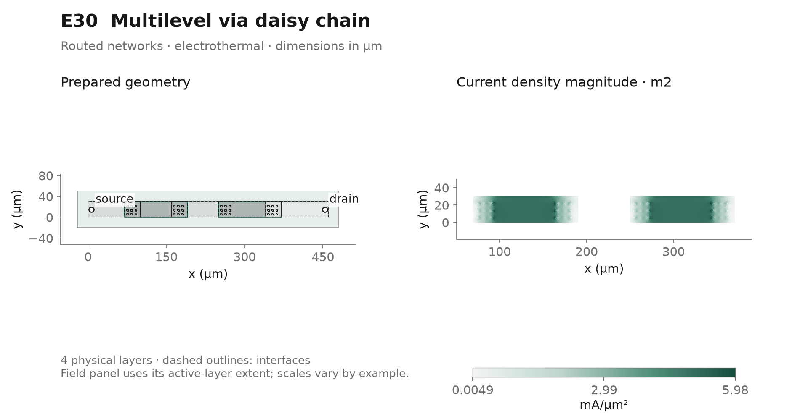](example-gallery/extended/E30_via_daisy_chain.svg)

**In the GUI:** choose **Coupled DC electrothermal**, then in Results select layer `m2` and **Volumetric current density (mA/µm²)**. Switch among m1, m2 and m3, then inspect individual via instances in the Analysis Contacts table.

**Look for:** The complete delivered current crosses four banks in series; individual vias within each bank load unequally.

**Try next:** Compare bank totals with individual normal-current density before and after contact refinement; a signed total over several transitions can cancel opposing transfers.

[Project (.etl)](../examples/E30_via_daisy_chain.etl) · [GDSII](../examples/E30_via_daisy_chain.gds) · [OASIS](../examples/E30_via_daisy_chain.oas) · [Vector preview](example-gallery/extended/E30_via_daisy_chain.svg)

<details>
<summary>Recorded inputs, model limits and numerical details</summary>

**Recorded operating point:** source 0 V (ground port; feeds source_landing: 0.5 mΩ); drain 0.3 A (current port; feeds drain_landing: 0.5 mΩ). Preview mode: **electrothermal**.

**Physical layers:** `m1` (copper, 2 µm); `m2` (copper, 2 µm); `m3` (copper, 2 µm); `substrate` (silicon, 100 µm).

**Saved sweep:** `power.ports.drain.value` = `[0.1, 0.3, 0.5]` (SI values, electrothermal)

The saved sweep is a separate experiment; review the selected parameter, values and analysis in **Parameter sweep…** before starting it.

**Physical scope:** Separate sheet potentials and finite-area vertical conductances; via interiors are not resolved in 3D. A 460 × 30 µm three-level copper chain alternates between separated M1 and M2 islands, then transfers to M3. Four independent 3 × 3 arrays contain 36 actual 3 × 3 µm vias, 2 µm high on 8 µm pitch. All 0.3 A must cross each bank; vias within a bank need not share equally. The three M1–M2 banks are grouped by fabrication transition, not silently merged electrically into a single crossing. Through-via fields are distributed interface links, not a resolved 3D sidewall solution. Two localized 12 × 30 µm landings each add 0.5 mΩ. Nominal setup: 0.3 A coupled DC through all four via banks. Layout support 500 × 70 µm including margins. Synthetic 300 K engineering assumptions, not process calibration or device ratings. Nearest-sheet SiO₂-equivalent gaps connect to a 100 µm silicon support; finite physical contacts/vias replace gap areas. One backside 300 K reservoir includes 2e-6 m²K/W die attachment plus half-substrate conduction. These thickness-averaged paths omit depth-resolved gradients. No prescribed heating is added: coupled mode uses conductor, contact and finite-feed losses only; 25% of external-feed loss enters the local landing and 75% remains external. Constant TaN sheet values, where present, are synthetic effective values without electrical temperature feedback; bulk copper retains its reference temperature dependence. Review 250–500 K material validity and mesh refinement before interpreting peaks. No electromigration, damage, reactive circuit or mechanical model is implied.

**Recorded computed preview:** 0.1194 Ω effective resistance; 0.01075 W electrical power; 304.8 K overall maximum temperature. 19,003 nodes / 37,242 triangles; converged. [Full metrics and hashes](example-gallery/extended/manifest.json).

**Recorded diagnostics:** Layer Lower alternating islands contains 2 disconnected polygon islands; inspect connectivity. Layer Middle chain links contains 2 disconnected polygon islands; inspect connectivity.

Review current Issues after validation; a recorded warning is not permission to ignore a current blocker.

Optional command-line run of the current project:

```powershell
.\.venv\Scripts\python.exe -m etlayout solve examples/E30_via_daisy_chain.etl --mode electrothermal --output results/E30
```

</details>

<a id="e31"></a>
## E31 · Tapped resistive ladder

**Starter · Contacts and measurements.** Read passive midpoint voltages and compare the ladder with its analytical resistance network.

[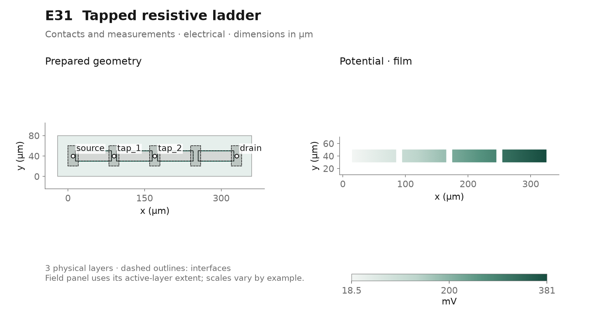](example-gallery/extended/E31_resistor_ladder.svg)

**In the GUI:** choose **DC electrical**, then in Results select layer `film` and **Potential (V)**. Open Quantitative results and compare tap_1, tap_2 and tap_3 with the applied end voltages.

**Look for:** Four equal film/contact sections produce quarter-step passive node voltages; the floating taps draw no net current.

**Try next:** Run the saved voltage sweep. Do the normalized tap voltages stay fixed while current and dissipated power change?

[Project (.etl)](../examples/E31_resistor_ladder.etl) · [GDSII](../examples/E31_resistor_ladder.gds) · [OASIS](../examples/E31_resistor_ladder.oas) · [Vector preview](example-gallery/extended/E31_resistor_ladder.svg)

<details>
<summary>Recorded inputs, model limits and numerical details</summary>

**Recorded operating point:** source 0 V (ground port; feeds source_landing: 1 mΩ); drain 0.4 V (voltage port; feeds drain_landing: 1 mΩ); tap_1 zero net current (floating); tap_2 zero net current (floating); tap_3 zero net current (floating). Preview mode: **electrical**.

**Physical layers:** `film` (tan, 0.2 µm); `pads` (copper, 2 µm); `substrate` (silicon, 100 µm).

**Saved sweep:** `power.ports.drain.value` = `[0.2, 0.4, 0.6]` (SI values, electrical)

The saved sweep is a separate experiment; review the selected parameter, values and analysis in **Parameter sweep…** before starting it.

**Physical scope:** Effective resistive film with zero-current floating sense footprints; no mechanical sensing model. Four identical 10 Ω/□ TaN film resistors join five copper electrode nodes on 80 µm pitch. Each resistor is 70 × 20 µm, including two 5 µm contact overlaps with 1e-9 Ω m² specific resistivity (10 µm transfer length); the free resistor length is 60 µm. Three complete middle electrode nodes are intentionally ideal zero-current floating probes. Equal resistor/contact geometry predicts quarter-step node voltages; this is a DC tapped divider, without capacitance or a switching-ladder model. End electrodes have 1 mΩ feeds. Nominal setup: 0.4 V DC electrical ladder bias. Layout support 380 × 80 µm including margins. Synthetic 300 K engineering assumptions, not process calibration or device ratings. Nearest-sheet SiO₂-equivalent gaps connect to a 100 µm silicon support; finite physical contacts/vias replace gap areas. One backside 300 K reservoir includes 2e-6 m²K/W die attachment plus half-substrate conduction. These thickness-averaged paths omit depth-resolved gradients. No prescribed heating is added: coupled mode uses conductor, contact and finite-feed losses only; 25% of external-feed loss enters the local landing and 75% remains external. Constant TaN sheet values, where present, are synthetic effective values without electrical temperature feedback; bulk copper retains its reference temperature dependence. Review 250–500 K material validity and mesh refinement before interpreting peaks. No electromigration, damage, reactive circuit or mechanical model is implied.

**Recorded computed preview:** 206.4 Ω effective resistance; 0.0007752 W electrical power. 9,533 nodes / 18,604 triangles; converged. [Full metrics and hashes](example-gallery/extended/manifest.json).

**Recorded diagnostics:** Layer TaN resistive film contains 4 disconnected polygon islands; inspect connectivity. Layer Five ladder electrodes contains 5 disconnected polygon islands; inspect connectivity.

Review current Issues after validation; a recorded warning is not permission to ignore a current blocker.

Optional command-line run of the current project:

```powershell
.\.venv\Scripts\python.exe -m etlayout solve examples/E31_resistor_ladder.etl --mode electrical --output results/E31
```

</details>

<a id="e32"></a>
## E32 · Parallel resistor array with resistive buses

**Advanced · Routed networks.** Measure how finite access buses change sharing among repeated resistive strips.

[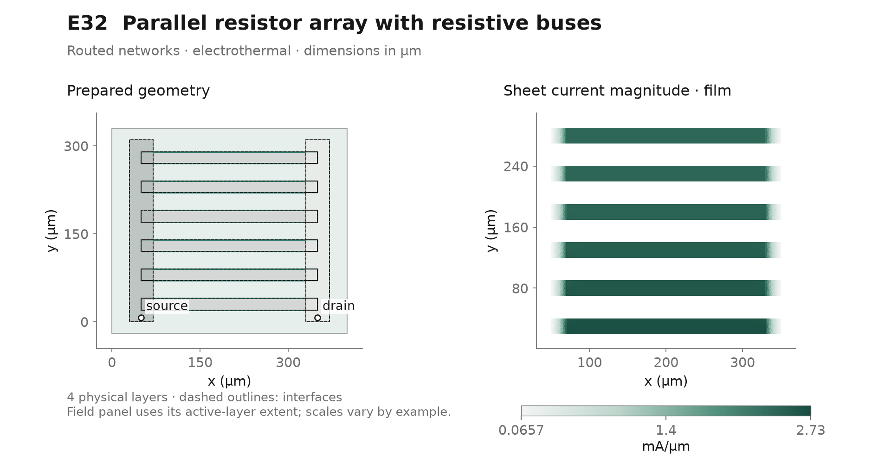](example-gallery/extended/E32_parallel_resistor_array.svg)

**In the GUI:** choose **Coupled DC electrothermal**, then in Results select layer `film` and **Sheet current density (mA/µm)**. Open the Analysis Devices table and compare the six resistor rows, then inspect source_bus and drain_bus potential maps.

**Look for:** Rows farther from the same-ended feeds carry less current because both collection buses remain resistive.

**Try next:** Run the source-bus thickness sweep at unchanged total current. Compare row sharing, voltage spread and loss rather than assuming identical strips carry identical current.

[Project (.etl)](../examples/E32_parallel_resistor_array.etl) · [GDSII](../examples/E32_parallel_resistor_array.gds) · [OASIS](../examples/E32_parallel_resistor_array.oas) · [Vector preview](example-gallery/extended/E32_parallel_resistor_array.svg)

<details>
<summary>Recorded inputs, model limits and numerical details</summary>

**Recorded operating point:** source 0 V (ground port; feeds source_landing: 1 mΩ); drain 0.3 A (current port; feeds drain_landing: 1 mΩ). Preview mode: **electrothermal**.

**Physical layers:** `film` (tan, 0.2 µm); `source_bus` (copper, 0.4 µm); `drain_bus` (copper, 0.4 µm); `substrate` (silicon, 100 µm).

**Saved sweep:** `layers.source_bus.thickness` = `[2e-07, 4e-07, 8e-07]` (SI values, electrothermal)

The saved sweep is a separate experiment; review the selected parameter, values and analysis in **Parameter sweep…** before starting it.

**Physical scope:** Distributed film/contact/bus resistance sets current sharing; per-strip currents are not prescribed. Six equal 300 × 20 µm effective 1 Ω/□ TaN resistors connect 0.4 µm copper buses, 40 µm wide and 310 µm long. Each film overlaps its bus by 20 µm with 1e-10 Ω m² specific contact resistivity; nominal transfer length is 10 µm. Both localized 40 × 15 µm feed footprints are at the same end, so remote rows carry less current because of resistive buses. Current sharing is solved, not imposed. Each row group reports its supported current, loss and current per 20 µm active width. Vary source-bus thickness while preserving all active film geometry and the 0.3 A delivered service. Nominal setup: 0.3 A coupled DC across six rows. Layout support 400 × 350 µm including margins. Synthetic 300 K engineering assumptions, not process calibration or device ratings. Nearest-sheet SiO₂-equivalent gaps connect to a 100 µm silicon support; finite physical contacts/vias replace gap areas. One backside 300 K reservoir includes 2e-6 m²K/W die attachment plus half-substrate conduction. These thickness-averaged paths omit depth-resolved gradients. No prescribed heating is added: coupled mode uses conductor, contact and finite-feed losses only; 25% of external-feed loss enters the local landing and 75% remains external. Constant TaN sheet values, where present, are synthetic effective values without electrical temperature feedback; bulk copper retains its reference temperature dependence. Review 250–500 K material validity and mesh refinement before interpreting peaks. No electromigration, damage, reactive circuit or mechanical model is implied.

**Recorded computed preview:** 2.54 Ω effective resistance; 0.2286 W electrical power; 311.7 K overall maximum temperature. 19,430 nodes / 38,356 triangles; converged. [Full metrics and hashes](example-gallery/extended/manifest.json).

**Recorded diagnostics:** Layer TaN resistive film contains 6 disconnected polygon islands; inspect connectivity.

Review current Issues after validation; a recorded warning is not permission to ignore a current blocker.

Optional command-line run of the current project:

```powershell
.\.venv\Scripts\python.exe -m etlayout solve examples/E32_parallel_resistor_array.etl --mode electrothermal --output results/E32
```

</details>

<a id="e33"></a>
## E33 · Thermal bridge heater

**Intermediate · Thermal experiments.** Compare lateral heat escape through anchors with weak distributed thermal attachment.

[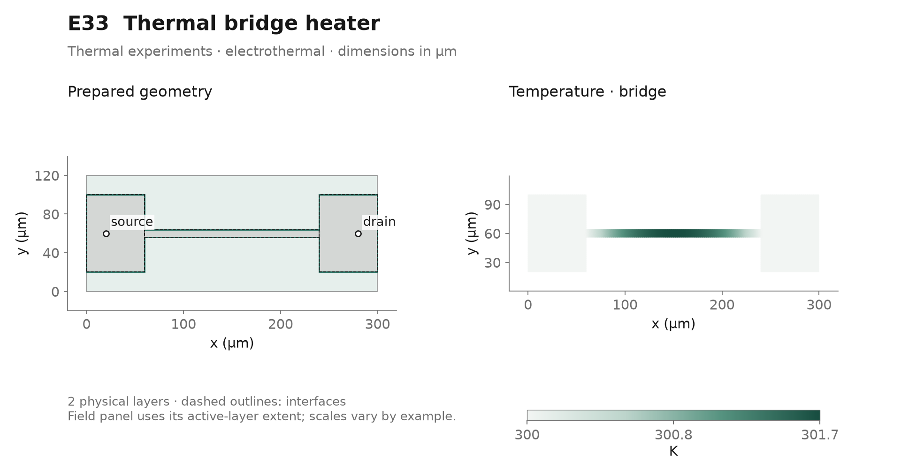](example-gallery/extended/E33_suspended_bridge_heater.svg)

**In the GUI:** choose **Coupled DC electrothermal**, then in Results select layer `bridge` and **Temperature (K)**. Compare bridge and substrate temperatures, then inspect anchor_attachment and weak_cavity_path in Contacts & connections.

**Look for:** Heat mainly escapes laterally through finite anchors; the weak cavity path is an explicit effective approximation.

**Try next:** Run the cavity heat-transfer sweep. Does the bridge or the support respond more strongly, and how sensitive is the conclusion to the effective path?

[Project (.etl)](../examples/E33_suspended_bridge_heater.etl) · [GDSII](../examples/E33_suspended_bridge_heater.gds) · [OASIS](../examples/E33_suspended_bridge_heater.oas) · [Vector preview](example-gallery/extended/E33_suspended_bridge_heater.svg)

<details>
<summary>Recorded inputs, model limits and numerical details</summary>

**Recorded operating point:** source 0 V (ground port; feeds source_landing_1: 1 Ω); drain 0.0003 A (current port; feeds drain_landing_1: 1 Ω). Preview mode: **electrothermal**.

**Physical layers:** `bridge` (tin, 0.4 µm); `substrate` (silicon, 50 µm).

**Saved sweep:** `interfaces.weak_cavity_path.thermal_value` = `[100.0, 200.0, 400.0]` (SI values, electrothermal)

The saved sweep is a separate experiment; review the selected parameter, values and analysis in **Parameter sweep…** before starting it.

**Physical scope:** Effective suspended-film thermal path; no mechanical suspension, gas-flow or radiation model. A narrow 200 × 8 × 0.4 µm TiN bridge connects wide end anchors. The 0.3 mA current creates Joule heat; no prescribed source is added. The cavity path is an explicitly effective 200 W/(m² K) residual gas/radiative approximation; heat primarily flows laterally to finite anchor attachments and then through the shared silicon support to one backside reservoir. Compare bridge and anchor temperatures. No mechanics, pressure or radiation law is solved. All inputs are synthetic engineering assumptions at 300 K; thickness-averaged layers omit depth-resolved gradients. External feed loss is deposited 25% locally and 75% outside the model.

**Original generator metadata (before the recorded solve):** The declaration below describes generation; the computed-preview record reports the subsequent actual calculation.

```json
{
  "bridge_width_m": 8e-06,
  "cavity_conductance_W_m2_K": 200.0,
  "die_um": [
    300.0,
    120.0
  ],
  "generator_version": 1,
  "hotspot_layer": "bridge",
  "max_dofs": 600000,
  "max_elements": 150000,
  "no_prescribed_heat": true,
  "reference_temperature_K": 300.0,
  "requested_current_A": 0.0003,
  "suspended_span_m": 0.00018,
  "thermal_reservoir": "backside",
  "validation": "Generated, not simulated; assess convergence and mesh sensitivity separately."
}
```

**Recorded computed preview:** 63.36 Ω effective resistance; 5.702e-06 W electrical power; 301.7 K overall maximum temperature. 10,903 nodes / 21,384 triangles; converged. [Full metrics and hashes](example-gallery/extended/manifest.json).

Optional command-line run of the current project:

```powershell
.\.venv\Scripts\python.exe -m etlayout solve examples/E33_suspended_bridge_heater.etl --mode electrothermal --output results/E33
```

</details>

<a id="e34"></a>
## E34 · Interleaved heater and sensor

**Advanced · Thermal experiments.** Separate the driven heater, weakly biased resistive sensor and common substrate temperatures.

[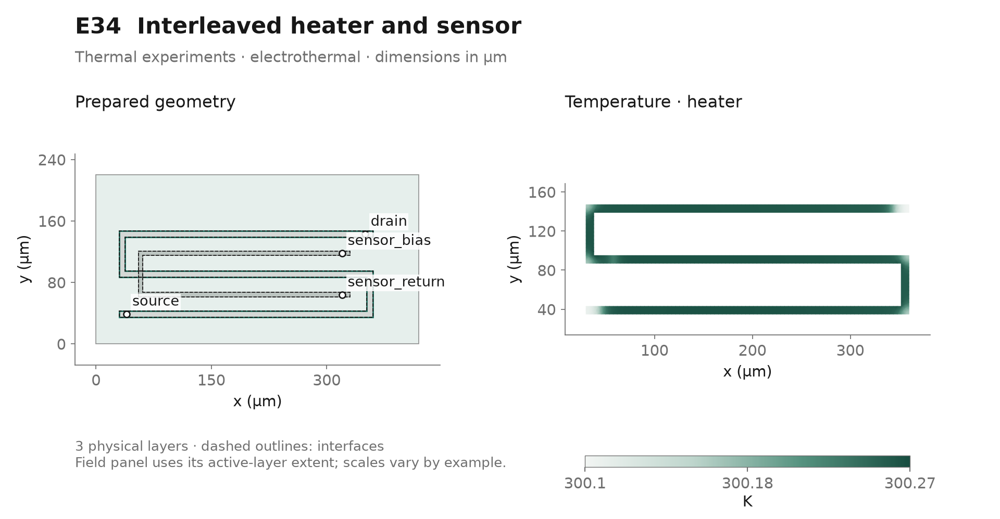](example-gallery/extended/E34_interleaved_heater_sensor.svg)

**In the GUI:** choose **Coupled DC electrothermal**, then in Results select layer `heater` and **Temperature (K)**. Compare heater, sensor and substrate layers, then inspect sensor_mean_temperature and sensor_probe_potential in Analysis Measurements.

**Look for:** The meanders stay electrically separate while the shared thermal path changes the weakly biased platinum sensor's temperature and voltage.

**Try next:** Run the heater-current sweep with sensor bias held fixed. Compare probe response with sensor temperature without treating the example as a calibrated thermometer.

[Project (.etl)](../examples/E34_interleaved_heater_sensor.etl) · [GDSII](../examples/E34_interleaved_heater_sensor.gds) · [OASIS](../examples/E34_interleaved_heater_sensor.oas) · [Vector preview](example-gallery/extended/E34_interleaved_heater_sensor.svg)

<details>
<summary>Recorded inputs, model limits and numerical details</summary>

**Recorded operating point:** source 0 V (ground port; feeds source_landing_1: 1 Ω); drain 0.002 A (current port; feeds drain_landing_1: 1 Ω); sensor_return 0 V (ground); sensor_bias 1e-05 A (current); sensor_probe passive sampling (probe). Preview mode: **electrothermal**.

**Physical layers:** `heater` (tin, 0.6 µm); `sensor` (platinum, 0.2 µm); `substrate` (silicon, 40 µm).

**Saved sweep:** `power.ports.drain.value` = `[0.001, 0.002, 0.003]` (SI values, electrothermal)

The saved sweep is a separate experiment; review the selected parameter, values and analysis in **Parameter sweep…** before starting it.

**Physical scope:** Electrical isolation and thermal crosstalk use existing sheet laws; no invented transduction or measurement electronics. Interleaved TiN heater and elevated platinum sensor meanders remain electrically isolated. A 2 mA heater and 10 µA sensor bias generate their own Joule heat. Nearest-layer SiO₂-equivalent insulation and a shared silicon layer transfer heat; the platinum reference resistivity has its explicit linear temperature coefficient. Compare sensor temperature and probe voltage during the bounded heater-current sweep. This is an effective thermoresistive readout, not a calibrated sensor, electrostatic coupling, or a new transduction model. All inputs are synthetic engineering assumptions at 300 K; thickness-averaged layers omit depth-resolved gradients. External feed loss is deposited 25% locally and 75% outside the model.

**Original generator metadata (before the recorded solve):** The declaration below describes generation; the computed-preview record reports the subsequent actual calculation.

```json
{
  "die_um": [
    420.0,
    220.0
  ],
  "electrically_isolated_masks": [
    "1/0",
    "2/0"
  ],
  "generator_version": 1,
  "hotspot_layer": "heater",
  "max_dofs": 600000,
  "max_elements": 150000,
  "no_prescribed_heat": true,
  "reference_temperature_K": 300.0,
  "requested_current_A": 0.002,
  "sensor_current_A": 1e-05,
  "thermal_reservoir": "backside",
  "validation": "Generated, not simulated; assess convergence and mesh sensitivity separately."
}
```

**Recorded computed preview:** 216.9 Ω effective resistance; 0.0008676 W electrical power; 300.3 K overall maximum temperature. 7,060 nodes / 13,798 triangles; converged. [Full metrics and hashes](example-gallery/extended/manifest.json).

Optional command-line run of the current project:

```powershell
.\.venv\Scripts\python.exe -m etlayout solve examples/E34_interleaved_heater_sensor.etl --mode electrothermal --output results/E34
```

</details>

<a id="e35"></a>
## E35 · Localized backside die attachment

**Advanced · Thermal experiments.** Observe lateral spreading when the thermal reservoir touches only a selected backside patch.

[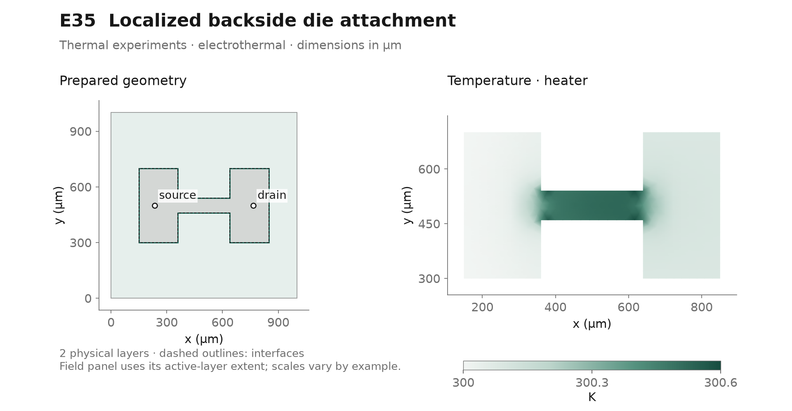](example-gallery/extended/E35_localized_die_attach.svg)

**In the GUI:** choose **Coupled DC electrothermal**, then in Results select layer `heater` and **Temperature (K)**. In Operating conditions locate the backside boundary; compare its partial footprint with the substrate temperature map.

**Look for:** Only one backside patch is attached, so lateral heat spreading moves the thermal pattern relative to the current-crowding pattern.

**Try next:** Run the attachment-resistance sweep at fixed electrical service. Which change comes from the boundary rather than the metal geometry?

[Project (.etl)](../examples/E35_localized_die_attach.etl) · [GDSII](../examples/E35_localized_die_attach.gds) · [OASIS](../examples/E35_localized_die_attach.oas) · [Vector preview](example-gallery/extended/E35_localized_die_attach.svg)

<details>
<summary>Recorded inputs, model limits and numerical details</summary>

**Recorded operating point:** source 0 V (ground port; feeds source_landing_1: 1 mΩ); drain 0.1 A (current port; feeds drain_landing_1: 1 mΩ). Preview mode: **electrothermal**.

**Physical layers:** `heater` (titanium, 2 µm); `substrate` (silicon, 200 µm).

**Saved sweep:** `thermal_boundaries.backside.value` = `[2e-06, 1e-05]` (SI values, electrothermal)

The saved sweep is a separate experiment; review the selected parameter, values and analysis in **Parameter sweep…** before starting it.

**Physical scope:** Thickness-averaged substrate and finite attachment area; no resolved through-thickness transient or package stress. A titanium dog-bone heater sits on a 1 × 1 mm silicon die. Only the left-side 370 × 800 µm backside footprint is attached; the remaining backside is insulated. At the unchanged 0.1 A drive, compare hot-spot position with electrical crowding and lateral substrate spreading. The finite top insulation and one partial backside path produce the cooling; hot metal is not independently attached to an ideal sink. No prescribed heat source, bond void mechanics or depth-resolved temperature solution is implied. All inputs are synthetic engineering assumptions at 300 K; thickness-averaged layers omit depth-resolved gradients. External feed loss is deposited 25% locally and 75% outside the model.

**Original generator metadata (before the recorded solve):** The declaration below describes generation; the computed-preview record reports the subsequent actual calculation.

```json
{
  "attach_mask": "30/0",
  "attached_area_m2": 2.96e-07,
  "die_um": [
    1000.0,
    1000.0
  ],
  "generator_version": 1,
  "hotspot_layer": "heater",
  "max_dofs": 600000,
  "max_elements": 150000,
  "no_prescribed_heat": true,
  "reference_temperature_K": 300.0,
  "requested_current_A": 0.1,
  "thermal_reservoir": "backside",
  "validation": "Generated, not simulated; assess convergence and mesh sensitivity separately."
}
```

**Recorded computed preview:** 0.943 Ω effective resistance; 0.00943 W electrical power; 300.6 K overall maximum temperature. 2,010 nodes / 3,830 triangles; converged. [Full metrics and hashes](example-gallery/extended/manifest.json).

Optional command-line run of the current project:

```powershell
.\.venv\Scripts\python.exe -m etlayout solve examples/E35_localized_die_attach.etl --mode electrothermal --output results/E35
```

</details>

<a id="e36"></a>
## E36 · Pulsed constriction and cooling

**Advanced · Pulsed operation.** Follow transient neck heating and temperature-dependent resistance over a current pulse train.

[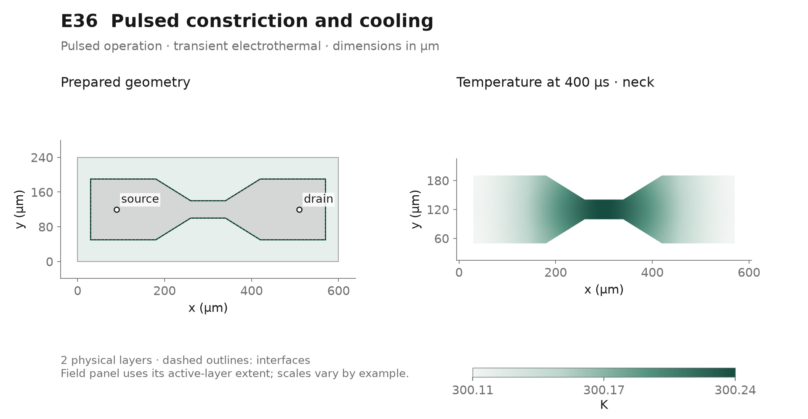](example-gallery/extended/E36_pulsed_hotspot_neck.svg)

**In the GUI:** choose **Electrothermal transient**, then in Results select layer `neck` and **Temperature (K)**. Inspect Time, waveform & initial-state settings…, run the pulse train and use retained times plus Time history to follow the neck.

**Look for:** The neck warms during the current pulses and cools afterward; the final field can be cooler than the peak over the complete run.

**Try next:** Use Time-step convergence… and local neck refinement before comparing the peak temperature or the energy deposited per pulse.

[Project (.etl)](../examples/E36_pulsed_hotspot_neck.etl) · [GDSII](../examples/E36_pulsed_hotspot_neck.gds) · [OASIS](../examples/E36_pulsed_hotspot_neck.oas) · [Vector preview](example-gallery/extended/E36_pulsed_hotspot_neck.svg)

<details>
<summary>Recorded inputs, model limits and numerical details</summary>

**Configured baseline drives (waveforms applied during the run):** source 0 V (ground port; feeds source_landing_1: 1 mΩ); drain 1 A (current port; feeds drain_landing_1: 1 mΩ). Preview mode: **transient electrothermal**.

**Physical layers:** `neck` (copper, 5 µm); `substrate` (alumina, 100 µm).

**Saved sweep:** `transient.drives.0.waveform.high` = `[0.5, 0.75, 1.0]` (SI values, electrothermal)

The saved sweep is a separate experiment; review the selected parameter, values and analysis in **Parameter sweep…** before starting it.

**Physical scope:** Quasi-static electrical/thermal storage approximation; no fusing, electrical switching loss or inductive overshoot. A tapered copper neck concentrates current between wide finite landings on a 600 × 240 µm alumina support. Two 1 A pulses have 20 µs rise/fall, an 80 µs plateau and a 200 µs period. The existing quasi-static electrical and thermal-storage solve gives Joule heating and delayed temperature response. Inspect the neck temperature and retained frames; refine time and mesh before comparing peaks. No inductance, switching losses, electromigration lifetime or prescribed heating is included. All inputs are synthetic engineering assumptions at 300 K; thickness-averaged layers omit depth-resolved gradients. External feed loss is deposited 25% locally and 75% outside the model.

**Original generator metadata (before the recorded solve):** The declaration below describes generation; the computed-preview record reports the subsequent actual calculation.

```json
{
  "die_um": [
    600.0,
    240.0
  ],
  "generator_version": 1,
  "hotspot_layer": "neck",
  "max_dofs": 600000,
  "max_elements": 150000,
  "neck_width_m": 4e-05,
  "no_prescribed_heat": true,
  "pulse_high_A": 1.0,
  "reference_temperature_K": 300.0,
  "requested_current_A": 1.0,
  "thermal_reservoir": "backside",
  "validation": "Generated, not simulated; assess convergence and mesh sensitivity separately."
}
```

**Transient setup:** stop 0.0004 s; maximum step 1e-05 s; saved output interval 2e-05 s. `power.ports.drain.value`: 0 → 1, delay 2e-05 s, rise 2e-05 s, plateau 8e-05 s, fall 2e-05 s, period 0.0002 s (target SI units). The field preview shows the final accepted time; use Time history to inspect the full run.

**Recorded computed preview:** 0 W electrical power; 300.2 K maximum temperature at final time; 302.3 K peak over all time steps; 3.429e-06 J integrated input heat. 1,612 nodes / 3,054 triangles; converged. [Full metrics and hashes](example-gallery/extended/manifest.json).

Optional command-line run of the current project:

```powershell
.\.venv\Scripts\python.exe -m etlayout solve examples/E36_pulsed_hotspot_neck.etl --mode electrothermal --output results/E36
```

</details>

<a id="e37"></a>
## E37 · Fully gated HEMT contact coupon

**Intermediate · Device studies.** Inspect a single fully controlled channel with finite source and drain contacts.

[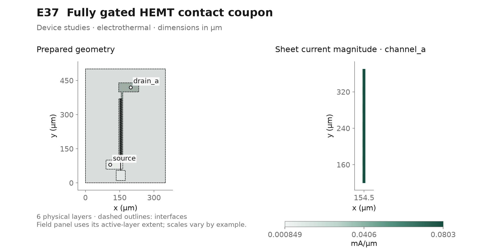](example-gallery/extended/E37_gated_hemt_coupon.svg)

**In the GUI:** choose **Coupled DC electrothermal**, then in Results select layer `channel_a` and **Sheet current density (mA/µm)**. Inspect channel_a sheet current, the source/drain Contacts records and the bank_a device group; then review gate_a under gate controls.

**Look for:** Every conducting channel path crosses the complete gate-controlled region; localized feeds and finite ohmic contacts remain visible in the loss budget.

**Try next:** Run the gate-bias sweep at fixed delivered current. Compare required drain voltage and local channel field; conductance-floor current is not predicted leakage.

[Project (.etl)](../examples/E37_gated_hemt_coupon.etl) · [GDSII](../examples/E37_gated_hemt_coupon.gds) · [OASIS](../examples/E37_gated_hemt_coupon.oas) · [Vector preview](example-gallery/extended/E37_gated_hemt_coupon.svg)

<details>
<summary>Recorded inputs, model limits and numerical details</summary>

**Recorded operating point:** drain_a 0.02 A (current port; feeds drain_a_landing_1: 1 mΩ); source 0 V (ground port; feeds source_landing_1: 1 mΩ); gate_a 3 V (gate). Preview mode: **electrothermal**.

**Physical layers:** `channel_a` (2deg, 0.01 µm); `drain_a` (copper, 8 µm); `source` (copper, 8 µm); `gate` (gold, 0.05 µm); `buffer` (gan, 2 µm); `substrate` (sic, 150 µm).

**Saved sweep:** `terminals.gate_a.value` = `[1.0, 2.0, 3.0]` (SI values, electrothermal)

The saved sweep is a separate experiment; review the selected parameter, values and analysis in **Parameter sweep…** before starting it.

**Physical scope:** Local-bias 2DEG resistance law; no ungated bypass, velocity saturation, trapping, breakdown or predicted off-state leakage. A single 250 µm-wide GaN coupon resolves a 1 µm gate, 2 µm source/drain access and finite 2 µm ohmic overlaps. The localized finite feeds deliver 20 mA. Every source-to-drain channel path crosses the complete gate; there is no ungated edge bypass. The drawn gate is insulated and its explicit gate terminal controls the existing analytical local-bias law. The same synthetic mobility, density bounds and finite 1e-10 Ω m² contacts as the larger power examples are retained. The single backside sink follows buffer/interface paths. No high-field saturation, breakdown, switching or calibrated rating is established; numerical conductance-floor current is not leakage. The supplied fixed-current gate study is bounded to 1–3 V. Deep-off, floor-dominated solves can become ill-conditioned and are outside this example's validated operating scope. All inputs are synthetic engineering assumptions at 300 K; thickness-averaged layers omit depth-resolved gradients. External feed loss is deposited 25% locally and 75% outside the model.

**Original generator metadata (before the recorded solve):** The declaration below describes generation; the computed-preview record reports the subsequent actual calculation.

```json
{
  "actual_gate_fingers": 1,
  "bank_count": 1,
  "contact_specific_resistance_ohm_m2": 1e-10,
  "die_um": [
    350.0,
    500.0
  ],
  "gate_length_m": 1e-06,
  "generator_version": 1,
  "hotspot_layer": "channel_a",
  "max_dofs": 600000,
  "max_elements": 150000,
  "maximum_channel_field_V_m": 300000.0,
  "model_temperature_range_K": [
    300.0,
    425.0
  ],
  "no_prescribed_heat": true,
  "reference_temperature_K": 300.0,
  "requested_current_A": 0.02,
  "supplied_gate_sweep_range_V": [
    1.0,
    3.0
  ],
  "thermal_reservoir": "backside",
  "total_gate_width_m": 0.00025,
  "validation": "Generated, not simulated; assess convergence and mesh sensitivity separately."
}
```

**Recorded computed preview:** 8.034 Ω effective resistance; 0.003214 W electrical power; 300.2 K overall maximum temperature. 1,671 nodes / 3,254 triangles; converged. [Full metrics and hashes](example-gallery/extended/manifest.json).

Optional command-line run of the current project:

```powershell
.\.venv\Scripts\python.exe -m etlayout solve examples/E37_gated_hemt_coupon.etl --mode electrothermal --output results/E37
```

</details>

<a id="e38"></a>
## E38 · Independently driven GaN banks

**Advanced · Device studies.** Compare separately driven gated banks through their shared source and thermal environment.

[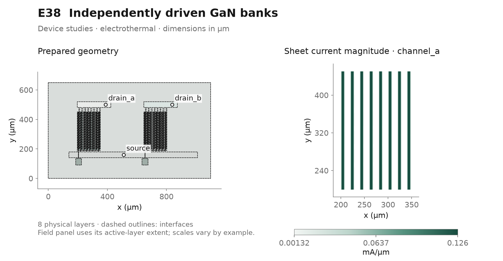](example-gallery/extended/E38_dual_bank_gan.svg)

**In the GUI:** choose **Coupled DC electrothermal**, then in Results select layer `channel_a` and **Sheet current density (mA/µm)**. Compare channel_a and channel_b with a shared manual range, then open bank_a and bank_b in the Analysis Devices table.

**Look for:** Independent drain drives set delivered bank service while the shared source metal and substrate create source-potential and thermal interaction.

**Try next:** Sweep only one bank's gate. Compare its required voltage and field with the other bank while preserving both requested currents.

[Project (.etl)](../examples/E38_dual_bank_gan.etl) · [GDSII](../examples/E38_dual_bank_gan.gds) · [OASIS](../examples/E38_dual_bank_gan.oas) · [Vector preview](example-gallery/extended/E38_dual_bank_gan.svg)

<details>
<summary>Recorded inputs, model limits and numerical details</summary>

**Recorded operating point:** drain_a 0.25 A (current port; feeds drain_a_landing_1: 1 mΩ); drain_b 0.25 A (current port; feeds drain_b_landing_1: 1 mΩ); source 0 V (ground port; feeds source_landing_1: 1 mΩ); gate_a 3 V (gate); gate_b 3 V (gate). Preview mode: **electrothermal**.

**Physical layers:** `channel_a` (2deg, 0.01 µm); `drain_a` (copper, 8 µm); `channel_b` (2deg, 0.01 µm); `drain_b` (copper, 8 µm); `source` (copper, 8 µm); `gate` (gold, 0.05 µm); `buffer` (gan, 2 µm); `substrate` (sic, 150 µm).

**Saved sweep:** `terminals.gate_a.value` = `[1.0, 2.0, 3.0]` (SI values, electrothermal); `terminals.gate_b.value` = `[1.0, 2.0, 3.0]` (SI values, electrothermal)

The saved sweep is a separate experiment; review the selected parameter, values and analysis in **Parameter sweep…** before starting it.

**Physical scope:** Synthetic fully gated conducting paths; no switching, gate leakage, high-field saturation or calibrated transistor rating. Two independently current-driven eight-finger GaN banks share finite source collection and a thermal substrate. Compare bank/finger currents, local source bias and temperatures while varying one gate at fixed 0.25 A per bank. Every source-to-drain channel path crosses the complete gate; there is no ungated edge bypass. The drawn gate is insulated and its explicit gate terminal controls the existing analytical local-bias law. The same synthetic mobility, density bounds and finite 1e-10 Ω m² contacts as the larger power examples are retained. The single backside sink follows buffer/interface paths. No high-field saturation, breakdown, switching or calibrated rating is established; numerical conductance-floor current is not leakage. The supplied fixed-current gate study is bounded to 1–3 V. Deep-off, floor-dominated solves can become ill-conditioned and are outside this example's validated operating scope. All inputs are synthetic engineering assumptions at 300 K; thickness-averaged layers omit depth-resolved gradients. External feed loss is deposited 25% locally and 75% outside the model.

**Original generator metadata (before the recorded solve):** The declaration below describes generation; the computed-preview record reports the subsequent actual calculation.

```json
{
  "actual_gate_fingers": 16,
  "bank_count": 2,
  "contact_specific_resistance_ohm_m2": 1e-10,
  "die_um": [
    1100.0,
    650.0
  ],
  "gate_length_m": 1e-06,
  "generator_version": 1,
  "hotspot_layer": "channel_a",
  "max_dofs": 600000,
  "max_elements": 150000,
  "maximum_channel_field_V_m": 300000.0,
  "model_temperature_range_K": [
    300.0,
    425.0
  ],
  "no_prescribed_heat": true,
  "reference_temperature_K": 300.0,
  "requested_current_A": 0.5,
  "supplied_gate_sweep_range_V": [
    1.0,
    3.0
  ],
  "thermal_reservoir": "backside",
  "total_gate_width_m": 0.004,
  "validation": "Generated, not simulated; assess convergence and mesh sensitivity separately."
}
```

**Recorded computed preview:** 1.026 Ω effective resistance; 0.1281 W electrical power; 301.1 K overall maximum temperature. 20,311 nodes / 40,444 triangles; converged. [Full metrics and hashes](example-gallery/extended/manifest.json).

**Recorded diagnostics:** Layer Fully gated GaN bank A contains 8 disconnected polygon islands; inspect connectivity. Layer Fully gated GaN bank B contains 8 disconnected polygon islands; inspect connectivity. Layer Gate contains 2 disconnected polygon islands; inspect connectivity.

Review current Issues after validation; a recorded warning is not permission to ignore a current blocker.

Optional command-line run of the current project:

```powershell
.\.venv\Scripts\python.exe -m etlayout solve examples/E38_dual_bank_gan.etl --mode electrothermal --output results/E38
```

</details>

<a id="e39"></a>
## E39 · SiC on-state die with active islands

**Engineering · Device studies.** Inspect area-normalized vertical current sharing between protected active islands and finite collection straps.

[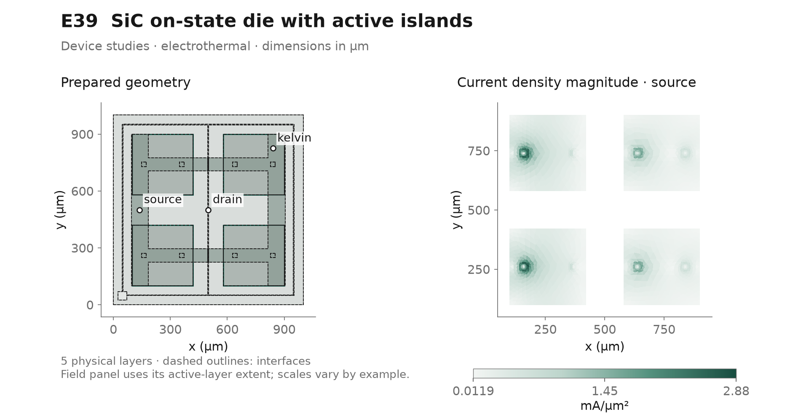](example-gallery/extended/E39_sic_island_die.svg)

**In the GUI:** choose **Coupled DC electrothermal**, then in Results select layer `source` and **Volumetric current density (mA/µm²)**. Inspect source, collector and drain layers, then compare island groups, collection vias and kelvin_potential in Analysis.

**Look for:** Local sheet voltages determine current division between four active islands; the distributed on-state device loss is separate from collection and feed losses.

**Try next:** Run the collector-thickness sweep at equal current and active area. Compare island sharing and Kelvin potential without interpreting the insulated gate drawing as an automatic gate-dependent model.

**Review F6 validation in the GUI:** the configured reference has zero blockers and one electrically connected network, with two expected notices. The Source warning reports four disconnected polygons: these are the intended active islands, joined through eight collection vias and the shared Collector; vertical on-state loads connect them to the Drain. The Drain/Collector projected-overlap information reports that those two sheets have no direct electrical contact. This is intentional: current must pass from Drain through the area-specific on-state resistance to Source, then through the collection vias to Collector. Do not add a direct Drain–Collector contact: it would short the device model. Use Locate to inspect both notices rather than turning warnings off; they remain useful when editing the layout.

[Project (.etl)](../examples/E39_sic_island_die.etl) · [GDSII](../examples/E39_sic_island_die.gds) · [OASIS](../examples/E39_sic_island_die.oas) · [Vector preview](example-gallery/extended/E39_sic_island_die.svg)

<details>
<summary>Recorded inputs, model limits and numerical details</summary>

**Recorded operating point:** source 0 V (ground port; feeds source_landing_1: 1 mΩ); drain 10 A (current port; feeds drain_landing_1: 1 mΩ); kelvin passive sampling (probe). Preview mode: **electrothermal**.

**Physical layers:** `source` (copper, 10 µm); `drain` (copper, 20 µm); `collector` (copper, 30 µm); `gate` (gold, 0.3 µm); `substrate` (sic, 200 µm).

**Saved sweep:** `layers.collector.thickness` = `[3e-05, 4e-05]` (SI values, electrothermal); `thermal_boundaries.backside.value` = `[2.025e-06, 1.0025e-05]` (SI values, electrothermal)

The saved sweep is a separate experiment; review the selected parameter, values and analysis in **Parameter sweep…** before starting it.

**Physical scope:** SiC MOSFET on-state interconnect model with fixed-gate area-specific resistance; no body diode, avalanche or switching physics. SiC MOSFET on-state interconnect model with four 320 × 320 µm active islands on a 1 mm die. Separated active zones, nonactive termination margins, insulated gate corridors and two elevated source straps make source collection visible. Eight geometric copper vias join the active source sheets to the straps; a passive Kelvin location samples their potential. Current sharing emerges from local j_z=(V_d−V_s)/Ron,sp(T), with Ron,sp=1e-7 Ω m² (1 mΩ cm²) at 300 K and alpha=0.003/K. Ron,sp includes intrinsic channel/drift/contact contributions, so substrate electrical resistance is not counted again. A fixed-on gate assumption, not the insulated drawing, controls this load. The 10 A service includes finite localized feeds and one backside thermal path. No body diode, avalanche, switching or planar/trench distinction is modeled. All inputs are synthetic engineering assumptions at 300 K; thickness-averaged layers omit depth-resolved gradients. External feed loss is deposited 25% locally and 75% outside the model.

**Original generator metadata (before the recorded solve):** The declaration below describes generation; the computed-preview record reports the subsequent actual calculation.

```json
{
  "active_area_m2": 4.0960000000000007e-07,
  "analytical_uniform_device_resistance_ohm": 0.24414062499999994,
  "die_um": [
    1000.0,
    1000.0
  ],
  "generator_version": 1,
  "hotspot_layer": "source",
  "macrocell_count": 4,
  "max_dofs": 600000,
  "max_elements": 150000,
  "model_temperature_range_K": [
    300.0,
    450.0
  ],
  "no_prescribed_heat": true,
  "on_state_specific_resistance_ohm_m2": 1e-07,
  "reference_temperature_K": 300.0,
  "requested_current_A": 10.0,
  "thermal_reservoir": "backside",
  "validation": "Generated, not simulated; assess convergence and mesh sensitivity separately.",
  "via_count": 8
}
```

**Recorded computed preview:** 0.2998 Ω effective resistance; 29.98 W electrical power; 381.9 K overall maximum temperature. 3,344 nodes / 6,486 triangles; converged. [Full metrics and hashes](example-gallery/extended/manifest.json).

**Recorded diagnostics:** Layer Source contains 4 disconnected polygon islands; inspect connectivity.

Review current Issues after validation; a recorded warning is not permission to ignore a current blocker.

Optional command-line run of the current project:

```powershell
.\.venv\Scripts\python.exe -m etlayout solve examples/E39_sic_island_die.etl --mode electrothermal --output results/E39
```

</details>

<a id="e40"></a>
## E40 · Three-level package interposer

**Engineering · Package interconnects.** Trace localized package landings through millimeter buses and hierarchical via banks.

[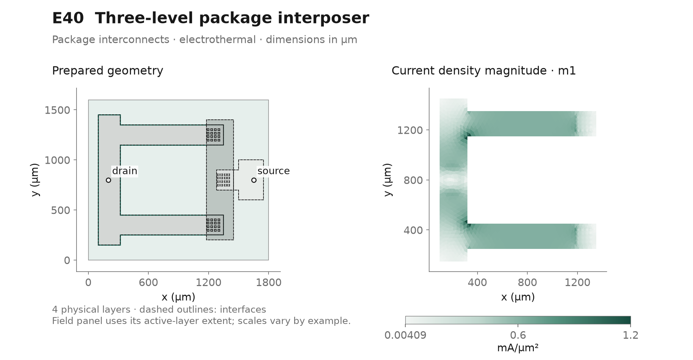](example-gallery/extended/E40_package_interposer.svg)

**In the GUI:** choose **Coupled DC electrothermal**, then in Results select layer `m1` and **Volumetric current density (mA/µm²)**. Follow m1 → m2 → m3 and open the Analysis Contacts table beside lower_branch_current and upper_branch_current measurements.

**Look for:** Two lower-metal arms go around a protected opening, transfer through separate via banks and recombine before the output landing.

**Try next:** Run the copper-thickness study at fixed service, then refine via transfer regions before ranking branch balance or the regularized hotspot.

[Project (.etl)](../examples/E40_package_interposer.etl) · [GDSII](../examples/E40_package_interposer.gds) · [OASIS](../examples/E40_package_interposer.oas) · [Vector preview](example-gallery/extended/E40_package_interposer.svg)

<details>
<summary>Recorded inputs, model limits and numerical details</summary>

**Recorded operating point:** source 0 V (ground port; feeds source_landing_1: 1 mΩ); drain 5 A (current port; feeds drain_landing_1: 1 mΩ). Preview mode: **electrothermal**.

**Physical layers:** `m1` (copper, 20 µm); `m2` (copper, 20 µm); `m3` (copper, 20 µm); `substrate` (alumina, 300 µm).

**Saved sweep:** `power.ports.drain.value` = `[2.5, 5.0, 7.5]` (SI values, electrothermal); `layers.m1.thickness` = `[2e-05, 3e-05]` (SI values, electrothermal)

The saved sweep is a separate experiment; review the selected parameter, values and analysis in **Parameter sweep…** before starting it.

**Physical scope:** Resistive/thermal 2.5D package approximation; hierarchy does not reduce FEM cost and no signal-integrity model is included. A 1.8 × 1.6 mm three-metal alumina interposer routes 5 A around a protected central opening. Two parallel lower-metal arms transfer through hierarchical 4 × 4 via arrays into a middle-metal collector, then through a third array into the upper output landing. Local finite input/output feeds leave sheet resistance and via sharing observable. Compare the two branch transfers and individual via currents; bends and access resistance create local crowding. Synthetic SiO₂-equivalent intermetal gaps and a single alumina backside path represent package heat transfer. This is a DC interconnect example, not RF impedance, inductance, switching or a package qualification. All inputs are synthetic engineering assumptions at 300 K; thickness-averaged layers omit depth-resolved gradients. External feed loss is deposited 25% locally and 75% outside the model.

**Original generator metadata (before the recorded solve):** The declaration below describes generation; the computed-preview record reports the subsequent actual calculation.

```json
{
  "die_um": [
    1800.0,
    1600.0
  ],
  "generator_version": 1,
  "hotspot_layer": "m1",
  "max_dofs": 600000,
  "max_elements": 150000,
  "metal_levels": 3,
  "no_prescribed_heat": true,
  "protected_opening_um": [
    350.0,
    400.0
  ],
  "reference_temperature_K": 300.0,
  "requested_current_A": 5.0,
  "thermal_reservoir": "backside",
  "validation": "Generated, not simulated; assess convergence and mesh sensitivity separately.",
  "via_count": 48
}
```

**Recorded computed preview:** 0.006373 Ω effective resistance; 0.1593 W electrical power; 306.7 K overall maximum temperature. 5,289 nodes / 10,372 triangles; converged. [Full metrics and hashes](example-gallery/extended/manifest.json).

Optional command-line run of the current project:

```powershell
.\.venv\Scripts\python.exe -m etlayout solve examples/E40_package_interposer.etl --mode electrothermal --output results/E40
```

</details>

## Maintaining the gallery

<details>
<summary>Advanced: deterministic generation and reproduction</summary>

The desktop walkthroughs above work with the existing projects. Maintainers can regenerate the scientific previews separately:

```powershell
.\.venv\Scripts\python.exe scripts/build_example_gallery.py --examples E25 E26 E27 E28 E29 E30 E31 E32 E33 E34 E35 E36 E37 E38 E39 E40 --output docs/example-gallery/extended --markdown docs/extended-examples.md --use-cache --no-overview
.\.venv\Scripts\python.exe scripts/build_example_gallery.py --examples E11 E16 --output .artifacts/gallery-preview --markdown .artifacts/gallery-preview.md
```

The generator reads existing projects from `examples/` and creates missing ones. Its cache is reused only when the physics hash, solver version and source-code fingerprint match. Use `--no-solve` for explicitly labeled geometry-only previews. The manifest records plotted range, units, mesh, convergence, diagnostics, operating point and configuration hashes.

</details>
