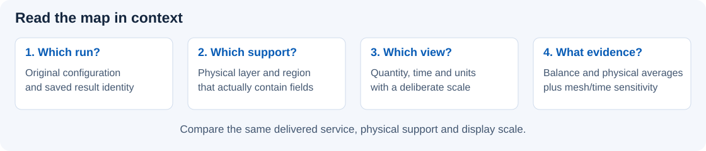

# Feature catalog

[Project introduction](../README.md) · [Guided examples](examples.md) · [Desktop workflow](desktop-workflow.md)

Use the desktop to move from a layout question to a result you can inspect,
compare and reopen. This catalog covers the current source edition; it describes
available tools, not a claim that every physical model is calibrated for your process.

<!-- BEGIN GENERATED CAPABILITIES -->
## Versioned capability index

The source registry records when each capability became available. Compare **Since**
with the installed version in About or `etlayout --version`; an entry does not
claim that a matching binary has been published. Analysis names describe supported
modes, subject to the stated limits and prerequisites. Test links identify behavior
coverage locations, not a claim that a particular CI run passed.

| Stable ID / feature | GUI or CLI route | Analyses | Since | Boundary / behavior tests |
| --- | --- | --- | --- | --- |
| `layout.import` · **GDSII/OASIS hierarchy** | File → Import layout…; Layout & Region | electrical, thermal, electrothermal, thermal-transient, electrothermal-transient | 0.4.0 | Layout hierarchy does not reduce finite-element cost. [geometry](../tests/test_geometry.py) |
| `layout.regions` · **Distinct domain, crop and reporting support** | Layout & Region; Model; View | electrical, thermal, electrothermal, thermal-transient, electrothermal-transient | 0.4.0 | View-only changes preserve physical identity. [workflow_maintenance](../tests/test_workflow_maintenance.py) |
| `layout.vertices` · **Project-owned polygon editing** | Edit → Edit layout polygon vertices | electrical, thermal, electrothermal, thermal-transient, electrothermal-transient | 0.4.0 | Imported source is preserved; polygon editing is not general CAD construction. [layout_editor](../tests/test_layout_editor.py) |
| `stack.materials` · **Materials and technology templates** | Layers & Materials | electrical, thermal, electrothermal, thermal-transient, electrothermal-transient | 0.4.0 | Thickness-averaged 2.5D sheets require explicit interfaces. [technology_templates](../tests/test_technology_templates.py) |
| `stack.thermal-films` · **Thermal films and explicit heat placement** | Layers & Materials; Contacts & Connections | electrical, thermal, electrothermal, thermal-transient, electrothermal-transient | 0.4.1 | Avoid counting effective thermal paths twice. [thermal_stacks](../tests/test_thermal_stacks.py) |
| `analysis.dc` · **Fixed-temperature DC electrical** | Header → Analysis type → DC electrical | electrical | 0.4.0 | Conduction model; no charge storage or switching parasitics. [electrical](../tests/test_electrical.py) |
| `analysis.thermal` · **Steady thermal and coupled electrothermal** | Header → Analysis type | thermal, electrothermal | 0.4.0 | Configured material laws and reservoirs determine physical validity. [thermal](../tests/test_thermal.py) |
| `analysis.transient` · **Thermal/electrothermal transients** | Header → Analysis type; Simulation → Time and load settings… | thermal-transient, electrothermal-transient | 0.4.0 | Quasi-static electrical loss and thermal storage; no switching physics. [transient](../tests/test_transient.py) |
| `analysis.temperature-limits` · **Maximum-temperature engineering acceptance** | Operating conditions → Maximum operating temperature… | electrical, thermal, electrothermal, thermal-transient, electrothermal-transient | 0.4.1 | Acceptance is distinct from numerical convergence. [temperature_limits](../tests/test_temperature_limits.py) |
| `power.ports` · **Finite ports, vias and distributed loads** | Contacts & Connections; Studies → Routing & optimization | electrical, electrothermal, electrothermal-transient | 0.4.0 | Projected overlap is not connectivity; device parameters need calibration. [power_solver_multiport](../tests/test_power_solver_multiport.py) |
| `power.routing` · **Constrained routing and equal-service optimization** | Studies → Routing & optimization | electrical, thermal, electrothermal | 0.4.0 | Steady operation only; compare delivered service and verified finalists. [power_routing](../tests/test_power_routing.py) |
| `power.multiport` · **Passive multiport export** | Contacts & Connections → Extract passive network / SPICE | electrical | 0.4.0 | Fixed-temperature passive DC only; temperature, landing map, per-entry mesh evidence and optional external simulator checks remain separate. [power_solver_multiport](../tests/test_power_solver_multiport.py), [multiport_study](../tests/test_multiport_study.py), [circuit_validation](../tests/test_circuit_validation.py), [multiport_gui](../tests/test_multiport_gui.py) |
| `power.capacitance` · **Experimental 3D conductor capacitance** | Studies → Capacitance & loop inductance → Parasitics | electrostatic | 0.4.4 | Optional separate FastCap2/raw-output engine; homogeneous dielectric, whole PEC bodies and infinity reference only. Raw acceptance and mesh evidence remain distinct; no bundled engine or RLC dynamics. [capacitance](../tests/test_capacitance.py), [field_snapshot](../tests/test_field_snapshot.py), [parasitic_workflow](../tests/test_parasitic_workflow.py) |
| `power.loop-rl` · **Experimental closed-return impedance and inductance** | Studies → Capacitance & loop inductance → Parasitics | closed-loop-rl | 0.4.4 | Optional separate FastHenry; complete nonmagnetic rectangular-bar loops with ideal end junctions. Explicit positive frequencies, output precision and every matrix entry are checked; no arbitrary plane reduction. [inductance](../tests/test_inductance.py), [field_cli](../tests/test_field_cli.py), [field_persistence](../tests/test_field_persistence.py) |
| `results.maps` · **Layer, region, quantity and time maps** | Results → Layer / Quantity / Region | electrical, thermal, electrothermal, thermal-transient, electrothermal-transient | 0.4.0 | Display scales preserve saved fields; raw extrema need physical qualification. [result_layer_selection](../tests/test_result_layer_selection.py) |
| `results.engineering` · **Independent evidence and same-support quantities** | Results → Metrics & loss budget → Engineering | electrical, thermal, electrothermal, thermal-transient, electrothermal-transient | 0.4.1 | Convergence, conservation, mesh confidence, model range and calibration are separate. [engineering_workflow](../tests/test_engineering_workflow.py) |
| `results.transient-peaks` · **Peak and final transient frames** | Results → Time navigation | thermal-transient, electrothermal-transient | 0.4.1 | A cool selected frame does not erase whole-run acceptance failure. [engineering_workflow](../tests/test_engineering_workflow.py) |
| `studies.convergence` · **Mesh and time-step sensitivity studies** | Studies → Mesh convergence… / Time-step convergence… | electrical, thermal, electrothermal, thermal-transient, electrothermal-transient | 0.4.0 | Compare integrals and regularized hotspots; sensitivity is not a rigorous error bound. [study_execution](../tests/test_study_execution.py) |
| `studies.local-mesh` · **Physical local refinement and per-metric evidence** | Mesh & Checks → Suggest local refinement… | electrical, thermal, electrothermal, thermal-transient, electrothermal-transient | 0.4.1 | A suggestion or generated mesh is not proof; retain support and resource limits. [local_refinement_gui](../tests/test_local_refinement_gui.py) |
| `studies.devices` · **Configured GaN, SiC and finite-contact studies** | Studies → Run configured study… / Finite-contact TLM study (E27)… | electrical, electrothermal, electrothermal-transient | 0.4.1 | Synthetic effective models do not establish breakdown or switching performance. [device_scenarios](../tests/test_device_scenarios.py) |
| `projects.history` · **Embedded projects and read-only run history** | File → Save project as…; History | electrical, thermal, electrothermal, thermal-transient, electrothermal-transient | 0.4.0 | Apply/Discard/Stay resolves drafts; historical physical settings remain read-only. [lazy_history_workflows](../tests/test_lazy_history_workflows.py) |
| `projects.sharing` · **Scientific sharing and complete archives** | Results → Export task | electrical, thermal, electrothermal, thermal-transient, electrothermal-transient | 0.4.0 | Complete archives contain confidential source/configuration; review output scope. [explicit_exports](../tests/test_explicit_exports.py) |
| `execution.cpu` · **Cancellable background work and shared CPU budget** | Edit → Execution settings… | electrical, thermal, electrothermal, thermal-transient, electrothermal-transient | 0.4.0 | Assembly/studies can parallelize; sparse factorization is serial. No GPU backend. [execution](../tests/test_execution.py) |
| `examples.references` · **Forty reference examples** | File → Ready-to-run examples | electrical, thermal, electrothermal, thermal-transient, electrothermal-transient | 0.4.0 | Each example has its own supported modes, validity and resource limits. [example_science](../tests/test_example_science.py) |
| `examples.browser` · **Searchable examples, family presets and scenarios** | File → Browse example library… | electrical, thermal, electrothermal, thermal-transient, electrothermal-transient | 0.4.1 | Opening does not solve; named scenarios define inputs; large presets are opt-in. [example_library_browser](../tests/test_example_library_browser.py) |
| `workflow.verification` · **Direct result-to-verification guidance** | Results → Check mesh / time-step sensitivity… | electrical, thermal, electrothermal, thermal-transient, electrothermal-transient | 0.4.1 | Current applied physics required; historical inspection cannot edit or run. [workflow_next_steps](../tests/test_workflow_next_steps.py) |
| `identity.build` · **Machine-readable build provenance** | CLI: etlayout build-info | electrical, thermal, electrothermal, thermal-transient, electrothermal-transient | 0.4.1 | Source/build identity does not establish publication or calibration. [build_provenance](../tests/test_build_provenance.py) |

<!-- END GENERATED CAPABILITIES -->

## Build the experiment

| Tool | Where to find it | What you can do |
| --- | --- | --- |
| GDSII/OASIS and hierarchy | **File → Import layout…**, **Layout & Region**, **View → Hierarchy / layers / nets** | Inspect cells and instances, frame geometry and choose an explicit simulation scope. New masks start display-only until mapped. |
| Purposeful regions | **Layout & Region**, **Model → Define measurement support**, **Model → Define routing keepout**, **View → Draw view crop** | Keep physical domain, reporting support, routing protection and camera framing separate. Preview and commit the stated purpose. |
| Project-owned vertex editor | **Edit → Edit layout polygon vertices**, **Ctrl+Shift+E** | Move polygons or individual exterior/hole vertices, enter coordinates, insert/delete points and apply an undoable copy. The imported source file is preserved. |
| Physical stack and materials | **Layers & Materials**, **Model → Materials and library** | Assign sheet roles, thickness, bottom elevation and electrical/thermal material models. Review a stack cross-section. Thermal-only films and explicit loss-deposition controls preserve the default 50/50 endpoint split; [avoid double counting thermal paths](thermal-stacks.md). |
| Reusable technology mapping | **Layers & Materials → Technology templates…** | Preview and apply physical mappings/material snapshots to chosen masks; project drives and thermal boundaries remain a separate setup task. |
| Connections | **Contacts & Connections** | Define boundary terminals, finite-feed physical ports, interlayer contacts, passive probes, floating electrodes and supported gate controls. Projected overlap alone is not a physical interface. |
| Operating conditions | **Operating Conditions** | Configure electrical drive, prescribed heat, thermal reservoirs and numerical/initial conditions; dormant settings survive analysis-mode changes. |

[Desktop setup](desktop-workflow.md) explains the complete path. The [layout editor](layout-editor.md)
and [setup handbook](handbook/setup-and-boundaries.md) cover geometry and physical assumptions.

## Choose the calculation

In the working setup, use the header's **Analysis type** selector. Its selection
updates the prerequisites; it does not launch a run or erase inputs used by
another mode. Historical inspection and active jobs retain their editing locks.

| Analysis | Question it answers | Start with |
| --- | --- | --- |
| **DC electrical** | Where does current flow at a fixed configured temperature, and what resistance/loss does that produce? | E1 straight strip, E2 bend/taper, E12 via ladder. |
| **Steady-state thermal** | Where does prescribed or supported electrical heating go through the configured stack and reservoirs? | E15 thermal crosstalk (prescribed heating). |
| **Coupled DC electrothermal** | How do temperature-dependent conduction and Joule heating settle together? | E11 serpentine heater or a nominal power reference. |
| **Thermal transient** | How do thermal mass, pulses and cooling affect temperature over time? | E17 thermal RC reference, E19 passive multilayer thermal delay. |
| **Electrothermal transient** | How does changing temperature feed back into quasi-static electrical loss during a pulse? | E18 pulsed conductor. |

**Simulation → Time and load settings…** provides supported pulse/PWL waveforms,
initialization and time controls. Saved-state start/resume and time-step studies
support repeatable continuation. There is no electrical charge-storage or
switching-parasitic model. See [transient operation](handbook/transient.md).

## Inspect evidence, not just colors



| Task | GUI route | Read the result with this context |
| --- | --- | --- |
| Validate and mesh | **Mesh & Checks**, **F6**, **F7** | Issues carry severity and object/location where available. **Locate** frames evidence; **Fix** opens its editing task. |
| Enforce maximum temperature | **Operating conditions → Maximum operating temperature…** | Optional global °C/K and exact layer/region limits fail engineering acceptance at equality/exceedance while retaining converged fields; transients can stop at a violating accepted state. [Thermal-limit guide](temperature-limits.md). |
| Review local refinement | **Mesh & Checks → Suggest local refinement** | Inspect physical radius/contact-transfer/gate/via sizing, optional bounded flux guidance, grading and resource estimates. A suggestion is not proof of convergence; inspect [three-level per-metric confidence](local-meshing.md). |
| Explore maps | **Results** | Select result, layer, quantity, physical region and transient time. Peak frame/Last frame distinguish the retained peak from cooldown; whole-run failure survives cool-frame inspection. Colormaps/manual ranges change display, not the saved fields. |
| Explain a hotspot | **Results → Metrics & loss budget → Engineering → Same support** | Integrate E, K, physically defined metal J, local power and T/ΔT on the same exact layer/region or probe square, including partial elements and holes. [Interpret the independent evidence axes](engineering-results.md). |
| Sample and integrate | Result probes; **Results → Draw line profile**, **Integrate branch current**, **Contacts, devices and loss budget** | Use component-local fields and physical support. Keep sheet current, metal volumetric current density and contact-normal loading distinct. |
| Compare results | **Results → Compare layers…**, **Compare field maps…**, **Load field difference…** | Compare the intended layer, support, scale and time; inspect a numerical difference alongside the maps. |
| Revisit a run | **History**, **Results → Inspect saved runs** | Historical context is read-only. **Return to working setup** restores editing; retained runs keep their original configuration identity. |
| Check a change | **Studies → Mesh convergence…**, **Time-step convergence…**, **Compare project designs…** | Compare integral quantities and regularized hotspots as well as solver convergence. |

**Results → Check mesh sensitivity…** and **Check time-step sensitivity…** open the
existing verification studies directly. The selected run must match the applied
physical setup; historical inspection keeps these actions disabled until you
return to the working setup. A global study does not automatically verify an
arbitrary selected map region or pixel.

Maps and human-readable tables use engineering units. Volumetric current density
is **mA/µm²**, sheet current is **mA/µm**, and electric field is **V/µm**. Absolute
temperature and rise are reported in K; scalar voltage/current/power/time use
appropriate prefixes. Manual ranges use their printed unit. Raw numerical
exports and model inputs remain SI. See [result units](desktop-workflow.md#result-display-units)
and [results and validation](handbook/results-and-validation.md).

## Compare power routes at equal service

**Studies → Routing & optimization** opens the shared power workspace:
**Baseline → Allowed changes → Operating scenarios → Goals / limits → Preview /
check → Evaluate → Compare / verify**.

- Analyze device groups, supported measurements, physical ports, individual via
  loading, contact loss, external-feed loss and current-sharing metrics.
- Generate bounded supported routing changes while respecting protected geometry,
  connectivity and fabrication rules.
- Evaluate multiple operating scenarios, retain failed candidates and check equal
  delivered service before comparing objectives.
- Review mesh verification and exported-layout reimport before accepting a
  finalist. Lower delivered current is not a routing improvement.
- Export supported passive multiports with electrical-response fidelity checks.

**File → Choose example operating scenario…** selects optional thermal/device
experiments; original references stay available. **Studies → Run configured
study…** executes their bounded sweeps. For E27, **Studies → Finite-contact TLM
study (E27)…** solves four distinct finite-contact coupons and fits sheet/contact
parameters; see [contact extraction](contact-extraction.md) and the
[device study guide](device-engineering-examples.md).

The [power guide](POWER_ROUTING.md) describes the controls and acceptance checks.
The [power-device examples](power-examples.md) keep active geometry, device law,
thermal environment and service fixed when those are not the studied variables.
They include RDL feeds, long-finger/multi-bank GaN and stripe/cellular SiC
on-state collection, with reference projects, compact generation presets and opt-in larger
benchmarks. Use **File → Browse example library…** to choose supported size presets, routing
variants and thermal boundaries. The optional CLI offers the same family generators.

## Run a device operating study

Open a reference through **File → Ready-to-run examples**, then use **File →
Choose example operating scenario…**. E37 adds voltage-controlled GaN output,
transfer and contact studies; E38 adds genuinely parallel banks and explicit
mismatch choices; E39 offers a lower-current 2 A reference and semiconductor heat
placement alongside the original 10 A stress experiment. E40 retains its 5 A
interposer reference. Generation opens an editable project without running it.

**Studies → Run configured study…** selects a stored specification with its
actual values and analysis mode. For E27, **Studies → Finite-contact TLM study
(E27)…** generates and calculates four contact spacings in a background job.
Choose a parent folder: the GUI creates a new empty child directory, preserving
existing projects. A supplied TLM output directory must be empty. The fit reports
sheet/contact resistance, specific contact resistivity, transfer length and
numerical residual uncertainty; that scatter does not establish experimental
calibration. See the [contact-extraction guide](contact-extraction.md).

For E40, **Results → Device and fixture observations…** separates internal loss
and feed-deembedded operating-point resistance from external fixture power.
Locally deposited feed heat still belongs in the thermal balance; subtract all
feed electrical loss when deembedding. An undefined multiport service does not
receive a scalar resistance. The [device guide](device-engineering-examples.md)
explains the GUI cases, equal-service caveats and recorded checks.

## Keep and share the experiment

Use **File → Save project as…** for your working configuration, embedded layout,
material snapshots and retained history. Resolve pending edits with **Apply**,
**Discard** or **Stay** before changing context. Use **Results → Export task** to
choose **Share figure or report**, **Share selected numerical data**, or
**Archive complete experiment**. Review the exact files and information before
writing. Sharing uses selected FE support and excludes the original layout,
configuration, notes and history. Complete archives retain those confidential
inputs. PNG/PDF/SVG share the same scientific plot renderer, with engineering
units, physical scales, explicit ranges and source warnings. A selected-run
archive belongs to that run's setup; it differs from saving an edited project.

The CLI/Python interface shares the backend for batch use and reproduction.
`etlayout capabilities` includes the stable feature catalog alongside CPU/thread
control availability. It is
optional for these [GUI walkthroughs](examples.md). See [automation](handbook/automation-and-troubleshooting.md)
for scripts and command-line details.

## Scope and execution

This is a thickness-averaged **2.5D** conduction application. Explicit interfaces
connect sheets; the stack preview does not add full 3D field resolution. GaN's
local-gate-bias sheet model and SiC's fixed-on-state area-specific load are
effective models, not calibrated transistor ratings. Read [model limits](handbook/model-and-physics.md)
before interpreting an example as a device prediction.

**Edit → Execution settings…** sets the shared CPU budget (default: at most four
available logical CPUs). Background jobs remain cancellable with **Shift+F5**;
assembly and independent studies can use that budget, while some phases remain
serial. There is no GPU backend. Windows 11 x64/Python 3.12 is the validated
desktop platform; see [Windows setup](windows.md) and [verification scope](validation.md).


## Maintaining the capability catalog

Stable feature IDs, introduced source versions, GUI/CLI routes, supported
analyses, limitations and behavior-test references live in
[the Qt-free registry](../src/etlayout/capabilities.py). Add or revise that record
when a capability changes. `etlayout capabilities` exposes the same manifest
for tools without loading Qt. Then run:

```powershell
python scripts/generate_capability_docs.py
python scripts/generate_capability_docs.py --check
python -m pytest tests/test_capability_catalog.py
```

The generator updates only marked tables here and in offline help; surrounding
engineering explanations remain maintained prose. The check runs in the fast
suite. An introduced version establishes source availability; publication and
packaged-build validation remain separate release gates.
