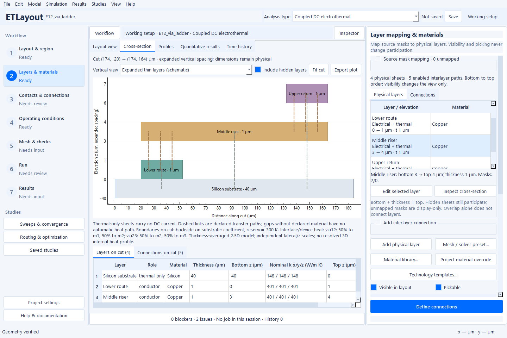

# Set up a physical stack and its connections

This guide describes the **0.4.3 source controls**. Check
[Releases](https://github.com/mmensing/electrothermal-layout-studio/releases)
for matching Windows downloads; older binaries retain their previous controls.

A source mask describes a footprint. A **physical layer** adds a material,
role, bottom elevation and thickness to that footprint. A declared **interface**
then transfers current, heat, or both between two layers over a specific region.
These are separate choices: overlapping colors in the layout do not connect
anything automatically.

## Start from the layer inventory

1. Open an example or import your layout, then choose **Layers & materials**.
   Review the source-mask mapping before assigning physics. Unassigned masks can
   remain display-only; every physical sheet needs its own material and footprint.
2. Inspect the **physical stack**, ordered from bottom to top. Read **bottom**,
   **top** and **thickness** together: `top = bottom + thickness`. Changing an ID
   or a layer's position in a list does not change its physical elevation.
3. Select the role deliberately. **Conductor** carries electrical current and
   heat. **Insulator** and **Thermal** carry heat only. Visibility and pickability
   are view settings, not participation switches.
4. Select a row to locate its actual footprint and edit it with the existing
   inspector. Choose **Apply** to commit the complete valid draft, **Discard**
   to restore applied values, or **Stay** to keep editing. Material provenance,
   electrical laws and advanced fields remain available in the same editor.
5. Reuse **Technology templates** for reviewed stacks. The preview is additive:
   check mask mappings, renamed IDs, materials and included interfaces before
   applying. A template is not a replacement for process calibration.

## Inspect a cross-section before adding links

Choose **Inspect cross-section** to reuse your last cut or start through a declared
connection of the selected layer. If no such link exists, it starts at the layer
center. You can also draw a cross-section line through a particular feature. The viewer uses the prepared layer
geometry, including openings; it does not extrude a decorative screenshot.

- **Expanded thin layers** makes thin films readable by expanding the spacing
  between actual elevations. The axis lists the real elevations; the scale is
  explicitly schematic. Shared surfaces stay coincident.
- **Physical elevation** restores proportional thickness and gap dimensions.
  Horizontal and vertical scales are independent in both views.
- **Layers on cut** lists real bottom/top elevations, thickness and nominal
  conductivity. Click a layer in the plot or table to synchronize selection.
- **Connections on cut** lists only enabled interfaces whose actual support
  intersects the cut. Double-click a connection to review its normal editor.
- **Include hidden layers** is a cross-section view preference. Hiding a layer
  in plan view never silently removes its electrical or thermal contribution.

Dashed links represent declared sheet-to-sheet transfer laws, not invented
solid material. The thermal summary names intersected reservoirs and loss
placement. A cut without a listed connection does not by itself establish a
setup error: isolated gates, protected openings and deliberately uncoupled
regions are legitimate.

This native Windows view cuts through both via banks. The expanded vertical
spacing makes the real sheets readable; the printed elevations and thicknesses
retain physical units. Select **Physical elevation** to restore proportional z.

## Add one deliberate interlayer connection

In the physical stack, choose **From layer**, **To layer** and the connection's
purpose, then **Review new connection**. This opens an unapplied draft in
**Contacts & connections**; the existing inspector, footprint validation and
undoable project transaction remain authoritative.

| Purpose | Review before Apply |
| --- | --- |
| Thermal path | Choose the thermal law. `Stack` includes both half-sheet resistances; specify any gap material or extra interface resistance explicitly. Electrical kind remains `None`. |
| Finite electrical contact | Choose two conductors, the actual landing footprint and area-specific contact resistance. Enter the physical contact resistance; the initial draft value is illustrative, not calibrated process data. Thermal transfer is a separate choice. |
| Physical via | Choose two conductors, a via footprint, declared material, stack-derived or explicit height, openings/replaced sheets and enclosure. Review thermal transfer separately. |

When geometry is available, the initial footprint is the exact shared lateral
support. Narrow it to the actual contact/via region before applying when the
full overlap is not a physical landing. If the pair has no overlap, draw or
enter a valid footprint; no connection is fabricated. Existing enabled paths
for the selected pair are listed to help avoid accidental parallel links.

Do not add an electrical link through a dielectric sheet merely because it
appears between two metals. A physical via needs the appropriate opening and
material definition. Conversely, thermal sheets still need explicit thermal
links and a real reservoir boundary. See [thermal stacks](thermal-stacks.md)
for gap-versus-explicit-film modeling and counting resistance once.

## Connect the stack to network extraction

First complete the physical contacts, vias and external port landings. You can
then extract directly; a prior electrical solve is not required. A layout net name is organizational metadata; it
cannot replace the declared physical current path. [Passive network extraction](passive-network-workflow.md) reduces
the assembled sheet/contact network to the chosen external ports. It does not add
missing vias, infer insulated gate conduction or extract electromagnetic
parasitics. Keep device-load assumptions and finite feed/contact contributions
explicit, and inspect the port connectivity and exported-network fidelity
checks before using a SPICE file in another tool.
