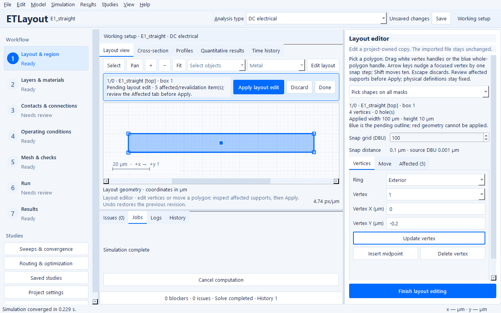

# Edit layout polygons without changing the imported file

The layout editor changes original GDSII/OASIS shapes in a project-owned copy.
The imported file stays unchanged. Applied revisions participate in the same
Undo/Redo history as other physical project edits; saving an `.etl` project embeds
the current edited layout so it can reopen without the original source file.

## Move a polygon point

1. Open an imported layout or a portable project in the **working setup**. Choose
   the intended cell or instance in Layout & Region before editing.
2. Click **Edit layout** above the canvas, choose **Edit → Edit layout polygon
   vertices**, or press **Ctrl+Shift+E**. Preparation uses the existing cancellable
   background worker. The canvas shows original shapes rather than merged or
   domain-clipped simulation footprints.
3. Select a polygon. Its exterior and hole vertices have square handles. The
   inspector identifies the source mask, cell and placement; its mask filter helps
   select overlapping shapes. Zoom and pan remain available.
4. Drag a white handle, or select its **Ring** and **Vertex** in the **Vertices**
   tab and enter **X/Y (µm)**. Numeric entry updates the same pending polygon as
   dragging. Choose the snap grid as an integer number of database units; the
   inspector also shows its distance in µm. A focused handle moves one snap step
   with an arrow key, or ten with **Shift+arrow**. The blue
   outline is the pending polygon; the physical project is unchanged until Apply.
5. Review **Affected**, then click **Apply layout edit** to commit one undoable revision. The application writes
   a new OASIS copy and verifies the polygon after reimport. **Discard** or **Escape**
   restores the polygon's applied vertices. **Done** returns to ordinary selection.
6. Validate the changed setup, regenerate its mesh and rerun the analysis. Save
   the project when ready. **Undo/Redo** restores previous immutable layout
   revisions, including the original import.

Moving vertices can create a self-intersection, collapse an edge or move a hole
outside its exterior. Invalid geometry has a red outline and a diagnostic;
**Apply layout edit** remains disabled. Coordinates must be finite and each ring
must retain at least three distinct points. The written polygon must match the
grid-snapped preview exactly; an instance transform that cannot represent those
coordinates is rejected with guidance to edit the untransformed cell.

## Insert, delete and move

**Insert midpoint** adds a vertex on the outgoing edge of the selected vertex,
including the closing edge and hole rings. **Delete vertex** removes the selected
point. A focused canvas handle also accepts **Insert** and **Delete**. Both
operations validate the whole polygon before changing the draft. They reject
coincident snapped points, crossings and deletions that would leave fewer than
three vertices in a ring. Deleting a triangular hole never silently deletes the
hole itself. A midpoint on a sloped edge may move slightly when snapped; inspect
the resulting outline before applying it.

Drag the blue whole-polygon handle, or enter **ΔX/ΔY (µm)** in **Move**, to move all
exterior and hole vertices together. The displacement snaps to the chosen grid;
existing coordinates are not individually resnapped, so selecting a coarser grid
does not reshape the polygon. Numeric offsets reset to zero after moving the
draft. **Discard** restores the complete applied polygon, including any inserted
or removed points and all holes.

The snap setting is a remembered desktop preference. Changing it does not change
the physical project, invalidate the mesh, or alter result identity. The default
is one source database unit. No arbitrary sub-DBU coordinates are written.

## Inspect affected definitions before Apply

The **Affected** tab compares the draft with the applied source geometry. It
lists changed physical layers, terminal/port and interface support, thermal
boundaries and heat sources, measurement support, nested device groups, routing
keepouts and fixed regions, protected masks, and recipes that become stale.
Measurements and device groups retain the documented union-within-category and
intersection-between-category selection rules, including partial geometric
support. Overlapping original shapes are retained when computing effective mask
support. Select a listed definition to read its diagnostic and highlight its
affected bounds in amber.

Declared active widths/areas and all explicit coordinates stay unchanged. The
preview calls out lost support and shows old/new supported area where applicable;
it does not move a contact along with the edited polygon. Recipe source hashes
remain unchanged and require deliberate revalidation. Result-component and
per-instance contact selectors that require a mesh are explicitly marked as
unassessed rather than receiving a false pass. Edge-boundary snapping and
acceptance are also explicitly marked for backend revalidation. Interface
footprint area is counted once; multilayer measurement area sums its selected
sheet supports.

Physical via/contact height, enclosure and replaced-dielectric handling reuse
the backend's shared stack resolver on a read-only project clone. Parallel
effective thermal support excludes physical connection footprints as it does
during preparation. Invalid physical geometry exposes the resolver's diagnostic
and requires F6 revalidation rather than presenting an unchanged-support pass.
Layout extents use area geometry, excluding text, consistently with preparation.

This preview is a geometric review, not a connectivity, stack, transfer-length or
fabrication-rule certification. Run **F6** after applying to obtain the full setup
checks and rebuild the mesh before solving. A pre-existing invalid/stale support
definition can prevent preview evaluation; the inspector displays that diagnostic
and still permits a valid polygon repair.

## Drafts, hierarchy and results

Selecting another polygon, saving, changing workflow/context, inspecting a
historical run, or leaving editing resolves an unapplied draft with **Apply,
Discard or Stay**. Apply commits a valid draft, Discard restores applied geometry,
and Stay cancels the transition while preserving the editor and working context.
Historical inspection is read-only, and editing is blocked while a calculation
or layout-edit worker owns the model.

A reused cell or array placement is isolated when edited. Sibling placements and
other top cells retain their previous geometry. Source mask identity, shape and
instance properties, units, and unrelated shapes are preserved. Boxes become
polygons after an edit. Editing a path changes its polygonized outline; that
edited object becomes a polygon rather than retaining parametric path width or
end-extension controls. Text and other non-area objects remain in the file but
have no vertex handles.

An applied layout edit changes physical configuration identity, invalidates the
working mesh and fields, and preserves recorded runs with their original setup.
Contacts, boundaries, simulation domain, measurement supports, device groups and
routing rules retain their definitions; they do **not** automatically follow a
moved vertex. Review **Affected** before Apply and their support and connectivity
with **F6** before solving.
Existing routing recipes retain their original source hash and must be
deliberately revalidated after a layout revision.

## Scope and compatibility

This mode moves, inserts and deletes exterior/hole vertices and translates an
entire polygon. It does not create shapes, delete holes or polygons, edit cell definitions globally, remap masks or provide
a general CAD design-rule editor. The bounded enumerator accepts at most 10,000
area shapes and 100,000 placements in the selected hierarchy; choose a smaller
instance when the limit is exceeded. Hierarchy reduces repetition in the layout
file, but does not remove the preparation cost of selectable placements.

No project-schema migration is introduced. Edited OASIS revisions use the existing
embedded-layout persistence and hash checks. Save the portable project before
moving it between machines; an unsaved revision in the local application cache
is not a portable deliverable. A source changed externally is rejected until
reimported or relinked. The original file is never an edit destination.

See the [guided workflow](desktop-workflow.md) for purpose-specific region
selection and the [geometry contract](geometry.md) for imported units, transforms
and simulation support.
