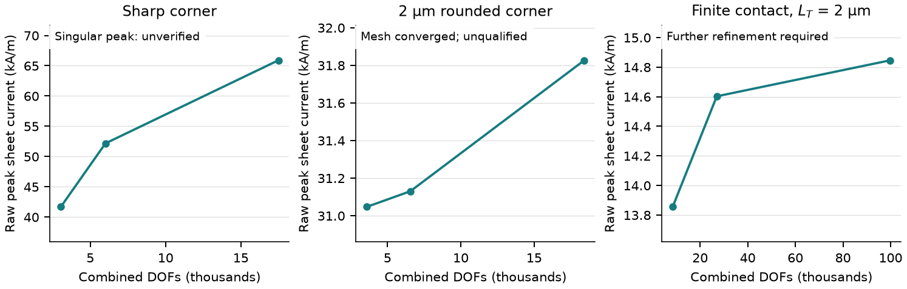

# Physical local meshing

Local controls resolve physical features while leaving the imported layout,
materials, contacts and operating conditions intact. They are reviewed proposals,
not an automatic physical qualification.

## GUI workflow

1. In **Mesh & Checks**, generate or load a compatible converged result.
2. Open **Review local refinement**. Geometry-only proposals also work before a solve.
   Optionally enable **Include bounded flux guidance** for a solved-state indicator.
3. Select radius, reentrant corner, neck, gate, contact or via controls.
   Review the element, DOF and memory screens before applying.
4. Run the three-level local mesh study. In study results, open **Mesh confidence**.
   Inspect each quantity, fixed physical support, actual sizes and measured cost.
5. Refine quantities that fail. A sharp-corner raw peak remains unverified even
   when integral quantities stabilize.

Flux jumps are optional local indicators: squared normal sheet-current or lateral
heat-flux jumps across interior edges, weighted by edge and element scales.
They are not rigorous error bounds. At most 64 cells per layer target 60% of jump
weight; an explicit exclusion radius around ideal reentrant vertices avoids
chasing their mathematical singularities.

Circular radii are inferred from polygon facets, never asserted as manufactured
radii. Radius controls target six elements per inferred radius. Contact proposals
use the shortest sampled directional transfer length, with four elements per
length; a two-resistive-sheet bound includes both sheets. Via estimates use actual
resistivity at component-local contact temperatures and physical via height.
An unsolved estimate uses the declared initial temperature. HEMT gate length and
conducting finger width remain separate quantities.

## Grading, budgets and identity

Each refinement has an optional nonnegative **grading length** in metres (displayed
in micrometres). Gmsh distance/threshold fields grade out of the exact local support.
Zero preserves legacy sizing and configuration identity. The conservative planning
screen includes overlapping finest-size halos; actual post-mesh element/DOF budgets
remain authoritative. This is not a peak-RSS guarantee. Narrow geometry is never
deleted and contact resistivity is never inflated to fit a budget.

A confidence receipt requires at least three converged levels, strictly decreasing
selected sizes, unchanged selected supports and physical configuration, and
increasing actual element counts. Transients must complete the same physical
start/end interval. Local heat uses a 2% criterion; mean/raw current and local
temperature use 5%, on both final intervals. Temperature changes are normalized
to rise above a named reservoir, not absolute kelvin. Missing references remain
unavailable. None of these statuses establishes material calibration or a safe
current rating.

## Reproduction

~~~powershell
python -m etlayout mesh-plan project.etl --field-driven --output .artifacts/mesh-plan
python scripts/verify_physical_mesh.py --output .artifacts/local-mesh --capture
python scripts/render_physical_mesh.py .artifacts/local-mesh/verification.json --output .artifacts/local-mesh/figures
python -m pytest tests/test_physical_refinement.py
~~~

The generator runs real coupled calculations and saves/reopens typed ETL results.
The maintained [CSV](validation/local-mesh/local-mesh.csv) and figure contain
three levels of sharp-L, rounded-L and finite-contact benchmarks. Their 10 mV drive,
material laws and thermal conditions are unchanged within each study.
The finite-contact case declares specific resistance 4e-14 ohm m2 and a 2 micrometre
single-sheet transfer length, so contact resolution is actually exercised.

Measured Windows source runs on the shared verification host, four requested CPUs:
sharp corner 2,901 to 17,275 triangles (0.42 to 2.42 s); rounded corner 3,439 to
18,179 (0.49 to 2.42 s); finite contact 5,143 to 51,255 (0.99 to 14.62 s).
These are run wall times, not speedup estimates or clean-machine benchmarks.
Fixed-area heat, mean current and temperature pass their mesh criteria in all
three cases. The sharp raw peak is singular/unverified; the rounded peak passes;
the contact peak still requires refinement because its first change exceeds 5%.
No failed peak is hidden by smoothing or a changed acceptance threshold.

Native Windows confidence dialogs were inspected at 1050 and 760 pixel widths;
glyph checks passed. Source GUI evidence does not establish frozen-package or
clean-machine validation. Detailed fields and bulky performance logs belong in
generated artifacts rather than this repository.
