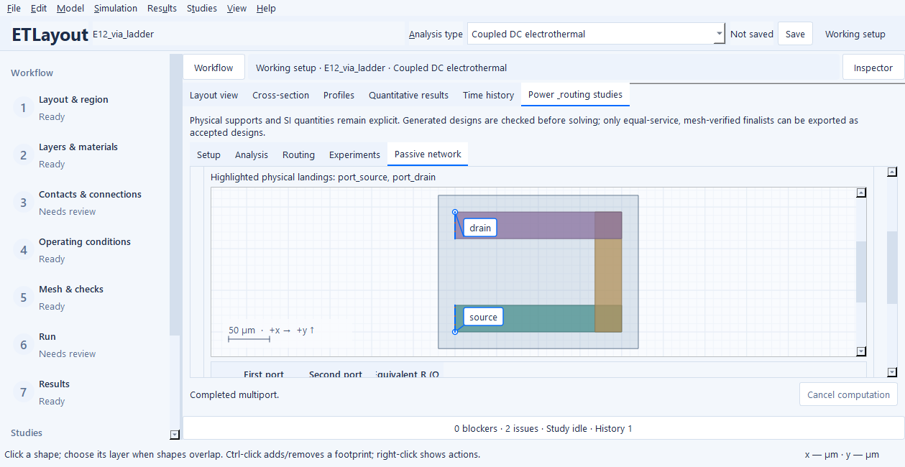
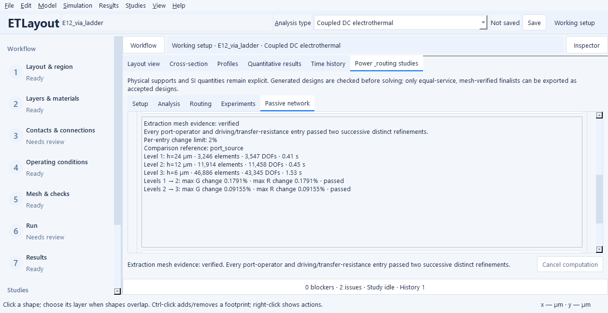

# Extract a passive resistor network in the GUI

This guide describes current source controls. **Temperature selection, landing
cross-probing, extraction mesh studies and simulator bundles are unreleased
additions**; Windows 0.4.3 has the earlier port/reference and preview controls.
Check [Releases](https://github.com/mmensing/electrothermal-layout-studio/releases)
for actual downloads.

Use this workflow to replace a **linear interconnect** with a fixed-temperature
DC multiport model. It does not extract switching parasitics or a transistor
small-signal model. Voltage-dependent HEMT layers are rejected explicitly.

1. Open **Contacts & Connections → Extract passive network / SPICE** (also
   available under Studies). Review **Setup** if physical ports are missing.
   Each port owns localized terminal landings and their finite feed resistance;
   a boundary terminal alone is not a physical port.
2. In **Passive network**, check at least two independent ports. Landing-layer
   names identify the physical electrodes. Unchecked ports remain floating.
   Existing voltage/current drives are preserved in the working setup.
3. Choose **Matrix reference**. This removes one voltage coordinate for the
   resistance matrix; it adds no physical connection and does not ground a
   subcircuit pin in SPICE. Choose **Temperature source**: the project initial
   temperature, an explicit fixed temperature in **K**, or the selected run's
   retained final temperature fields. None starts a new thermal solve or changes
   the working conditions.
4. Press **Extract passive network**. The standard background worker prepares
   geometry and mesh, checks connected independent ports, and calculates the
   full conductance operator. Cancel remains available.
5. Review actual KCL/reciprocity errors, the source identity and the node mapping.
   **View full port matrix** shows currents entering each port per applied volt,
   in siemens. **Export reviewed network** offers JSON, labeled CSV or SPICE.


The illustrated E12 project declares its existing source/drain footprints as
physical ports with distinct IDs (`port_source`, `port_drain`), retaining their
original ground/current drives. To reproduce it in **Setup → Physical ports**,
use **Edit collection** and add one port per existing footprint; select its
terminal in **Landings**. This example retains the original ideal external feeds.
Real feed/contact resistance should come from the intended assembly.

The preview is the exact SPICE text produced by the exporter, after independently
reconstructing its resistor network and checking each port response. Weak finite
connections are retained. If resistor-only fidelity cannot be established, the
page explains why SPICE is unavailable; JSON/CSV retain the full operator.

Hover over port-table headings and the reference selector for units and sign
conventions. A changed selection or physical setup retires the preview and
requires extraction again. Results from a previous electrothermal run are kept
separate from this fixed-temperature network.

For multilayer connectivity, first follow [the layer-stack workflow](layer-stack-workflow.md).
A visual overlap is not an electrical short; declare interfaces and their support.
See [the power reference](POWER_ROUTING.md) for model and CLI details.


## Choose the temperature deliberately

**Project initial temperature** preserves the original behavior. **Explicit fixed
temperature** freezes material conductance at the entered absolute K value;
changing this input is a local extraction choice, not an edit to the project.

**Selected run — retained final temperature** uses a compatible converged thermal
or completed transient run. Its component-local P1 fields and exact saved mesh
are retained, including disconnected conductors at coincident coordinates. No
nodal smoothing, remeshing or silent fallback to initial temperature occurs.
The report records source identities, mesh and temperature-field hash and, for
a transient, final time. This is a frozen hot network, not thermal feedback or
extraction at the currently displayed intermediate transient frame. Missing,
stale, incomplete or invalid fields fail with guidance to recompute/select a run.

Changing temperature, port selection, matrix reference or the relevant selected
run retires the old preview and evidence. View-only map inspection preserves the
working setup, saved result, mesh and physical identity.

## Find the physical landings

Select a port row and press **Locate selected port** to open **Layout**. It shows
the extraction's verified geometry and highlights all localized landings owned
by that port. Selecting an equivalent resistor row highlights both endpoint
landing groups. Pin names and original port names remain visible.

A reduced pairwise resistor represents a distributed path through the eliminated
network. It is not an identified individual wire, contact or via, and its endpoint
highlight does not imply that only the highlighted polygons carry current.
Physical edits retire the map along with the extracted model.



## Check extraction mesh confidence

In **Mesh evidence**, choose three to five decreasing global sizes in µm, or use
the default `2h, h, h/2`. Existing contact, layer and local refinement sizes scale
proportionally; each level retains the project's element/DOF limits. Choose a
per-entry relative change limit (default **2%**) and run the study.

The summary separates successful extraction from **mesh verified**. Verification
requires two successive distinct refinements to pass every conductance entry
and every driving/transfer resistance entry. A common strong comparison reference
avoids grounding a weak port; the user's exported matrix reference stays intact.
No global norm or absolute cutoff may hide a weak connection. Zero/sign changes,
unchanged meshes, missing levels and resource failures prevent verification.
Open detailed evidence to inspect the actual matrices, changes and failed level.
The finest successful network can be exported with its source/fine-mesh identities
and evidence; a sensitivity screen is not a rigorous error bound or calibration.

A retained spatial temperature field cannot be moved between study meshes without
a validated projection. This study rejects that choice explicitly. Use a declared
uniform temperature for mesh comparisons, and extract the hot field separately
on its exact retained mesh.



## Validate in an external circuit simulator

After extraction, open **Simulator**. **Export validation bundle** writes a new or
empty chosen folder containing the exact resistor subcircuit, operator/provenance,
a hash manifest and one self-contained DC basis deck per port. Preparation alone
is labeled **prepared**, not simulator validated.

To execute, explicitly choose a trusted, independently installed **console/batch
ngspice executable**. On Windows this is commonly `ngspice_con.exe`; a GUI launcher
or package-manager shim can return without producing calculation output and must
not be taken as a successful check. Nothing is downloaded or bundled.
**Validate with selected ngspice** runs only regenerated controlled decks in an
isolated working directory, ignoring simulator initialization files. It does not
execute an imported or edited netlist. The job retains cancellation, a total
execution budget (default 30 s), a 4 MiB output budget and owned-child cleanup.

Every basis excitation is checked against every original port current using a
`1e-8` relative limit and zero absolute tolerance; exact zeros remain exact checks.
Status, per-port errors, executable hash, deck hashes and bounded logs are saved.
Failures/timeouts/output limits remain failures. Simulator agreement validates
circuit fidelity, not mesh convergence, material calibration or omitted physics.

The CLI shares these calculations. For an existing portable passive project:

```powershell
python -m etlayout multiport project.etl --temperature-k 350 --format spice --output network.cir
python -m etlayout multiport project.etl --temperature-source retained --output hot-network.json
python -m etlayout multiport project.etl --mesh-study --mesh-sizes-um 20 10 5 --output mesh-evidence.json
python -m etlayout multiport project.etl --validation-directory circuit-check --output network.json
```

The retained command needs saved compatible result fields in that ETL archive.
Mesh evidence is JSON; validation is a separate operation. To execute rather than
only prepare a bundle, add `--ngspice-executable` with its full trusted console path
and optionally `--simulator-timeout`. Existing bundle folders must be empty.

## Use the exported subcircuit

The SPICE file contains a reusable `.subckt ETLAYOUT p1 ... pN`, rather than
an excitation or a complete simulation. Read its port-mapping comments before
connecting it: pin order follows the checked ports, not the matrix reference.
Port names remain descriptive metadata; generated pin names are always `p1`,
`p2`, and so on. Control characters and non-ASCII names use reversible JSON
string escapes in current source exports so each mapping stays on one ASCII
comment line; the JSON report retains the original names.

For a **two-port** export saved as `network.cir`, put this separate testbench
beside it. It applies 1 V to the first pin and connects the second pin to the
circuit reference. For more ports, connect every pin according to the intended
external circuit; do not infer connections from the matrix reference selector.

```spice
Two-port fixed-temperature DC check
.include network.cir
Vtest driven 0 DC 1
Xdut driven 0 ETLAYOUT
.control
set numdgt=17
op
print i(Vtest)
quit
.endc
.end
```

With an independently installed [ngspice](https://ngspice.sourceforge.io/), run
`ngspice -b testbench.cir`. Its voltage-source current is positive into the
source, so **`-i(Vtest)`** is the current entering the first network port.
For a 1 V excitation it equals the corresponding diagonal entry of the full
conductance matrix. Use the JSON/CSV operator to check all port responses.
ETLayout does not install or automatically run a circuit simulator.

This is a DC resistance reduction at the reported fixed temperature. It has no
capacitance, inductance, frequency-dependent conductor loss or thermal RC
feedback, and does not turn a HEMT into a transistor SPICE model. Changing a
simulator's temperature cannot reconstruct the original material laws from
these constant resistors; extract again at the intended temperature.

For the C/L development boundary and acceptance gates, see the maintained
[parasitic extraction expansion plan](parasitic-extraction.md). Its current
matrix-interchange API validates supplied data; it does not extract C/L fields.
