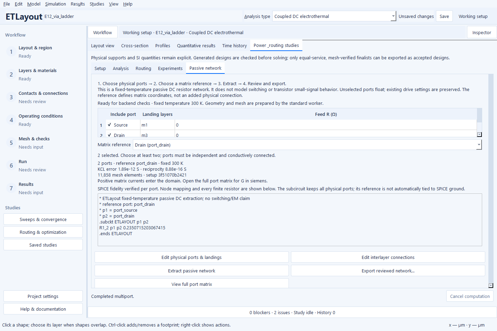

# Extract a passive resistor network in the GUI

This guide describes the **0.4.3 source controls**. Check
[Releases](https://github.com/mmensing/electrothermal-layout-studio/releases)
for matching Windows downloads; older binaries retain their previous controls.

Use this workflow to replace a **linear interconnect** with a fixed-temperature
DC multiport model. It does not extract switching parasitics or a transistor
small-signal model. Voltage-dependent HEMT layers are rejected explicitly.

1. Open **Contacts & Connections → Extract passive network / SPICE** (also
   available under Studies). Review **Setup** if physical ports are missing.
   Each port owns localized terminal landings and their finite feed resistance;
   a boundary terminal alone is not a physical port.
2. In **Passive network**, check at least two independent ports. Landing-layer
   names identify the physical electrodes. Unchecked ports remain floating.
   Existing voltage/current drives are preserved in the working setup.
3. Choose **Matrix reference**. This removes one voltage coordinate for the
   resistance matrix; it adds no physical connection and does not ground a
   subcircuit pin in SPICE. The extracted temperature is the project's initial
   temperature, held fixed; it is not a fresh electrothermal operating point.
4. Press **Extract passive network**. The standard background worker prepares
   geometry and mesh, checks connected independent ports, and calculates the
   full conductance operator. Cancel remains available.
5. Review actual KCL/reciprocity errors, the source identity and the node mapping.
   **View full port matrix** shows currents entering each port per applied volt,
   in siemens. **Export reviewed network** offers JSON, labeled CSV or SPICE.

The illustrated E12 project declares its existing source/drain footprints as
physical ports with distinct IDs (`port_source`, `port_drain`), retaining their
original ground/current drives. To reproduce it in **Setup → Physical ports**,
use **Edit collection** and add one port per existing footprint; select its
terminal in **Landings**. This example retains the original ideal external feeds.
Real feed/contact resistance should come from the intended assembly.

The preview is the exact SPICE text produced by the exporter, after independently
reconstructing its resistor network and checking each port response. Weak finite
connections are retained. If resistor-only fidelity cannot be established, the
page explains why SPICE is unavailable; JSON/CSV retain the full operator.

Hover over port-table headings and the reference selector for units and sign
conventions. A changed selection or physical setup retires the preview and
requires extraction again. Results from a previous electrothermal run are kept
separate from this fixed-temperature network.

For multilayer connectivity, first follow [the layer-stack workflow](layer-stack-workflow.md).
A visual overlap is not an electrical short; declare interfaces and their support.
See [the power reference](POWER_ROUTING.md) for model and CLI details.
