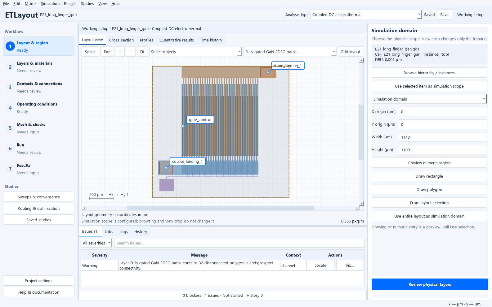
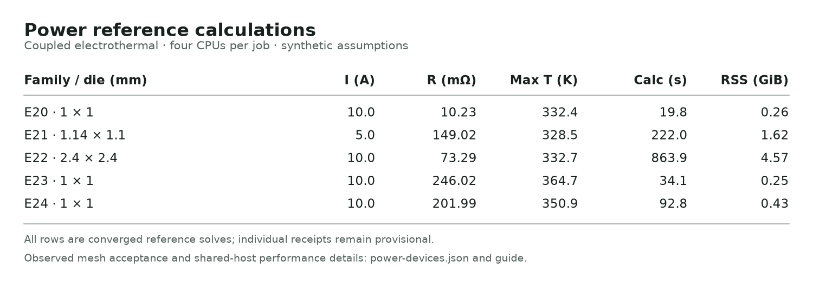
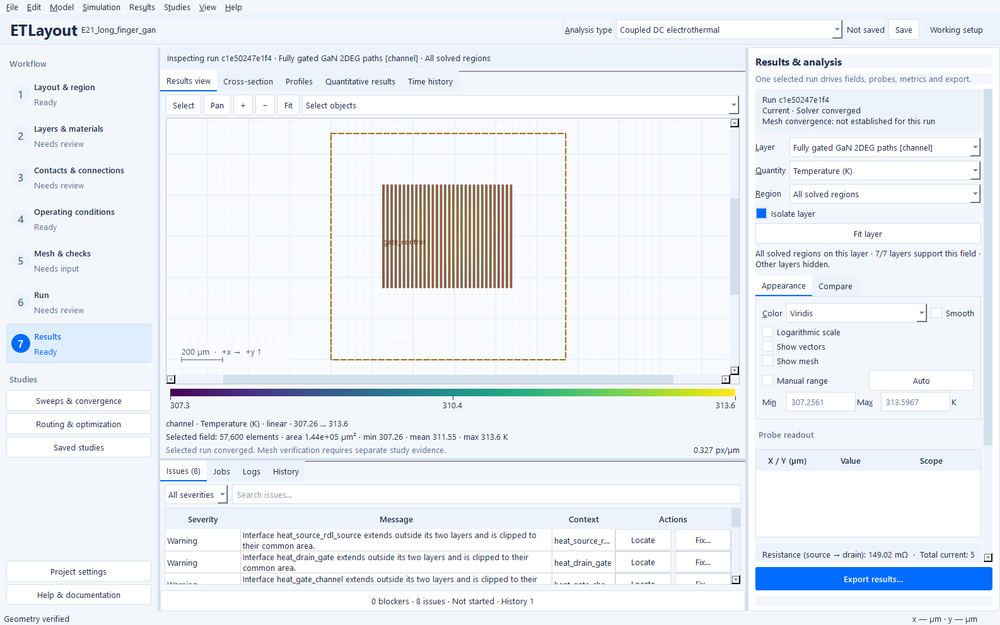
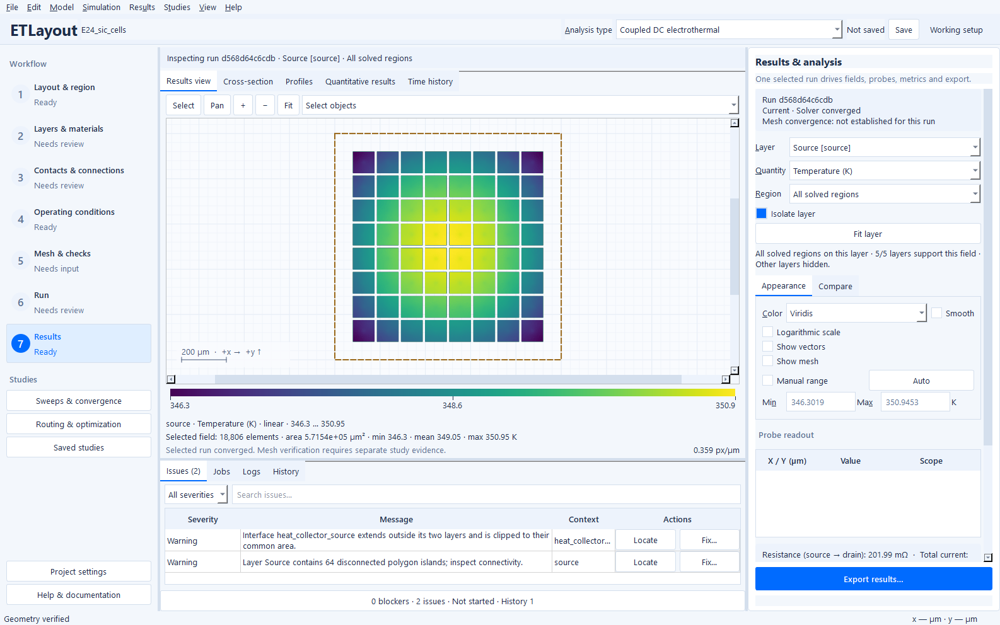

# Power-device examples: from layout to loss budget

Explore how fingers, banks, vias and source-collection metal share current and
heat. E20–E24 are complete projects: open one in the application, review its
connections and cooling, run it, and inspect the layer maps alongside the loss
budget. The GUI walkthrough below uses the shipped reference projects.

These are **synthetic engineering configurations, not calibrated device
ratings**. Their purpose is to ask useful interconnect questions under explicit
model assumptions. Start with [E1](examples.md#e1) if the numbered workflow is new
to you; E20 and E23 are useful first power examples. Long-finger E21 and multi-bank
E22 need more time and memory, so inspect their budgets before starting a run.
Opening an example prepares the project without solving it.

## Reference projects

Choose **File → Browse example library…** and search E20–E24 by ID or question.
The references open in **Coupled DC electrothermal** mode with physical landings,
layer mappings, measurements and bounded studies configured. The direct
**File → Ready-to-run examples** shortcuts retain the original references.

**Size preset** selects dimensions and their declared current request;
**Routing variant** selects a supported feed/collection arrangement; **Thermal
boundary** selects the declared attachment assumption. Review all three before
**Open example**. A named **Operating scenario** is a separate experiment and
cannot be combined with family-generation choices in the browser. Large/stress
presets are explicit choices, and opening never starts a calculation. The
[cross-generation learning paths](example-paths.md) connect these families to
smaller conductor, gate-control and sensing examples.

| ID / reference | Dimensions | Nominal request | Purpose / limitations |
| :-- | --: | --: | :-- |
| [E20 ETL](../examples/E20_high_current_rdl.etl) · [GDS](../examples/E20_high_current_rdl.gds) · [OAS](../examples/E20_high_current_rdl.oas) | 1 × 1 mm | 10 A | Three 10 µm copper levels, 45 vias, tapered branches and protected opening. Uniform/graded arrays and unequal-width poor routing. |
| [E21 ETL](../examples/E21_long_finger_gan.etl) · [GDS](../examples/E21_long_finger_gan.gds) · [OAS](../examples/E21_long_finger_gan.oas) | 1.14 × 1.10 mm | 5 A | 32 actual gate fingers × 500 µm, 16 mm total conducting gate width; opposing coplanar combs and upper source redistribution. |
| [E22 ETL](../examples/E22_multibank_gan.etl) · [GDS](../examples/E22_multibank_gan.gds) · [OAS](../examples/E22_multibank_gan.oas) | 2.4 × 2.4 mm | 10 A | Four hierarchical banks, each 16 × 500 µm; 32 mm total width, shared RDL, bank and finger measurements. |
| [E23 ETL](../examples/E23_sic_stripes.etl) · [GDS](../examples/E23_sic_stripes.gds) · [OAS](../examples/E23_sic_stripes.oas) | 1 × 1 mm | 10 A | Twenty active stripes; narrow/wide/cross source straps, insulated gate runners in the gaps, perimeter termination margin and fixed source landing. |
| [E24 ETL](../examples/E24_sic_cells.etl) · [GDS](../examples/E24_sic_cells.gds) · [OAS](../examples/E24_sic_cells.oas) | 1 × 1 mm | 10 A | 64 macrocells, active area 0.571536 mm²; gate grid in nonactive corridors, bond/clip/bump feed footprints and passive Kelvin sensing. |

The references preserve E1–E19 and the separate [power-routing demonstrations](POWER_ROUTING.md).
E7/E8 are small illustrative HEMTs with documented ungated edge bypass; E16 has
four fully gated stripes. E9 is a doped SiC resistor. E21–E24 provide the distinct
larger GaN and distributed SiC on-state models described here.

## A GUI session from layout to loss budget

1. **Open and save a working copy.** Choose the reference in **File → Ready-to-run
   examples**, then use **Save project as…**. Keep the configured nominal inputs
   for your first run.
2. **Read the physical paths.** In **Layout & region**, fit the layout and inspect
   the localized landing footprints. Continue through **Layers & materials** and
   **Contacts & connections** to see how sheets, vias, finite contacts and insulated
   gate routing are connected.
3. **Check the service and cooling.** In **Operating conditions**, choose
   **External port drives**, then inspect `drain`. This is where the requested
   power-port current is edited. Choose **Thermal boundaries / reservoirs** to
   inspect `backside`, the named 300 K reservoir. A port's landing footprint is
   not a second independently driven terminal.
4. **Validate and mesh.** In **Mesh & checks**, select **Run validation**, review
   **Locate / fix issues**, then **Generate / update mesh**. The supplied GaN mesh
   resolves narrow gate/contact regions without applying that spacing everywhere.
   Keep geometry, transfer length and resource limits in mind before changing it.
5. **Run the applied setup.** In **Run**, select **Run analysis**. The job runs in
   the background; **Show job & log** exposes progress and **Cancel computation**
   stops it. **Execution settings…** controls the CPU budget, which defaults to four.
6. **Inspect more than one map.** In **Results**, change **Layer** and **Quantity**,
   then use **Fit layer**. Compare **Temperature (K)** with the appropriate current
   quantity. **Sheet current density (mA/µm)** applies to a sheet channel;
   **Volumetric current density (mA/µm²)** describes metal loading. Use **Region**,
   **Isolate layer** and a common manual range to make comparisons interpretable.
7. **Ask where the power went.** **Metrics & loss budget** opens quantitative
   results. Open **Routing & optimization → Analysis** for **Ports**, **Contacts**,
   **Devices**, **Measurements**, **Reservoirs** and **Loss budget** tables.
   Selecting a contact also shows its normal-current map. Check delivered service,
   heat balance and model limits before interpreting a hotspot.

The loss ledger separates metal, contact/via, device-load and external-feed losses.
A solver-converged result remains provisional until a mesh study supports the
specific comparison. A low temperature obtained by delivering less current is
not an equal-service improvement.

## Choose the design question

<a id="e20"></a>
### E20 · Where does an RDL network crowd current?

Follow a localized landing through branching buses, bends, tapered sections and
via arrays. Inspect **m1**, **m2** and **m3**, then compare the **Contacts** table
with the metal maps. Look for unequal via loading and local bottlenecks rather
than assuming every via in an array carries the same current.

**Try next:** use **Sweeps & convergence → Parameter sweep…** to investigate the
physical-port current or collection-metal thickness. Keep current fixed when
comparing routing changes. Uniform, graded, distributed and intentionally poor
feed variants are selectable in **Browse example library…** and reproducible
through the generator below. Direct menu shortcuts open the reference.

<a id="e21"></a>
### E21 · How evenly are long GaN fingers fed?

Inspect the opposing coplanar source/drain combs and the insulated upper source
redistribution. In Results, compare **channel → Sheet current density** with
**source_rdl → Volumetric current density**. The **Devices** table and configured
measurements help distinguish current per active width from metal loading.



*The current E21 reference geometry has 32 actual gate fingers, each 500 µm along
the conducting width, and a configured 5 A request. This is a layout view, not a
new calculated field or a device-rating claim.*

The shown channel-island warning highlights separate conducting stripes. Their
source/drain paths join through the declared contacts and collection metals;
use **Mesh & checks** to verify those connections.

**Look for:** finger-to-finger loading and source-potential differences caused by
finite routing and contact resistance. Every intended source-to-drain channel
path crosses a gate-controlled region; the total conducting gate width is 16 mm.

**Try next:** compare collection-metal thickness at the same requested current,
or use the bounded collection study below. Choose single, dual or distributed
feeds in **Browse example library…** without changing active channel geometry;
review each generated project's requested service before comparing it.
The local gate model does not establish saturation, breakdown, trapping or
switching performance.

<a id="e22"></a>
### E22 · Do four HEMT banks share the load?

Follow the shared redistribution into the hierarchical banks, then inspect bank
and finger groups in **Analysis → Devices** and **Measurements**. Switch between
collection metal and substrate temperature to relate electrical sharing to
thermal interaction. Hierarchy makes the layout easier to construct; it does not
reduce the number of finite elements needed for a calculation.

**Try next:** compare the `single` and `asymmetric` generated variants to isolate
landing position: they retain identical complete GDS geometry. The `distributed`
variant also changes finger redistribution, so it answers a broader feed-design
question. Keep active width, device parameters, reservoir and delivered current
fixed when making either comparison.

<a id="e23"></a>
### E23 · How much loss belongs to the SiC device and how much to the source metal?

This **SiC MOSFET on-state interconnect model** combines frontside source collection
with a backside drain and distributed stripe-shaped on-state loads. Inspect the
source and collector layers, then use **Analysis → Loss budget** to separate
active-device, metal, contact/via and external-feed contributions.

**Look for:** current sharing that emerges from local sheet voltages, rather than
an equal current assigned to every stripe. The insulated gate drawing represents
a fixed-on-state operating assumption; it does not automatically control the load.

**Try next:** change collection-metal thickness in a parameter sweep while keeping
the same current and cooling. Narrow, wide and cross-strap layouts are additional
generated variants. Compare the electrical loss reduction with the resulting
thermal response, then refine the mesh before ranking them.

<a id="e24"></a>
### E24 · How does the landing footprint change source collection and sensing?

The active zones are macrocells: documented groups of physical SiC cells with
area-normalized on-state resistance. Inspect the collection metal and localized
power-source footprints, then compare **Devices**, **Measurements** and the passive
Kelvin-sense location. The Kelvin probe draws no current.

**Try next:** compare separately generated bond-like, clip-like and bump-array
projects at the same active area, device parameters, delivered current and thermal
environment. Check source-potential spread and Kelvin-sense error as well as total
loss. A footprint may improve one metric while worsening another; no universal
winner is assumed.

## Compare a bounded change in the GUI

For a smaller first study, choose **Sweeps & convergence → Parameter sweep…** and
review the selected parameter, units, values and analysis before running. The
projects include current, collection-metal thickness and package thermal-path
studies. The dialog's selected study must be reviewed; opening it does not run
all saved sweeps automatically.

For a constrained routing comparison:

1. Open **Routing & optimization → Experiments** and select `bounded_collection`.
2. Review the operating scenario, required delivered current, goals and limits.
   The supplied experiment allows two collection-bus choices and protects active
   device geometry.
3. Choose an **Experiment folder**, then **Start / resume experiment** when you
   are ready for the additional calculations and mesh-refined finalists.
4. Inspect **Candidates**, **Pareto plot** and the scenario/mesh evidence. Keep
   failed, resource-limited and uncertain candidates visible in your reasoning.
   **Export selected verified finalist…** requires the backend acceptance checks.

The experiment does not promise an improvement. Stress and pulsed projects do
not inherit a verified steady-state routing ranking. Additional geometry presets
and feed variants are generated on demand through **Browse example library…**
or the CLI; they do not inherit the reference's calculation or verification.

## Engineering reference and reproduction

The sections below retain model parameters, historical measured results, resource
budgets and advanced generation commands. They complement the GUI walkthrough;
recorded earlier results are not relabeled as new calculations on the public
revision you are using.

<details>
<summary>Model assumptions, physical paths and compatibility</summary>

## Physics and boundaries

**GaN:** every 9 µm source-to-drain strip crosses a 1 µm gate-controlled region.
Finite 2 µm contact zones and 2 µm access regions lie on either side. Finger length
means conducting width along the finger, not conduction distance. Isolated strips
prevent end bypass; total gate width is counted once per conducting path. The
existing analytical local-gate law uses synthetic mobility 0.12 m²/(V·s) at 300 K,
exponent 1.5, threshold −3 V, gate coupling 1.5×10¹⁶ m⁻²/V, density cap
2×10¹⁷ m⁻², smoothing 0.1 V and fixed gate bias +3 V. Specific contacts are
10⁻¹⁰ Ω·m². The numerical conductance floor 10⁻¹⁰ S is not predicted leakage.
Gate metal is insulated, thermal only; it is not an additional source/drain path.
The source and drain collection metals now share the same 0.1 µm bottom elevation
and 8 µm thickness. Their opposing combs have no projected overlap: source has a
bottom spine, drain a top spine, and the fingers stop before the opposite bus.
The upper source RDL provides insulated crossbars and declared vias. Dual feeds
add the opposite source-finger end and the left end of the top drain bus;
distributed feeds add intermediate source taps. Multi-bank drain collection uses
its separate upper RDL; via heights follow the actual updated stack. Specific
contacts include the unresolved local ohmic transfer rather than an extra device
resistance. A 120 × 100 µm gate pad connects the long gate runners through a 5 µm
feed neck; bank pads share an insulated trunk. The prescribed DC gate bias remains
the analytical local-gate model's input, without solving gate charging or gate
lead voltage drop.
Use local field screening ≤3×10⁵ V/m and temperature 300–425 K; these are declared
synthetic applicability screens, not established saturation/breakdown limits.
High-field transport, trapping and switching are absent. Store I/W and sheet current in A/m separately from metal volumetric density in
A/m². The GUI displays sheet loading in mA/µm and metal/normal current density in
mA/µm²; the physical quantities remain distinct.

**SiC MOSFET on-state interconnect models:** the existing distributed load solves
`j_z = (V_d − V_s) / R_on,sp(T)` locally with `R_cell = R_on,sp / A_cell`.
The synthetic reference is 1 mΩ·cm² = 10⁻⁷ Ω·m² at 300 K, with linear temperature
coefficient 0.003 K⁻¹ and declared range 300–450 K. Current sharing emerges from
coupled sheet/load voltages; currents are not assigned equally per macrocell.
R_on,sp includes the homogenized channel, drift region and intrinsic device
contacts. The SiC substrate is thermal only, avoiding a second electrical drift
loss. Explicit metal, collection vias and external feeds remain separate.
The insulated gate drawing does not control this fixed-on-state load. Macrocells
represent groups of physical cells, not resolved planar/trench transistor cells.
The gate landing is 60 × 60 µm on a 1 mm die, with 3 µm runners through gaps
between active stripes/tiles. A 60 µm perimeter collar is protected from new
frontside routing; it is a nonactive geometric termination margin, without
breakdown-field or guard-ring physics. Dimensions scale with the selected die
preset. The gate network never overlaps active-device support. The backside
drain still covers the die, while power-source and passive Kelvin footprints
remain localized on the frontside collection metal.
No body diode, avalanche, switching or architecture comparison is supported.
Load heat is split between endpoint sheets by the existing thickness-averaged
interface model, rather than depth-resolved dissipation.

These are openly identified synthetic parameters, not extracted measurements.
Existing material snapshots provide the named Cu/Au/GaN/SiC/SiO₂ properties; see
[physics](physics.md) and project snapshots for values and provenance.
Package/interface calibration and device/process measurements are required
before interpreting temperatures or on-state resistance as a product prediction.

Feeds occupy localized physical footprints. Equivalent total external resistance
is 1 mΩ per GaN/RDL port; SiC source is 2 mΩ and drain 1 mΩ. Parallel footprints
each use N times the total resistance, preserving the equivalent feed component
while allowing unequal currents. 25% of feed loss enters the landing, 75% is
outside the modeled die, explicitly retained in the ledger. No entire studied bus
is made equipotential. Source/drain metal thicknesses, footprints and active
geometry are fixed across a feed comparison unless explicitly varied.

Thermal paths descend to the nearest underlying sheet over exact overlap;
selectors intersect upper/lower source masks, then subtract intervening masks
and physical contacts/vias using `exclude_sources`. These masks remain live after
routing edits. Explicit polygons, if present, are unioned after that subtraction;
the general selector does not silently subtract exclusions from explicit support.
Intervening footprints block deeper parallel paths. Geometric gaps use synthetic
SiO₂-equivalent insulation. Physical contacts/vias replace those gap areas.
GaN has a 2 µm effective GaN buffer and 150 µm SiC substrate; SiC has a 200 µm
thermal substrate and backside drain; RDL has a 300 µm SiC support.
Only the backside has a 300 K reservoir: synthetic attach resistance area
2×10⁻⁶ (`attached`) or 10⁻⁵ (`resistive_attach`) m²K/W, plus half the boundary
sheet thickness divided by conductivity. Other hot sheets have no ideal sink.
For scale, the two attach values correspond to a 50 µm effective layer with
conductivity 25 or 5 W/(m·K); they are synthetic package assumptions, not fitted
to obtain an acceptable temperature.
There is no prescribed heating added to Joule/contact/device losses.
Depth gradients and detailed package geometry are thickness-averaged/effective
approximations. Cooling is not adjusted to meet a requested current.

### Generator identity and compatibility

Generator version 2 uses coplanar opposing GaN source/drain combs, connected
insulated gate landings/routing, and all-sided SiC nonactive termination margins.
Active channel widths, SiC active areas, device parameters and nominal current
requests are preserved. Historical 0.3.0 fields below describe earlier geometry;
they do not validate the revised reference projects.

Dimensions and operating points come from `power_examples.settings`; generated
project notes contain the complete SI configuration. Titles/scopes live in the
catalog and builder dispatch uses the explicit registry. Do not maintain a second
independent catalog of electrical inputs.

Current thermal selectors request exact live common-area support, avoiding
avoidable out-of-layer clipping warnings. Disconnected channel/source islands are
real: their paths connect through declared contacts, vias and collection sheets.
They do not replace connectivity or mesh checks.

Directional GaN sizing was introduced in 0.3.0. Generator-version-2 archives require
a reader with the 0.3.1 `exclude_sources` selector support; older readers must not
silently drop exclusions. Archives without these optional settings retain their
physical hash in the current reader. A waveform on an owned physical-port landing
is rejected with migration guidance: target `power.ports.<id>.value` instead.

</details>

<details>
<summary>Advanced: generate size/feed variants and reproduce calculations</summary>

## Generate and calculate

```powershell
python -m etlayout examples .artifacts/gan-dual --name E21 --preset reference --variant dual
python -m etlayout solve .artifacts/gan-dual/E21_long_finger_gan.etl --mode electrical --no-plots --output .artifacts/gan-fixed-T
python -m etlayout solve .artifacts/gan-dual/E21_long_finger_gan.etl --no-plots --output .artifacts/gan-coupled
python -m etlayout examples .artifacts/sic-clip --name E24 --variant clip --current 10 --thermal resistive_attach
python -m etlayout examples .artifacts/gan-custom --name E21 --preset compact --fingers 12 --gate-width-um 200 --current 1
python -m etlayout examples .artifacts/sic-pulse --name E23 --preset compact --pulse
python -m etlayout transient .artifacts/sic-pulse/E23_sic_stripes.etl --no-plots --output .artifacts/sic-pulse-results
```

Independent finger-count/width overrides do not adjust requested current.
Electrical-only references converge at their fixed material reference temperature;
their named-reservoir temperature-rise measurement remains explicitly unavailable
because no heat-removal problem is solved. The benchmark receipt therefore retains
that reporting exception rather than inventing a thermal result.
Optional pulses use quasi-static port current with thermal storage: 2 ms period,
0.5 ms high plateau, 20 µs edges, three periods, 0.1 ms integration steps and
0.5 ms retained-field intervals plus the actual peak snapshot. They are a starting
point for time refinement, not switching-loss calculations. Large pulse histories
can exceed the explicit retention budget and are rejected before solving; review
the estimate and adjust output retention explicitly. Port sweeps/drives
target `power.ports.drain.value`; an owned landing cannot carry a separate waveform.
Saved current, thickness and attach sweeps are bounded, explicit studies. The
two-choice collection-bus optimization uses fixed-current service and model
screens with mesh-verified finalists; RDL varies a branch taper, GaN edits between
connecting spines, stripes preserve side rails, and tiles compare the full edge
with a narrower neck connected at both ends. Nominal recipe replay preserves all
masks exactly. It is optional, not automatically executed.
`--stress` disables verified-ranking experiments. Higher currents are requests,
not silently reduced or guaranteed valid. Retain failures and overload results.

| Family | Compact test | Other presets | Routing variants |
| :-- | :-- | :-- | :-- |
| E20 | 200 µm, 1 A | reference 1 mm / 10 A; large 2 mm / 20 A | uniform/graded × single/distributed; poor_single |
| E21 | 4 × 60 µm, 0.075 A | small 16 × 250 µm / 1.5 A; reference 32 × 500 µm / 5 A; large 64 × 1000 µm / 20 A | single, dual, distributed |
| E22 | 2 × 2 banks of 2 × 60 µm, 0.15 A | reference 2 × 2; large 2 × 4 / 20 A; stress 2 × 4 / 30 A | single, dual, distributed, asymmetric |
| E23/E24 | 250 µm, 0.25 A | reference 1 mm / 10 A; large 2 mm / 40 A | narrow/wide/cross; bonds/clip/bumps |

Presets are geometry and service together; use `--current` to study 1/5/10/20 A
RDL or 5/10/20/40 A SiC at the same die size. For the bank feed-placement study,
compare `single` with `asymmetric`: their complete GDS geometry is identical;
only the drain landing moves. `distributed` also changes finger redistribution,
so its comparison studies the broader feed arrangement.
Review model and thermal screens.
The gate/contact-normal mesh spacing is 0.25 µm versus ~0.62 µm contact transfer
length at 300 K; tangential spacing is 20 µm. Opt-in conforming directional
triangles preserve the long fingers without globally applying this fine spacing.
Scalar/layer/contact refinements remain hard bounds. Nonrectangular partitions
fall back to the normal mesh; slender-element quality warnings remain visible.
Hierarchy reduces layout duplication, not FEM cost.

</details>

<details>
<summary>Recorded generator-version-2 calculations and mesh sensitivity (0.3.1)</summary>

<a id="current-031-reference-validation"></a>
## Recorded 0.3.1 generator-version-2 validation

The [recorded measured provenance](example-provenance/power-devices-0.3.1.json)
records actual generator-version-2 calculations. E21 and E23 were each recomputed
at mesh factors 1 and 0.8 on their recorded historical source snapshot, retaining the configured
5 A/10 A, device and thermal parameters, active geometry and resource budgets.
Their source guards, export/reimport masks and device identities passed. The
existing comparator established its two-level 3% observed-sensitivity screen for
both pairs; individual solves remain provisional. No routing ranking is claimed.

| Reference / measured level | Triangles | Delivered current | Resistance | Maximum temperature | Verification scope |
| :-- | --: | --: | --: | --: | :-- |
| E20 RDL · native nominal | 25,132 | 10 A | 10.2341 mΩ | 332.372 K | Converged/model-screened; no recorded two-level screen. |
| E21 long fingers · 0.8 | 227,203 | 5 A | 149.0131 mΩ | 313.539 K | Recorded two-level screen; 32 × 500 µm, 16 mm total gate width. |
| E22 four banks · native nominal | 373,106 | 10 A | 73.3511 mΩ | 329.577 K | Converged/model-screened; no recorded two-level screen. |
| E23 SiC stripes · 0.8 | 23,292 | 10 A | 246.0211 mΩ | 364.729 K | Recorded two-level screen; unchanged 20-stripe active area. |
| E24 SiC tiles · native nominal | 26,564 | 10 A | 201.9918 mΩ | 350.945 K | Converged/model-screened; no recorded two-level screen. |

The strict E21/E23 comparisons use the same benchmark source fingerprint at both
levels. Other rows come from independently audited native F6/F7/F5 archives at an
earlier recorded checkpoint, source fingerprint `bf16c999…`; their
physical inputs match the current references. The provenance distinguishes these
checkpoints instead of presenting them as one identical-source benchmark run.

E21's 110 µm averaged hotspot was 312.8284 → 312.8349 K; E23's 100 µm hotspot was
364.2673 → 364.2681 K, both relative to the named 300 K backside reservoir.
Finger loading deviation was 3.30497% → 3.31131%, and stripe loading deviation
0.768644% → 0.768084%. The largest screened relative change was routing loss:
0.198% for GaN and 0.305% for SiC. The comparator uses relative changes for
integral/spread/hotspot quantities and absolute changes for dimensionless sharing
fractions. Two levels do not establish an asymptotic error bound or calibration.

Preparation/mesh/physics/report times and sampled memory are recorded in the
provenance. Complete coarse/fine benchmark processes took 149.78/280.07 s for
E21 and 25.51/32.03 s for E23; sampled process-tree peaks were 1.55/2.44 GiB and
0.27/0.38 GiB. E22's native nominal solve took 862.188 s. Source tests and desktop
acceptance shared the 8-physical/16-logical-CPU Windows host, so these are resource
observations rather than isolated performance or speedup claims.

Re-run these bounded calculations on a named public revision and retain its new
source identities; do not relabel historical receipts as a current validation:

```powershell
python scripts/benchmark_power_examples.py --examples E21 E23 --preset reference --mesh-factor 1 --cpu-threads 4 --timeout 900 --output .artifacts/mesh-coarse --save-fields
python scripts/benchmark_power_examples.py --examples E21 E23 --preset reference --mesh-factor 0.8 --cpu-threads 4 --timeout 900 --output .artifacts/mesh-fine --save-fields
python scripts/compare_power_benchmarks.py .artifacts/mesh-coarse/E21_long_finger_gan/receipt.json .artifacts/mesh-fine/E21_long_finger_gan/receipt.json --output .artifacts/mesh-E21.json
python scripts/compare_power_benchmarks.py .artifacts/mesh-coarse/E23_sic_stripes/receipt.json .artifacts/mesh-fine/E23_sic_stripes/receipt.json --output .artifacts/mesh-E23.json
```

Compact landing callouts can overlap at fit-all zoom; select a layer or zoom in to
inspect individual footprints. SuperLU and reporting phases remain serial.
Subtracting a reservoir to display temperature rise can magnify ULP-scale noise
when the rise is nearly zero; use absolute **Temperature** or a manual display
range. Large presets were not rerun for these screens; the larger and
stress results below retain their historical 0.3.0 identity.

</details>

<details>
<summary>Resource budgets, benchmark commands and acceptance protocol</summary>

## Budgets and measured acceptance

[](images/power-examples/reference-calculations.svg)

All five **0.3.0** reference operating points completed coupled calculations on
the recorded native Windows host. The [historical measured provenance](example-provenance/power-devices.json)
contains actual phase times, sampled RSS, hardware, input/layout/physics hashes,
losses and current sharing. The table reports model temperatures, not calibrated
junction ratings. Individual solves remain provisional; two-level acceptance is
reported separately. Source and desktop/package checks can share this host, so
timings are observations rather than isolated performance or speedup claims.

Default CPU budget is four. Compact: 80k triangles / 350k DOFs / 1 GiB process
tree RSS. Reference RDL/SiC: 200k / 900k / 3 GiB. GaN reference/large:
650k / 1.5M / 8 GiB. Banks: 450k / 2M / 6 GiB. The explicit benchmark monitor
also caps memory at 80% of available host RAM and defaults to a 900 s wall limit.
These are resource bounds, not promised performance. Adjusting them must be
explicit; a resource-limited large case never substitutes a smaller layout.

```powershell
python scripts/benchmark_power_examples.py --examples E20 E21 E22 E23 E24 --timeout 1500 --output .artifacts/power-reference
python scripts/benchmark_power_examples.py --examples E21 E24 --mode electrical --output .artifacts/power-fixed-T
python scripts/benchmark_power_examples.py --examples E21 E24 --thermal resistive_attach --output .artifacts/power-weak-attach
python scripts/benchmark_power_examples.py --examples E20 E21 E22 E23 E24 --preset large --timeout 900 --output .artifacts/power-large
```

Receipts report generation, preparation, meshing, solve and postprocessing times,
process-tree peak RSS, hardware, solver execution settings, declared service,
losses, groups and model acceptance. GDS/OASIS export/reimport checks every mask
and group identity; different format bytes need not have the same layout hash.
Use two explicit levels for each representative variant, then
`scripts/compare_power_benchmarks.py BASE_COARSE BASE_FINE ALT_COARSE ALT_FINE --output .artifacts/comparison.json`.
It checks active geometry, parameters, reservoir and delivered service, integral
resistance/power, sharing/spread and physically averaged hotspot rise. A 3%
observed mesh-change screen and summed coarse/fine changes bound interpretation;
two meshes are not a rigorous error bound. No overall winner is implied.
Individual benchmark solves always remain provisional; only the comparison
receipt can establish its specific two-level acceptance.

Normal CI reuses one immutable exact compact solve per family and independent
analytical regressions, including GaN gate control, SiC area scaling, current and
thermal conservation, metal I² power scaling, asymmetric sharing, exact support,
portable reopening and browser/CLI behavior. Large cases are excluded from the
introductory three-mode loop. The manual **Power device benchmarks** workflow
uploads detailed receipts/logs; workflow completion is not scientific acceptance.
Bulky benchmark fields and detailed performance logs belong in artifacts.

</details>

<details>
<summary>Historical 0.3.0 field views, comparisons and larger/stress attempts</summary>

### Historical 0.3.0 reference-field views

[](images/power-examples/gan-reference-temperature.png)

[](images/power-examples/sic-reference-temperature.png)

These native Windows views show actual saved **0.3.0** reference fields. The layer is
explicit: GaN channel temperature differs from the model-wide maximum, and SiC
source temperature is shown only over active macrocells. Text, units and compact
controls were inspected at native scale; Qt 1.25 scaling was also exercised.
They preserve earlier source identity and should not be read as fields of the
current generator-version-2 layouts.

## Historical 0.3.0 release validation

Native Windows 11 / Python 3.12.14 source validation: **1,201 passed in 2,176.03 s**;
statement coverage **85.94%**, branch coverage **75.71%**, zero excluded lines.
The same initial focused command grew from 58 tests / 13.07 s to 68 / 16.29 s
as catalog-format cases expanded; this is not a solver speedup comparison.
Ruff and diff whitespace checks passed. Seven native desktop regression scripts,
all five reference browser openings, compact F5 GaN/SiC worker solves and actual
reference-field rendering completed. Native captures were inspected for readable
units/text; 1280 × 800 controls and Qt scale 1.25 were exercised.

The frozen Windows build passed **22** smoke checks, including dynamic power
example generation, compact coupled solves and engineering-project GUI opening.
Wheel contents include the new generator and offline guide, with resource-policy
exclusions checked. These are native build-host/source checks; clean-machine
execution, physical monitor DPI and screen-reader certification were not performed.
Detailed logs, coverage and solved fields remain CI/release artifacts.

A real three-period compact SiC pulse completed 69 integration steps, 14 retained
fields and maximum relative energy-balance error 7.76×10⁻¹⁰. The bounded compact
SiC optimization completed baseline mesh resolution; no verified improvement was
claimed. Current, waveform and integration step were retained when reducing the
example's field-output cadence to fit its declared history budget.


### Historical 0.3.0 measured routing and resource results

The historical 0.3.0 measured table contains exact nominal coupled calculations, including
32 × 500 µm GaN at 5 A and four GaN banks at 10 A. Those inputs matched the reference projects described in the historical
[0.3.0 notes](releases/0.3.0.md). Current GaN/SiC layout hashes and all five
thermal-selector configuration hashes differ. The fresh public history does not
contain a `v0.3.0` source tag; using current reference files is not an exact
reproduction of those earlier calculations. Individual historical solves remain
provisional; the following 0.3.0 comparisons passed the explicit two-level protocol.

| Comparison | Mesh-size factors | Observed outcome at equal delivered service |
| --- | --- | --- |
| E21 single / dual feeds, 5 A | 1 and 0.75 for each | Resistance 149.108 → 140.663 mΩ; routing loss 0.3460 → 0.1515 W. Both changes exceed summed observed mesh changes (0.156 mΩ / 0.000963 W). |
| E24 bond / clip feeds, 10 A | 1 and 0.5 for each | Clip improves sharing error from 0.6761% to 0.6560%, but increases resistance, routing loss, averaged hotspot and source-potential spread. No overall winner. |
| E20 uniform / graded distributed feeds, 10 A | 1 and 0.5 for each | Integral, sharing and averaged-hotspot screens passed; inspect metric-specific effects in the provenance receipt. |
| E23 stripe reference, 10 A | 1 and 0.5 | Integral, sharing and averaged-hotspot screens passed. |
| E22 four-bank reference, 10 A | 1.25 and 1 | Screens passed. A further 0.75 attempt exceeded the declared element budget (estimated 541,309 / 450,000). |

Both E24 thermal-boundary scenarios were solved at the explicitly requested 5 A:
maximum temperature was 311.57 K with the attached boundary and 353.75 K with
resistive attach. At the unchanged 10 A nominal request, resistive attach produced
704.29 K and failed the declared 450 K applicability limit. That rejected result
is retained without clamping temperature or reducing requested current. E21
resistive attach at 5 A remained within its declared screen at 358.51 K.
Fixed-temperature electrical references converged for all five families; the
thermal-rise measurement is explicitly unavailable because those calculations
have no thermal solution. This does not provide a thermal acceptance result.

All five larger presets were generated and attempted on the reported host:

| Larger preset | Requested service | Observed result |
| --- | --- | --- |
| E20, 2 × 2 mm | 20 A | Converged, maximum 343.77 K; provisional. |
| E21, 64 × 1000 µm, 1.78 × 1.60 mm | 20 A | Resource limited by the explicit 900 s wall budget; no validated current or thermal result. |
| E22, eight banks, 2.4 × 4.8 mm | 20 A | Resource limited before meshing: estimated 611,693 elements exceed 450,000. |
| E23, 2 × 2 mm | 40 A | Converged, maximum 390.43 K; provisional. |
| E24, 2 × 2 mm | 40 A | Converged, maximum 357.61 K; provisional. |

Large converged solves have not received the reference two-level mesh screen and
are excluded from verified rankings. Resource-limited cases retain their actual
geometry and requested service. Timing and process-tree RSS for every completed
phase, comparison receipts, applicability failures and stress attempts are in
[measured provenance](example-provenance/power-devices.json). Raw fields and logs
belong in release/CI artifacts. Results use synthetic assumptions and establish
neither calibrated device ratings nor high-field or switching performance.


The four-bank stress attempt retained 20 A and the 2.4 × 2.4 mm active layout,
using the explicitly reported 1.25 mesh factor. It completed its calculation
at 484.52 K and failed the declared GaN applicability screen; it is not a
verified high-current ranking. The eight-bank 30 A stress preset exceeded its
450,000-element budget before meshing. These presets are reproducible stress
requests, not validated device operating ratings.

</details>


See the [scientific evidence audit](example-science.md) for applicability levels, exact nominal measurements, model limits and reproduction commands.
