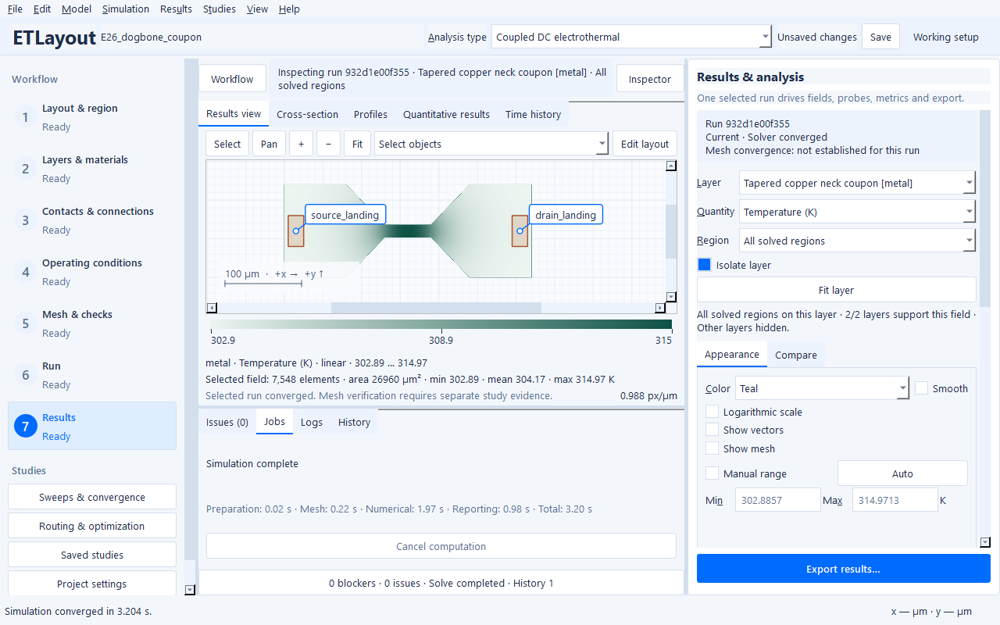
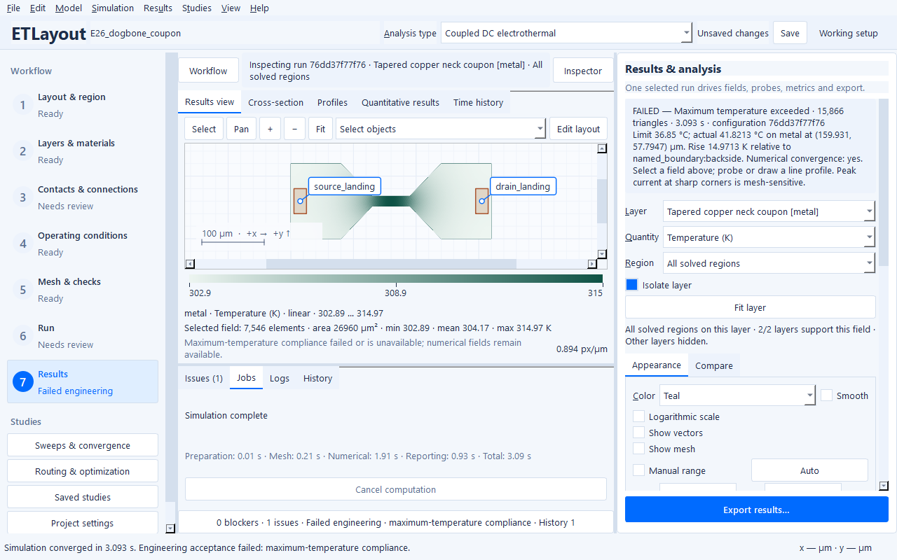
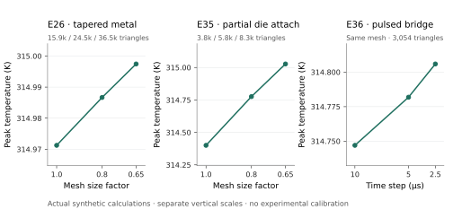

# Explore Joule heating without changing the reference

The original E1–E40 projects remain available unchanged. Suitable examples now
have additional operating scenarios: stronger **electrical excitation** makes
Joule heating visible while geometry, material laws, thermal paths and the named
300 K reservoir stay fixed. These are synthetic screening calculations, not
current ratings or calibrated device predictions.

## Use the desktop workflow

1. Open a reference from **File → Ready-to-run examples** and review its inputs.
2. Select **File → Choose example operating scenario…**. Pending edits use the
   same Apply / Discard / Stay safeguard as other project transitions. This
   regenerates an editable project; it never starts a calculation.
3. Choose **Joule thermal demonstration**, or **Separate Joule heating** to remove
   an independent prescribed heater. The original project remains selectable.
4. Save your own project. Follow **Mesh & checks → Run validation → Generate /
   update mesh**, then **Run → Run analysis**. Inspect the Issues drawer.
5. In **Results**, choose the conducting layer and **Temperature**. Use the
   automatic range and turn off the mesh overlay to read the heat distribution.
   Compare temperatures and losses numerically before judging the color map.
6. Open **Sweeps & convergence** for the saved three-point electrical-drive
   study. E36 varies the pulse amplitude itself. Try mesh and time studies
   separately; a converged solve alone does not establish either verification.



E26's tapered neck reaches **314.97 K**, a 14.97 K rise, with 56.81 mW total
input. Its finite external feeds consume 6.29 mW; only their configured 25%
thermal fraction enters the modeled sheets. Routing Joule heat is integrated
separately. The corner current maximum remains mesh sensitive; the synthetic
example supplies no electromigration or ampacity criterion.

## Choose a question

| Question | Scenario | Changed electrical input | Observed peak |
| --- | --- | --- | ---: |
| How does a meander heat itself? | E11 thermal demonstration | 30 mA; remove independent prescribed heat | 313.31 K |
| How do nearby tracks heat one another? | E15 thermal demonstration | 0.8 / 0.5 V; remove independent prescribed heat | 314.19 K |
| Where does a finite landing feed a neck? | E26 thermal demonstration | 1.25 A | 314.97 K |
| How do openings redirect current? | E29 thermal demonstration | 8 A | 310.60 K |
| What heats in a distributed via route? | E30 thermal demonstration | 0.6 A | 320.34 K |
| How does an effective thin sheet heat? | E33 thermal demonstration | 0.9 mA | 315.17 K |
| What does a passive sensor measure? | E34 thermal demonstration | 15 mA heater; retain the 10 µA sensor | 315.27 K |
| How does partial die attachment affect heat flow? | E35 thermal demonstration | 0.5 A | 314.40 K |
| Can a cooled final frame hide a hot pulse? | E36 thermal demonstration | 2.5 A pulse; unchanged duty cycle/time grid | 314.75 K |

The higher currents represent finite-loss screening experiments in the declared
bulk/sheet laws. Temperature-dependent properties stay inside their declared
ranges in these runs. Current and field ranges are retained in the
[all-forty original-versus-revised comparison](example-science/operating-scenarios.json);
absence of a declared failure law does not establish safe operation. Do not
infer fusing, electromigration lifetime, high-field transport or package ratings.

E16's Joule-only case rises only **0.00358 K**. Its roughly 14.5 µW electrical
power cannot credibly make a 10 K demonstration under the unchanged thermal
conditions, so it remains a low-heating gate-control example. Its independent
0.2 mW prescribed heater belongs to the original thermal-excitation experiment.
E18, E19 and E32 already have informative reference rises; they need no artificial
cooling changes. E18/E19 retain the hot pulse state even after cooling.

## A converged result can fail engineering acceptance

E18, E26 and E36 offer **Failed engineering limit**, using a deliberately chosen
310 K maximum. Full-duration transient runs preserve cooling and the earlier
violating hot state. **Stop at accepted hot state** is available for E18/E36:
it stops at the first accepted violating physical state and retains its fields.
The observation time does not interpolate an exact threshold crossing.



The normal thermal demos use a chosen 423.15 K limit. Neither threshold is a
material rating. The Run/Results pages distinguish numerical convergence from
engineering acceptance; inspect the actual limit, location, rise and reservoir.
See [temperature limits](temperature-limits.md).

## Measured sensitivity and reproduction

All 17 optional scenarios were actually calculated at their configured inputs,
checked for conservation and project nonmutation, and saved/reopened with fields.
GDSII/OASIS export/reimport and embedded-layout reopening passed. All nine saved
three-point electrical studies ran through the normal sweep engine. The
[observations](example-science/operating-scenarios.md) include three spatial levels
for every thermal demonstration and a separate byte-identical-mesh E36 time
study. The final spatial differences in input power or pulse energy are below
0.3%, and in temperature rise below 1.7%. These selected-metric observations do
not certify singular raw current peaks or experimental accuracy.



The panels have separate temperature scales and display actual values; no
statistical confidence intervals are inferred from three deterministic grids.
The E36 final two time steps differ by 0.16% in rise and 0.34% in input energy.
The [editable plotting script](../scripts/plot_thermal_sensitivity.py) reads the
maintained [SI observations](example-science/operating-scenarios.json).

Generate an editable project without calculating it:

```text
etlayout examples examples-local --name E26 --scenario thermal_demo
```

Run opt-in validation and store bulky results outside the source tree:

```text
python scripts/verify_example_scenarios.py --output artifacts/thermal-scenarios --save-fields
python scripts/verify_example_scenarios.py --cases E26:thermal_demo E35:thermal_demo --mesh-factors 1 .8 .65 --output artifacts/thermal-mesh
python scripts/verify_example_scenarios.py --cases E36:thermal_demo --time-steps 1e-5 5e-6 2.5e-6 --output artifacts/thermal-time
```

The driver bounds each process to 4 CPU threads, 3 GiB sampled RSS and 600 s by
default. Generation never launches it. Measurements used native Windows 11,
Python 3.12.14, 8 physical / 16 logical CPU cores and 33.48 GB RAM on a shared
host. Timings, mesh counts, conservation residuals and actual loss/field ranges
are in the comparison data. Native source GUI operation and readable glyphs at
1280 × 800 were checked. No frozen-build, clean-machine or external 3D validation
is claimed for this scenario round.

## E35: reproduce an external 3D comparison

The partial attachment is especially sensitive to through-depth spreading; its
2.5D result is a screening result. Use the [thermal-stack comparison protocol](thermal-stacks.md)
with the exact generated E35 geometry, nominal material laws, finite landings,
0.5 A and original 25% local feed heat. Resolve the 2 µm Ti heater and 200 µm
silicon substrate volumes. The attachment footprint is x = 50–420 µm,
y = 100–900 µm; other unassigned exterior faces are adiabatic.

Avoid counting the sheet half-thickness resistance again in the 3D model.
The effective center-to-center link is 1e-6 m² K/W. With nominal Ti
k = 21.9 W/(m K) and silicon k = 148 W/(m K), the remaining surface-to-surface
resistance is `1e-6 - 2e-6/(2*21.9) - 200e-6/(2*148)` =
**2.78662e-7 m² K/W**. The backside center-to-reservoir resistance 2e-6 m² K/W
becomes **1.32432e-6 m² K/W** after subtracting the resolved silicon half column.
Those effective resistances are zero-storage interfaces, not invented solid
films. Compare total heat, attachment heat flux and temperatures averaged through
layer thickness over identical physical supports. Report a resolved top-surface
3D peak separately. No external 3D calculation has yet been performed.
