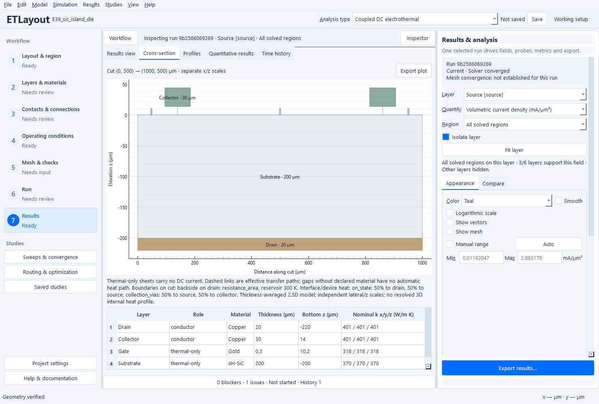

# Passivation, dielectric sheets and heat-source depth

Electrothermal Layout Studio already models lateral heat conduction, capacity and
declared vertical exchange in **thermal** and **insulator** sheets. These roles
do not enter the DC electrical space. Adding a drawing alone creates no heat
path: declare the adjacent interfaces and a physical reservoir boundary.

## Choose the representation

Use an **effective gap** when lateral film heat spreading and film heat capacity
are negligible for the requested metric. Use an **explicit sheet** when lateral
spreading, stored energy, openings, top-metal coupling or cross-heating matter.
Both remain thickness-averaged 2.5D approximations. A thick substrate, a hotspot
smaller than the relevant layer thickness, or strong through-depth gradients
needs an external 3D comparison before qualification.

| Material or region | Intended thermal representation and limitation |
| --- | --- |
| SiN, SiO₂ passivation/intermetal dielectric | Process-dependent film k, density, heat capacity and interface resistance; use measured data, not bulk values by name. |
| Al₂O₃, AlN | Deposition, crystallinity and interfaces can dominate. Al₂O₃ is a representative seed; the new AlN seed (100 W/(m K)) is explicitly synthetic and uncalibrated. |
| Polyimide/encapsulation | The 0.2 W/(m K) seed is a synthetic sensitivity assumption, not a product datasheet or calibrated package. |
| GaN buffer, SiC substrate | Separate thermal support from the electrical sheet/device law. The existing seeds are representative screening values, not measured epitaxial/substrate properties. |
| Redistribution/backside metal | Physical metal sheet spreading and capacity; distinguish it from a zero-thickness effective interface or external feed fixture. |

Set the material **Thermal anisotropy** x/y multipliers and optional **Thermal
conductivity z** independently. Temperature laws and validity bounds remain
editable; uncalibrated constants do not become certified properties. The
[Ioffe semiconductor archive](https://www.ioffe.ru/SVA/NSM/Semicond/index.html)
provides the existing semiconductor-reference context. The [NIST thermal
measurement overview](https://www.nist.gov/programs-projects/transport-property-measurements-semiconductors-and-energy-materials/thermal-1)
describes measurement of conductivity tensors, interface conductance and heat
capacity; process-specific measurements are needed for quantitative film claims.

## Build the stack in the GUI

1. In **Layers & materials**, add a physical layer with **Insulator** or
   **Thermal** role, its actual footprint/openings, thickness and bottom z.
2. In **Contacts & connections**, set its electrical interface kind to **None**
   and thermal kind to **Stack**. Connect adjacent sheet midplanes.
3. Replace the old material-filled effective gap with the two adjacent links.
   Do not keep a direct material-filled bridge through the explicit film.
4. Apply a backside/package boundary once at the appropriate support. A top
   convection boundary is optional physics, not an automatic sink on every layer.
5. Draw a **Cross-section**. Its compact table shows layers intersecting the cut,
   role, material, thickness, z and nominal x/y/z conductivity. Tooltips expose
   material provenance, anisotropy and effective-gap/half-sheet assumptions. The
   summary identifies intersected reservoir boundaries and heat deposition.



The cross-section uses independent lateral/elevation scales; thin films remain
listed even when too thin for a legible in-plot label. Dashed links are transfer
paths, not invented solid material. Boundary temperatures are named reservoirs,
not a claim of a resolved internal boundary temperature.

## Count resistance once

A `stack` link has area resistance in m² K/W:

`R_ab = t_a/(2 k_z,a) + R_interface + h_gap/k_z,gap + t_b/(2 k_z,b)`.

The gap term exists only with a declared gap material. Inserting an explicit
film replaces that gap; two adjacent links contribute two film half-thicknesses,
which sum to `t_film/k_z,film`. Interface boundary resistances are extra physical
terms and must not include the same omitted film again. A bottom boundary
defined at an external face may need an external half-sheet term; do not add
that term again when the support is already explicitly resolved. For top
convection represented from the sheet midplane, use the series resistance
`t/(2 k_z) + 1/h_external` where the half-sheet drop is relevant.

Preparation rejects a material-filled effective stack gap occupying an explicit
intervening layer. A legacy direct conductance/resistance bridge across an
explicit film receives an actionable warning because a deliberately calibrated
parallel path can be legitimate. No coefficients are silently rewritten. Existing
physical-via opening/replacement/enclosure and volume-overlap checks remain active.

## Locate generated heat deliberately

Lateral Joule heat stays in its conducting sheet. A finite interface, via or
distributed device-load loss is integrated once with the existing consistent
P1 mass matrix. The default remains **50% to each endpoint**. This is reasonable
only as an explicit unresolved deposition approximation; it is not a solved
through-contact temperature profile.

The interface editor now provides two alternatives:

- **Heat to layer A fraction** in [0, 1], with the remainder to layer B.
- **Heat layer**: deposit all interface/device-load loss into a named physical
  thermal support at identical x–y coordinates. Keep the endpoint fraction at
  its default 0.5 when selecting this alternative; ambiguous combinations fail.

The target must cover the complete interface support. Missing/partial targets
are rejected without clipping or rescaling. The electrical response, total loss
and external-feed thermal fractions remain unchanged. The result retains the
per-interface `analysis.heat_deposition` ledger and deposited W by layer. This
can represent calibrated GaN contact/channel-depth or SiC device-load deposition
in semiconductor support; it does not establish the correct fraction without
calibration or an external reference. It works in coupled, one-way and transient
calculations and survives project/result reopening.

## Measured sensitivity cases

The opt-in generator uses two **prescribed-heating thermal coupons**, separate
from electrical/Joule demonstrations. Each is 100 × 100 µm, with a 20 × 20 µm
source centered at (30, 50) µm and a passive 20 × 20 µm receiver centered at
(70, 50) µm. The GaN sheet is 2 µm with 20 mW; the SiC sheet is 20 µm with
50 mW. Both have a 100 µm SiC substrate, a 1 µm SiN film and an electrically
isolated 5 µm Cu cap. The sole backside reservoir is 300 K, with declared
synthetic package resistance 2e-6 m² K/W plus the external substrate half-sheet.
No top ideal sink, duplicate Joule source or temperature clipping is used.

The baseline film has k = 3 W/(m K), and each film interface has 2e-8 m² K/W.
Variants change one factor: k = 1 or 10; each interface R = 0 or 2e-7; film
thickness = 2 µm; or removal of the actual top cap. These are controlled
uncalibrated sensitivities, not claimed film processes/device ratings. The
effective-gap representation retains the same cap and total normal resistance,
omitting only the film lateral conduction and capacity.

Fine-level steady results below use 5 µm maximum size. Hotspot/receiver means
are exact support-weighted P1 averages over the fixed 20 µm squares. Rth uses
the named 300 K reservoir and positive prescribed internal power.

| Family | Variant | Tmax (K) | Rth (K/W) | Hotspot mean (K) | Receiver mean (K) |
| --- | --- | ---: | ---: | ---: | ---: |
| GAN | effective | 308.406 | 420.32 | 307.446 | 304.314 |
| GAN | explicit | 308.403 | 420.15 | 307.443 | 304.314 |
| GAN | low_k | 308.839 | 441.97 | 307.765 | 304.288 |
| GAN | high_k | 307.767 | 388.33 | 306.990 | 304.345 |
| GAN | low_tbr | 308.339 | 416.95 | 307.397 | 304.318 |
| GAN | high_tbr | 308.718 | 435.88 | 307.674 | 304.296 |
| GAN | thick_film | 308.699 | 434.95 | 307.661 | 304.297 |
| GAN | no_cap | 309.193 | 459.63 | 308.034 | 304.261 |
| SIC | effective | 312.876 | 257.52 | 312.632 | 311.271 |
| SIC | explicit | 312.876 | 257.52 | 312.632 | 311.271 |
| SIC | low_k | 312.904 | 258.09 | 312.657 | 311.265 |
| SIC | high_k | 312.840 | 256.79 | 312.601 | 311.276 |
| SIC | low_tbr | 312.872 | 257.44 | 312.629 | 311.272 |
| SIC | high_tbr | 312.896 | 257.92 | 312.650 | 311.267 |
| SIC | thick_film | 312.895 | 257.90 | 312.649 | 311.267 |
| SIC | no_cap | 312.933 | 258.65 | 312.683 | 311.254 |

The SiC coupon is insensitive to this top-film choice at this operating point.
The explicit/effective differences (about 0.0035 K GaN and 0.0002 K SiC) are
smaller than the last spatial-refinement changes; **do not rank them as a
validated improvement**. The GaN cap/k sensitivity is larger and reproducible
on the examined levels, while still subject to the 2.5D approximation.

### Spatial and time sensitivity

Three maximum mesh sizes, 10, 6.667 and 5 µm, retain geometry, input power and
reservoirs. The explicit coupons have about 1004, 2152 and 3838 elements and
2172, 4548 and 8000 thermal DOFs. GaN fixed-source mean temperature is
307.394 → 307.429 → 307.443 K; SiC is 312.618 → 312.628 → 312.632 K.
The last mean-rise changes are below 0.2%; the last raw Tmax-rise changes are
below 0.2%. This is selected-metric three-level evidence, not a universal
mesh-verification certificate or 3D calibration.

Backward Euler step responses use 10, 5 and 2.5 µs steps to 100 µs. The exact
same mesh SHA-256 is retained within each time study. At 100 µs, the explicit
GaN Tmax is 304.852 → 304.855 → 304.857 K; SiC is
303.530 → 303.537 → 303.540 K. The finest-vs-middle temperature-rise change
is below 0.1%. Stored/input/output energies are retained; coupon thermal
balance errors are below 1e-12. These are step-heating responses, not pulse
switching simulations or claims of an exact time constant.

### Configured device comparisons

The generator also solves the unchanged **E37 at 20 mA** and **E39 at 10 A**,
then replaces one existing omitted oxide gap with the identical material as an
explicit sheet. Other electrical inputs, contacts, feeds and thermal boundaries
are preserved. E37 Tmax is 300.222726 K vs 300.222725 K (3254 elements);
E39 is 381.856773 K vs 381.856760 K (6486 elements). E39 input power is
29.982819 W, while 29.832689 W is deposited internally; the remainder is
external-feed loss. Device-load loss remains separate from ordinary contacts.
The effect of these particular gaps is negligible. Fresh Gmsh triangulations
can change these small differences by roughly 0.001 K, so no winner is claimed.
Neither device comparison establishes mesh convergence or a calibrated rating.

## Reproduce and inspect costs

Run from a source installation; generated fields and detailed logs belong outside
the tracked tree. Nothing runs on importing the generator.

```powershell
$evidence = Join-Path $env:TEMP "etlayout-thermal-stacks"
python scripts/verify_thermal_stacks.py --output "$evidence/coarse" --transient --time-steps 10e-6 5e-6 2.5e-6 --device-examples
python scripts/verify_thermal_stacks.py --output "$evidence/medium" --mesh-size 6.666666666666667e-6
python scripts/verify_thermal_stacks.py --output "$evidence/fine" --mesh-size 5e-6
python -m pytest tests/test_thermal_stacks.py tests/test_gui_thermal_stacks.py tests/test_thermal.py tests/test_coupled.py tests/test_power_stack.py
```

The [machine-readable CSV](../benchmarks/thermal-stack-sensitivity.csv) and
[scope receipt](../benchmarks/thermal-stack-sensitivity.json) retain 100 actual
calculations, mesh hashes, conserved powers, fixed-region averages, energies,
element/DOF counts, preparation/meshing/numerical/linear/reporting wall times,
archive sizes and save/reopen costs. The Windows source environment was Python
3.12.14, PySide6/Qt 6.12.0, AMD Ryzen AI 7 PRO 350 (8 cores/16 logical CPUs),
with four configured CPU threads. Fine explicit steady coupons took about
0.21–0.33 s wall time; measured peak working set across the process lifetime
was below 194 MB. These are shared-session observations with within-invocation
geometry/mesh caches, not isolated performance guarantees. The native Windows
source screenshot was inspected for readable glyphs; this work does not claim
a rebuilt frozen package or clean-machine validation.

## External 3D reference protocol — not performed

No matching external 3D calculation or experimental calibration was available.
A maintainer can reproduce the coupon solids with the exact x/y/z dimensions,
k tensor, density and heat capacity above. Make the source a uniform volumetric
term `P/(A*t_active)` over the specified 20 µm square and full active thickness.
Apply the two film interface boundary resistances once, use adiabatic lateral
and top surfaces, and apply 300 K through **only 2e-6 m² K/W** attachment at
the physical substrate underside. The 3D solid already resolves substrate
thickness, so omit the extra 2.5D external half-substrate term.

Use at least three independently refined 3D meshes and time steps. Compare
integral power/energy, through-thickness-averaged temperatures on matching
20 µm supports, cap spreading and receiver response. Report midplane and
through-thickness extrema separately. Retain boundary/source/material files,
element/DOF/memory costs and convergence uncertainty. Until that is done, the
comparison is an explicit **unverified external reference**, not evidence of
full-3D heat-flow accuracy.

## Compatibility

Old projects decode to the unchanged 0.5 endpoint split. Default deposition
fields are omitted from project serialization and both full-configuration and
physical identities, preserving unchanged archives for old strict readers.
Nondefault deposition is physical configuration and changes identity. Nondefault heat-deposition fields
are saved explicitly; older 0.4.0 applications with strict model decoding may
reject archives that use this capability and should be upgraded rather than having fields silently
removed. Heat-deposition targets are remapped with layer IDs in technology
templates; excluding the target sheet omits that dependent link.
